# dragon

> 動く図を、人も AI も書きやすい記法で書く。

[English](README.md)

<p>
<a href="CHANGELOG.md"></a>
<a href="LICENSE"></a>
<a href="https://cardene777.github.io/dragon/"></a>
</p>

<picture>
<source media="(prefers-color-scheme: dark)" srcset="docs/readme/ja/hero-dark.png">
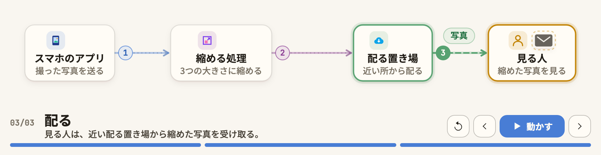
</picture>

dragon は、短い文の file から段ごとに動く図を描く。
箱と、箱をつなぐ線と、線の上を運ばれる物を描き、段を送るごとに話が進む。
人も AI も同じ dragon記法で図を書き、記法は原本の JSON と行き来できる。
同じ原本を頁に置いて動かし、mp4、GIF、HTML、PNG にも書き出せる。

見本帳 (全ての種類の図と、書くとその場で動く編集画面) は <https://cardene777.github.io/dragon/> にある。

## mermaidとの違い

| | mermaid | dragon |
|---|---|---|
| 出来上がる物 | 止まった1枚の絵 | 段ごとに動く図。線が光り、札が運ばれ、値が変わる |
| 見た目 | 図ごとに選ぶテーマ | 全ての種類が読む、色と字の大きさと余白の1つの表 |
| 書き出し | mermaid-cliでSVG、PNG、PDF | `dragon export`でMP4、GIF、HTML、PNG |
| AIで書く時 | 描く時に出る読めない所の誤り | `dragon check`が誤りの行と列を示し、skillがAIに記法を教える |
| GitHubでの見え方 | `mermaid`の塊をその場で描く | 書き出した絵で見せる。scriptの1行で、どの頁でも動かせる |

## 考え方

dragon は、ブロックを組み立てて図を作る道具である。
レゴのように、決まった形のブロックを組み合わせて、どの種類の図も同じ見た目で組み立てる。

| ブロック | 何か | 例 |
|---|---|---|
| コアブロック | 2 つ以上の種類の図で使い回すブロック | 箱 (`box`)、段 (`step`)、色、絵柄 |
| 個別ブロック | 1 つの種類の図だけで使うブロック | 時系列図の生存線、構成図の区画 (`group`) |
| 接続ブロック | 2 つのブロックを結ぶブロック | 線 (`->`)、枝分かれの図の merge |

図は、ブロックを組み立てたものである。
図の種類は、ブロックの並べ方と、受け付ける付け方だけを決める。
どの図でどのブロックを使えるかは、ブロックの付け方から決まる。
色と字の大きさと余白は 1 つの表が持ち、全てのブロックがそこから読むので、どの図も同じ見た目に揃う。

ブロックは、使う人が自分の手元でも足せる。
今の箱と線と印のどれかを元にして形と色の役を替えたブロックを、データだけの定義で書く ([ブロックを足す](https://github.com/cardene777/dragon/blob/main/packages/dragon/README.ja.md#ブロックを足す))。
図の種類と、元にできるブロックを増やす時は、この repo への pull request か fork で足す。

もう 1 つの軸は、mermaid と同じ手軽さで書けて、そのまま表示まで出ることである。

- 書く字が短い。図の種類の語と `A -> B: 名前` の 2 行で図になり、線に出た名前が箱になる
- script の 1 行で出る。頁に script の 1 行と記法の塊を置くだけで、動く図になる
- AI が速く書ける。AI も人と同じ記法で書き、読む処理の誤りの文が示す行と列を直す。JSON は原本として残り、記法と行き来できる
- 軽くて速い。頁は、書いた図が使うブロックだけを読む

記法は mermaid を手本にした独自の形で、mermaid とは互換にしない。
`-->|文|` のような読みにくい形を持たず、行の頭の英語の語だけで何の行かが分かる形を選んだ。

## 入れ方

```sh
npm install @cardenelabs/dragon
```

## AI に図を書かせる

dragon の skill は、AI に dragon記法で図を書かせ、`dragon check` で確かめて読めるまで直させる。
Claude Code では、この repo をプラグインの置き場に足してから、プラグインを入れる。

```text
/plugin marketplace add cardene777/dragon
/plugin install dragon@dragon
```

ほかの AI では、この repo の skill の dir (`plugins/dragon/skills/dragon`) を、その AI が skill を読む場所へ写す。
AI は `SKILL.md` から読み始め、描く図の種類の参照の file だけを読む。
プラグインの版は npm の `@cardenelabs/dragon` の版と同じで、skill は入れた版を `dragon --version` で確かめる。

## 最初の図

```dragon
sequence

ブラウザ -> アプリ: GET /login
アプリ -> ブラウザ: ログインの頁を返す
```

図の種類の語と、箱どうしを `->` で結ぶ行だけで図になる。
線に出た名前が箱になり、線 1 本が 1 段になって書いた順に光る。
箱に見せる名前や添え書きを付け、段に題と本文を付ける時は、`box` と `step` の行を書く。

```dragon
sequence ログインを頼む

box ブラウザ as 利用者のブラウザ [note: 利用者が操作する]
box アプリ [note: ログインを頼む側]

step ログインを押す
  say 利用者がアプリのログインを押す。
  ブラウザ -> アプリ: GET /login
```

見本帳の編集画面に貼ると、その場で動く。
自分の頁に出す時は、頁に script の 1 行と、記法を書いた `<pre class="dragon">` の塊を置くと、塊が動く図になる ([script の 1 行で頁に出す](packages/dragon/README.ja.md#script-の-1-行で頁に出す))。
package を import して描く時は、`parseNotation` で読んだ結果を `mountDiagram` に渡す ([頁に置く](packages/dragon/README.ja.md#頁に置く))。

## 描ける図

どの絵も、[`packages/dragon/examples`](packages/dragon/examples)の見本を最後の段で止めた物。
種類を押すと、その種類の書き方を読める。

<table>
<tr>
<td align="center" width="33%"><a href="packages/dragon/examples/quick-start.md#時系列図"><picture><source media="(prefers-color-scheme: dark)" srcset="docs/readme/ja/kinds/sequence-dark.png">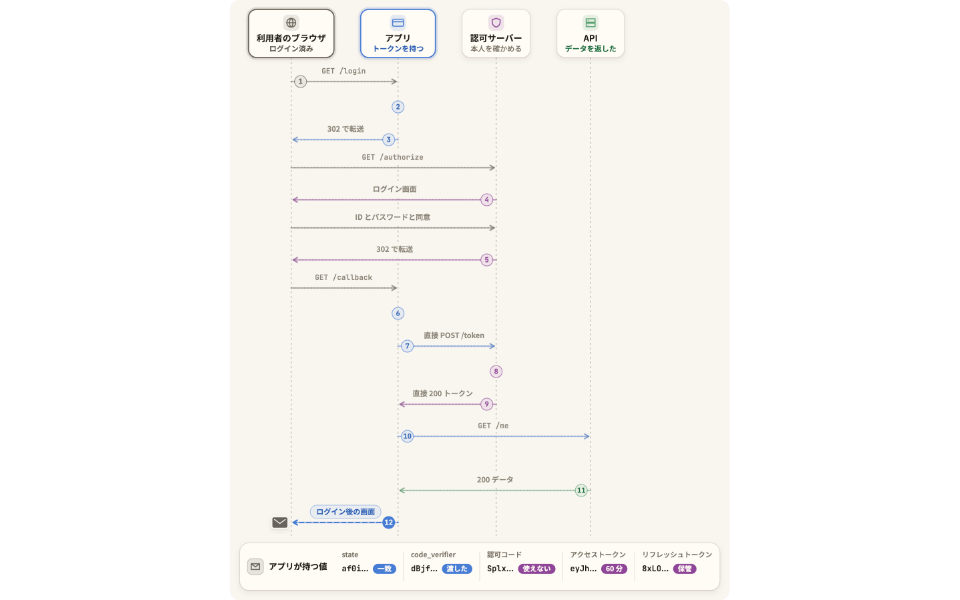</picture><br>時系列図</a></td>
<td align="center" width="33%"><a href="packages/dragon/examples/quick-start.md#構成図"><picture><source media="(prefers-color-scheme: dark)" srcset="docs/readme/ja/kinds/architecture-dark.png">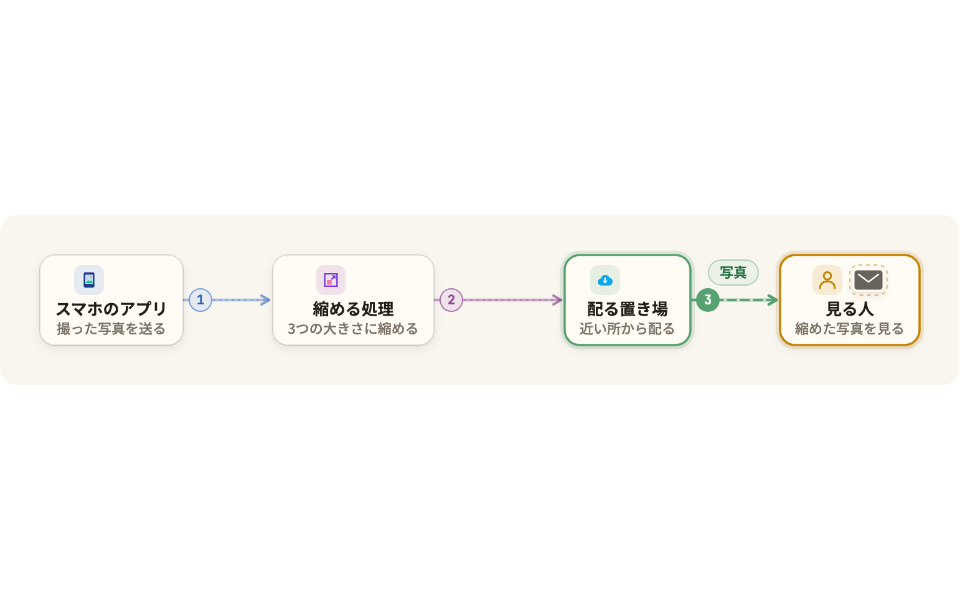</picture><br>構成図</a></td>
<td align="center" width="33%"><a href="packages/dragon/examples/quick-start.md#状態遷移図"><picture><source media="(prefers-color-scheme: dark)" srcset="docs/readme/ja/kinds/state-dark.png">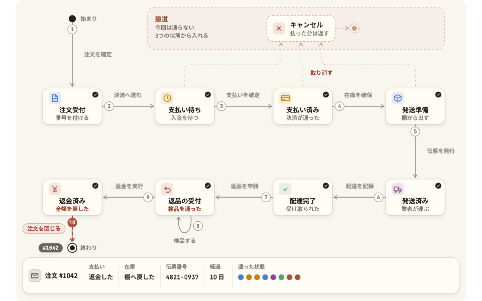</picture><br>状態遷移図</a></td>
</tr>
<tr>
<td align="center"><a href="packages/dragon/examples/quick-start.md#枝分かれの図"><picture><source media="(prefers-color-scheme: dark)" srcset="docs/readme/ja/kinds/git-dark.png">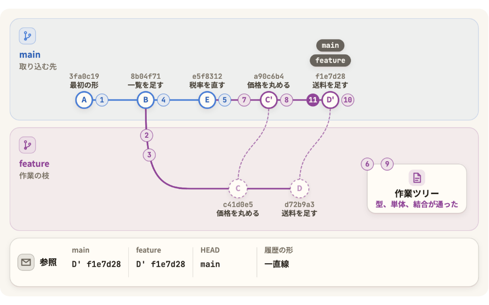</picture><br>枝分かれの図</a></td>
<td align="center"><a href="packages/dragon/examples/quick-start.md#時間軸の図"><picture><source media="(prefers-color-scheme: dark)" srcset="docs/readme/ja/kinds/time-dark.png">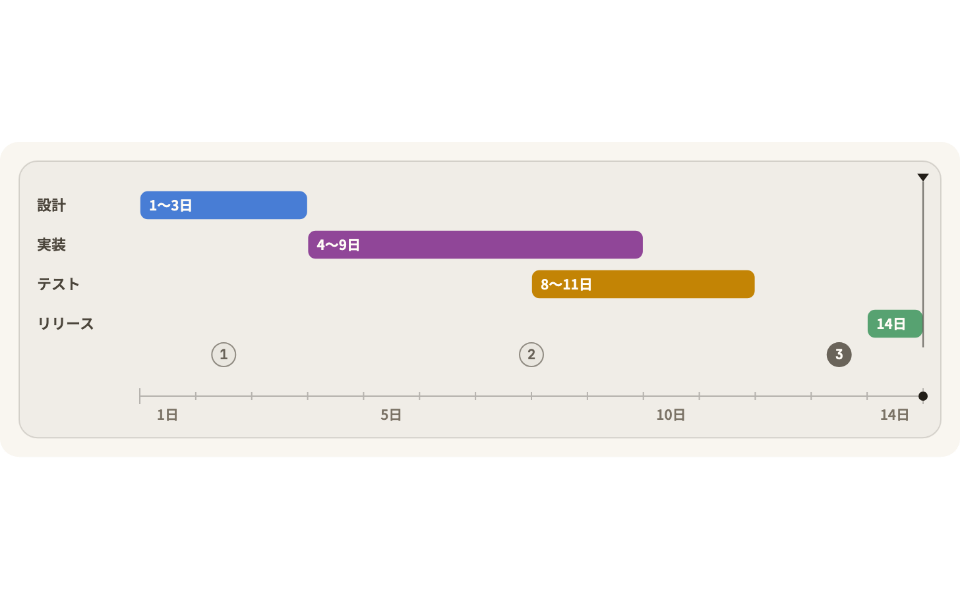</picture><br>時間軸の図</a></td>
<td align="center"><a href="packages/dragon/examples/quick-start.md#木の図"><picture><source media="(prefers-color-scheme: dark)" srcset="docs/readme/ja/kinds/tree-dark.png">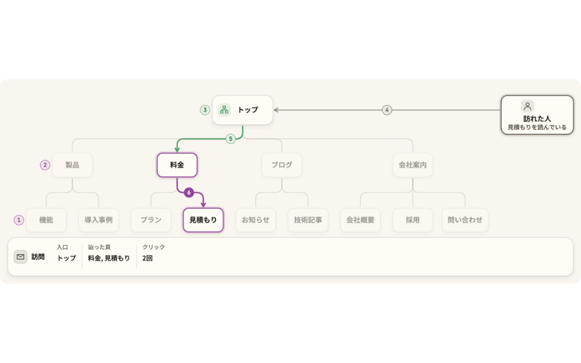</picture><br>木の図</a></td>
</tr>
<tr>
<td align="center"><a href="packages/dragon/examples/quick-start.md#列の図"><picture><source media="(prefers-color-scheme: dark)" srcset="docs/readme/ja/kinds/lineup-dark.png">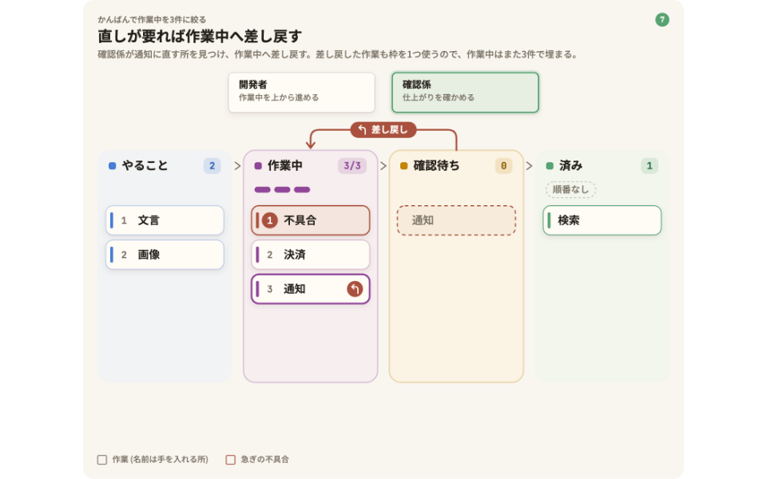</picture><br>列の図</a></td>
<td align="center"><a href="packages/dragon/examples/quick-start.md#試す図"><picture><source media="(prefers-color-scheme: dark)" srcset="docs/readme/ja/kinds/try-dark.png">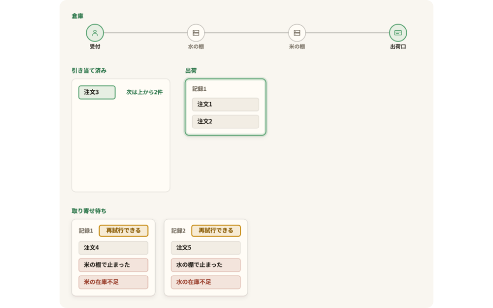</picture><br>試す図</a></td>
<td align="center"><a href="packages/dragon/examples/quick-start.md#配管の図"><picture><source media="(prefers-color-scheme: dark)" srcset="docs/readme/ja/kinds/pipe-dark.png">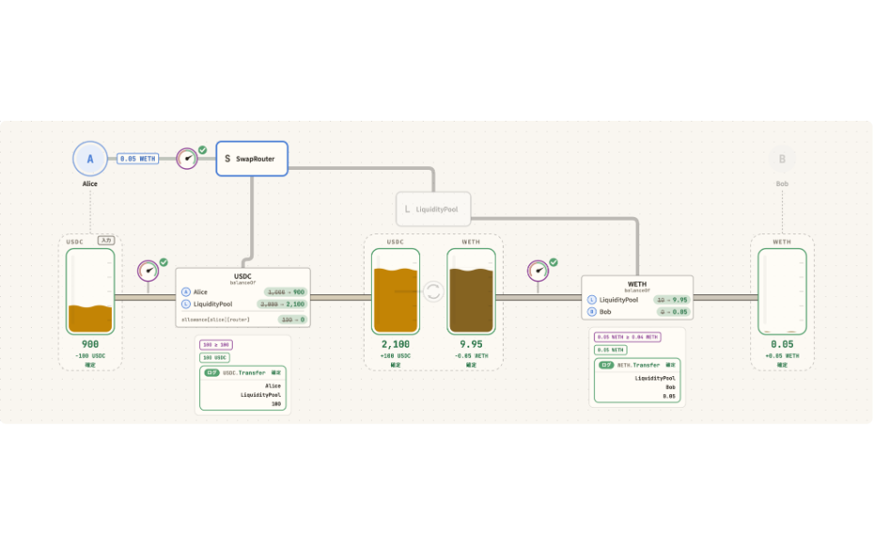</picture><br>配管の図</a></td>
</tr>
<tr>
<td align="center"><a href="packages/dragon/examples/quick-start.md#量の図"><picture><source media="(prefers-color-scheme: dark)" srcset="docs/readme/ja/kinds/chart-dark.png">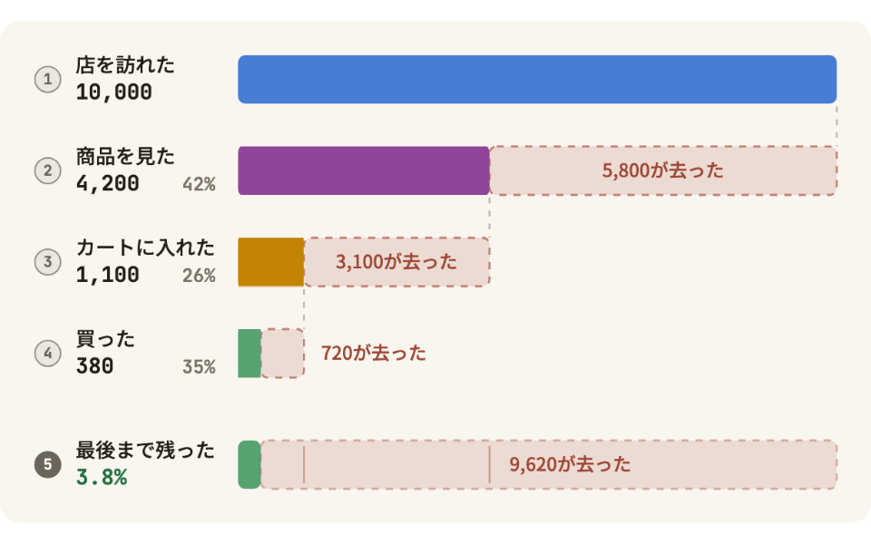</picture><br>量の図</a></td>
<td align="center"><a href="packages/dragon/examples/quick-start.md#手順の図"><picture><source media="(prefers-color-scheme: dark)" srcset="docs/readme/ja/kinds/flow-dark.png">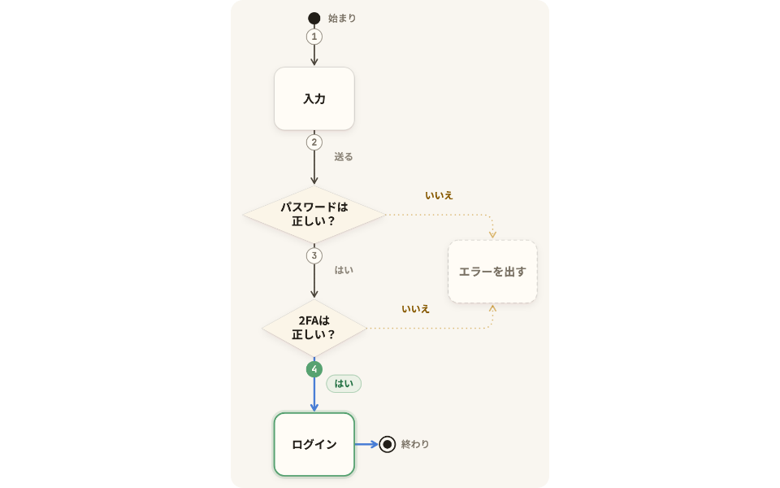</picture><br>手順の図</a></td>
<td align="center"><a href="packages/dragon/examples/quick-start.md#回り続ける図"><picture><source media="(prefers-color-scheme: dark)" srcset="docs/readme/ja/kinds/cycle-dark.png">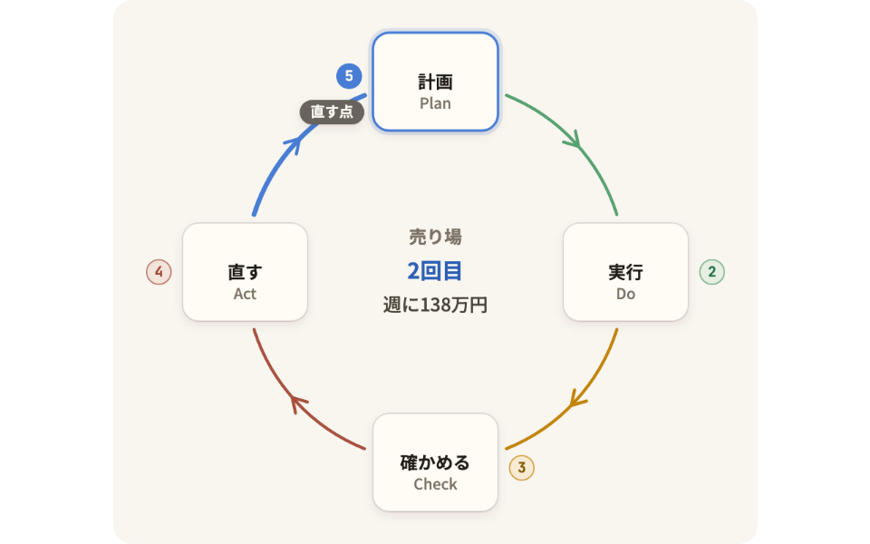</picture><br>回り続ける図</a></td>
</tr>
<tr>
<td align="center"><a href="packages/dragon/examples/quick-start.md#考えを広げる地図"><picture><source media="(prefers-color-scheme: dark)" srcset="docs/readme/ja/kinds/mind-dark.png">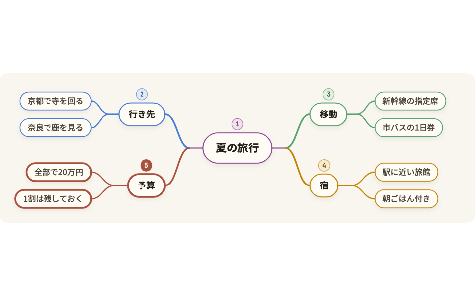</picture><br>考えを広げる地図</a></td>
<td align="center"><a href="packages/dragon/examples/quick-start.md#表どうしの関係の図"><picture><source media="(prefers-color-scheme: dark)" srcset="docs/readme/ja/kinds/er-dark.png">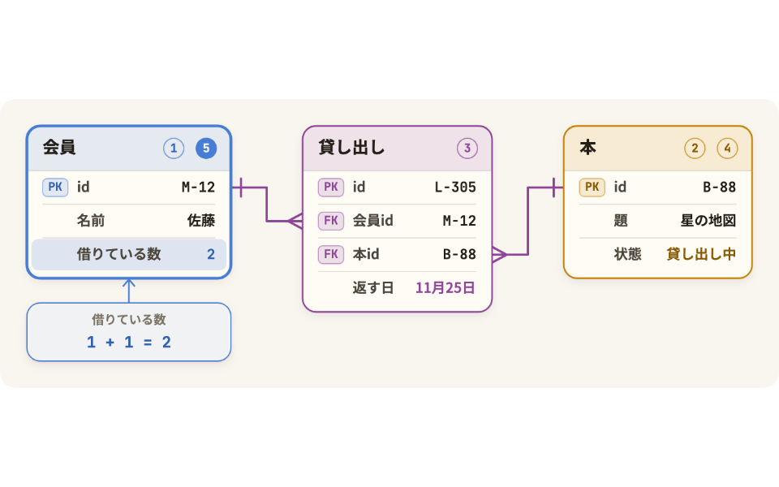</picture><br>表どうしの関係の図</a></td>
<td align="center"><a href="packages/dragon/examples/quick-start.md#2つの軸で置く図"><picture><source media="(prefers-color-scheme: dark)" srcset="docs/readme/ja/kinds/matrix-dark.png">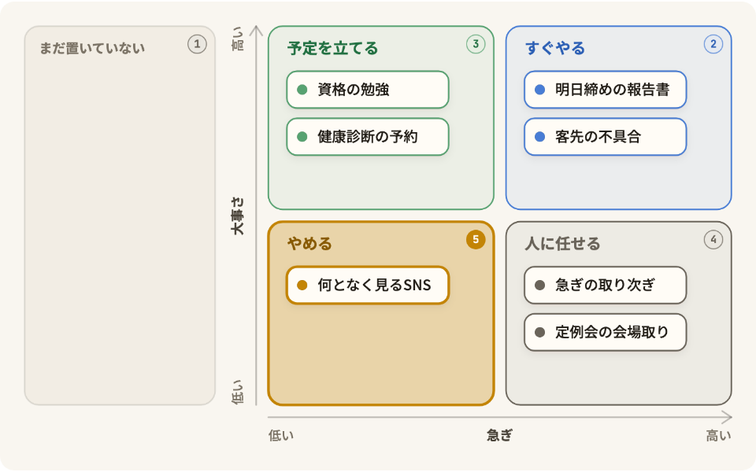</picture><br>2つの軸で置く図</a></td>
</tr>
<tr>
<td align="center"><a href="packages/dragon/examples/quick-start.md#集合の重なりの図"><picture><source media="(prefers-color-scheme: dark)" srcset="docs/readme/ja/kinds/venn-dark.png">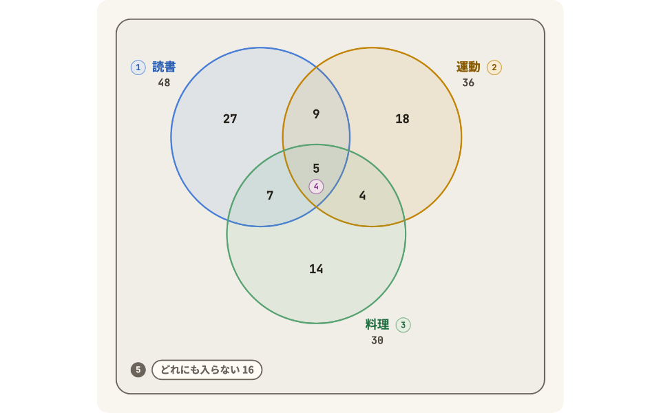</picture><br>集合の重なりの図</a></td>
<td align="center"><a href="packages/dragon/examples/quick-start.md#量の行き先の図"><picture><source media="(prefers-color-scheme: dark)" srcset="docs/readme/ja/kinds/sankey-dark.png">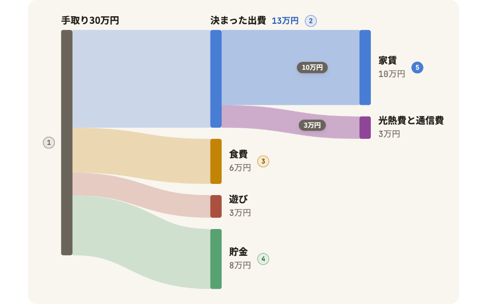</picture><br>量の行き先の図</a></td>
<td align="center"><a href="packages/dragon/examples/quick-start.md#持ち主ごとのカードの図"><picture><source media="(prefers-color-scheme: dark)" srcset="docs/readme/ja/kinds/cards-dark.png">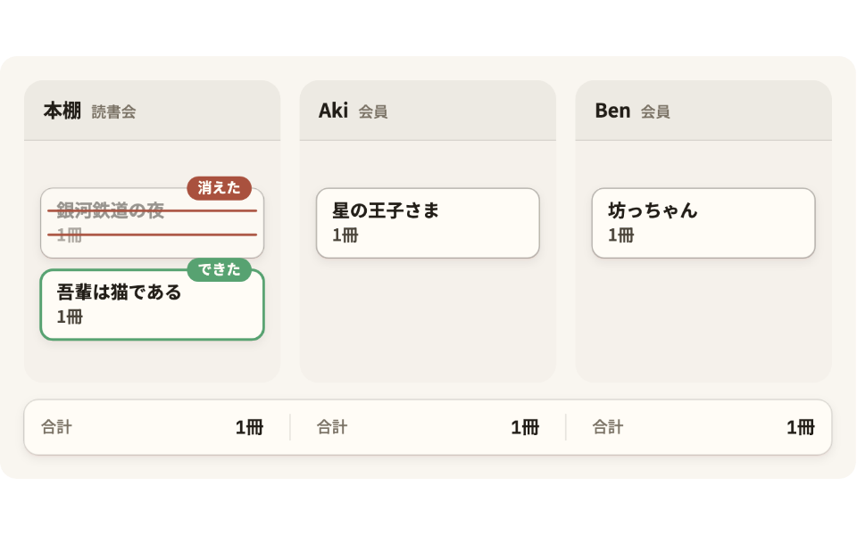</picture><br>持ち主ごとのカードの図</a></td>
</tr>
<tr>
<td align="center"><a href="packages/dragon/examples/quick-start.md#購入操作図">購入操作図</a><br>読む人が条件を変えられる購入の模型</td>
</tr>
<tr>
<td align="center"><a href="packages/dragon/examples/quick-start.md#判定の表">判定の表</a><br>例を規則と照らして通すか止めるかを出す表</td>
</tr>
</table>

## できること

| 項目 | 形 |
|---|---|
| 原本 | 図の種類と題と段の骨組みに、ブロックの名前ごとの欄 (`blocks`) を持つ JSON。版を持ち、古い版は読む時に変換する |
| 人が書く記法 | 行の頭の英語の語で行の種類が決まる dragon記法 (下の節)。JSON と行き来でき、書き戻す時は整えた形で出す。名前と文は日本語でも書ける |
| 描く部品 | 原本を頁に描き、段ごとに動かす |
| 描ける図 | 時系列図、構成図、状態遷移図、枝分かれの図、時間軸の図、木の図、列の図、試す図、配管の図、量の図、手順の図、回り続ける図、考えを広げる地図、表どうしの関係の図、2つの軸で置く図、集合の重なりの図、量の行き先の図、持ち主ごとのカードの図、購入操作図、判定の表 |
| 書き出し | 同じ原本から mp4、GIF、HTML、PNG を書き出す命令 `dragon export` |

## dragon記法

人は dragon記法で図を書く。
どの行も次の決まり 4 つに従う。

1. 行の種類は行の頭の英語の語で決まる。矢印の行だけは箱の名札から始まる
2. 鍵と値はコロンで区切り、属性は `[ ]` の中に `,` で並べる
3. 空白を含む名前と文は、行末か `[` の前に置く。`,` か `]` を含む値と、`[` を含む名前だけを `"` で囲む
4. 入れ子は `group … end` だけ。段は次の `step` までで、字下げは読みやすさのために付ける。`say` の続きの行だけは `say` より深く字下げする

全ての行の形と、図の種類ごとの書き方は[書き方の手引き](packages/dragon/examples/quick-start.md)にある。
種類ごとの見本の全文は[`packages/dragon/examples`](packages/dragon/examples)にある。

## 詳しい書き方

| 読む物 | 何が書いてあるか |
|---|---|
| [`packages/dragon/README.ja.md`](packages/dragon/README.ja.md) | 頁に置く書き方、他のツールへの組み込み、図の種類の部品を後から読む書き方、ブロックを足す書き方、書き出し |
| [書き方の手引き](packages/dragon/examples/quick-start.md) | 全ての行の形と属性と、図の種類ごとの書き方 |
| [`CHANGELOG.ja.md`](CHANGELOG.ja.md) | 版ごとの変更と、前の形の記法を書き直す対応表 |

## 手伝う

Issue と pull request を歓迎する。
build と検査の回し方と、直しの送り方は [`CONTRIBUTING.ja.md`](CONTRIBUTING.ja.md) にある。

## license

MIT
