# dragon

> Animated diagrams that people and AI write in a plain notation.

[日本語](README.ja.md)

<p>
<a href="CHANGELOG.md"></a>
<a href="LICENSE"></a>
<a href="https://cardene777.github.io/dragon/"></a>
</p>

<picture>
<source media="(prefers-color-scheme: dark)" srcset="docs/readme/hero-dark.png">
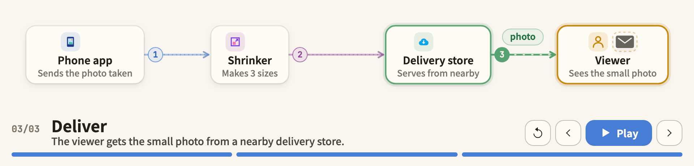
</picture>

dragon turns a short text file into a diagram that plays one step at a time.
It draws boxes, the lines between them, and what travels along those lines.
Each step moves the story forward.
People and AI write the same dragon notation, and the notation converts to and from a JSON source.
The same source plays on a web page and exports to MP4, GIF, HTML, and PNG.

The catalog at <https://cardene777.github.io/dragon/> shows every kind of diagram, with an editor that plays what you type.

## Why dragon

| | mermaid | dragon |
|---|---|---|
| What you get | A still picture | A diagram that plays step by step. Lines light up, chips travel, and values change |
| Look | A theme picked per diagram | One table of colors, sizes, and spacing that every kind reads |
| Export | SVG, PNG, and PDF through mermaid-cli | MP4, GIF, HTML, and PNG through `dragon export` |
| Writing with AI | Parse errors when the diagram renders | `dragon check` points to the line and column, and a skill teaches the notation to AI agents |
| On GitHub | Drawn from a `mermaid` code block | Shown as an exported picture, and plays on any page with one script line |

## The idea

dragon builds diagrams out of blocks, the way Lego builds models out of bricks.
Every kind of diagram is assembled from blocks of fixed shapes, so all of them share one look.

| Block | What it is | Examples |
|---|---|---|
| Core blocks | Blocks that two or more diagram kinds share | box (`box`), step (`step`), color, icon |
| Kind blocks | Blocks that only one diagram kind uses | the lifeline of a sequence diagram, the group of an architecture diagram (`group`) |
| Connector blocks | Blocks that join two blocks | the edge (`->`), the merge of a git graph |

A diagram is blocks put together.
A diagram kind only decides how its blocks are laid out and which connections it accepts.
Colors, text sizes, and spacing live in one table that every block reads, so every diagram looks consistent.

You can also add your own blocks in your own project.
Start from a box, a line, or an icon, change its shape and color role, and write it as plain data ([Add your own blocks](https://github.com/cardene777/dragon/blob/main/packages/dragon/README.md#add-your-own-blocks)).
To add a diagram kind or a new base block, open a pull request to this repository or work in a fork.

dragon also aims to be as easy as mermaid to write, and to show the diagram right away.

- Short to write. The diagram kind and one `A -> B: name` line make a diagram, and the names on the lines become boxes.
- One script line. Add one script line and the notation to a page, and the notation becomes a diagram that plays.
- Fast for AI to write. AI writes the same notation as people and fixes the line and column that the parser's error messages point to. JSON stays as the source and converts to and from the notation.
- Light and fast. A page loads only the blocks its diagrams use.

The notation is modeled on mermaid, but it is not compatible with mermaid.
It drops hard-to-read forms such as `-->|text|`, and the first English word of each line says what the line is.

## Install

```sh
npm install @cardenelabs/dragon
```

## Write diagrams with AI

The dragon skill teaches an AI agent to write diagrams in the dragon notation.
The agent checks each diagram with `dragon check` and fixes it until it reads.
In Claude Code, add this repository as a plugin marketplace and install the plugin.

```text
/plugin marketplace add cardene777/dragon
/plugin install dragon@dragon
```

For another AI agent, copy the skill directory `plugins/dragon/skills/dragon` of this repository to where that agent reads skills.
The agent starts from `SKILL.md` and reads only the reference file for the kind of diagram it draws.
The plugin version matches the npm version of `@cardenelabs/dragon`, and the skill checks the installed version with `dragon --version`.

## A first diagram

```dragon
sequence

browser -> app: GET /login
app -> browser: Return the sign-in page
```

The diagram kind and lines that join boxes with `->` are enough to make a diagram.
The names on the lines become boxes, and each line becomes one step, lit in the order written.
Add `box` and `step` lines when a box needs a display name or a caption, or a step needs a title and a body.

```dragon
sequence Ask to sign in

box browser as User's browser [note: operated by the user, color: slate]
box app as App [note: asks for sign-in, color: blue]

step Press sign in
  say The user presses the app's sign-in button.
  browser -> app: GET /login
```

Paste it into the editor on the catalog to watch it play.
To show it on your own page, put one script line on the page and the notation in a `<pre class="dragon">` block.
The block turns into a diagram that plays (see [Show it with one script line](packages/dragon/README.md#show-it-with-one-script-line)).
To draw it from code, parse it with `parseNotation` and pass the result to `mountDiagram` (see [Put it on a page](packages/dragon/README.md#put-it-on-a-page)).

## Diagram kinds

Each picture is the last step of an example in [`packages/dragon/examples`](packages/dragon/examples).
Select a kind to read how to write it.

<table>
<tr>
<td align="center" width="33%"><a href="packages/dragon/examples/quick-start.en.md#sequence-diagram"><picture><source media="(prefers-color-scheme: dark)" srcset="docs/readme/kinds/sequence-dark.png">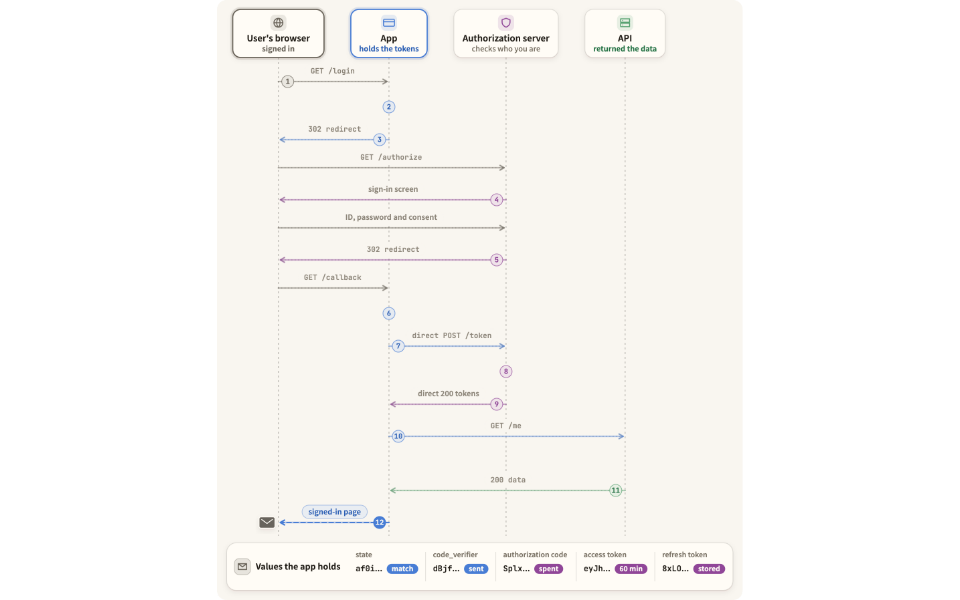</picture><br>Sequence diagram</a></td>
<td align="center" width="33%"><a href="packages/dragon/examples/quick-start.en.md#architecture-diagram"><picture><source media="(prefers-color-scheme: dark)" srcset="docs/readme/kinds/architecture-dark.png">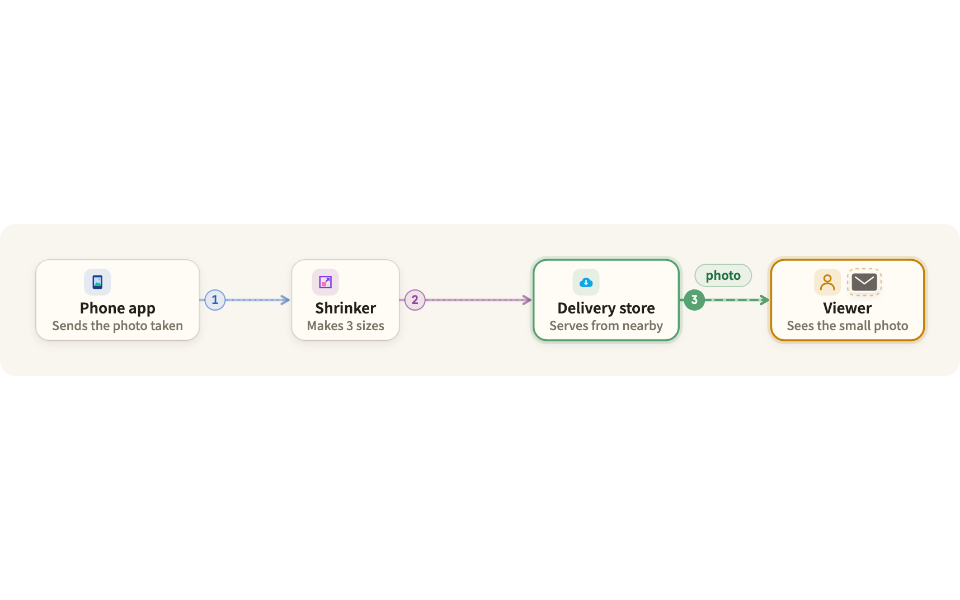</picture><br>Architecture diagram</a></td>
<td align="center" width="33%"><a href="packages/dragon/examples/quick-start.en.md#state-diagram"><picture><source media="(prefers-color-scheme: dark)" srcset="docs/readme/kinds/state-dark.png">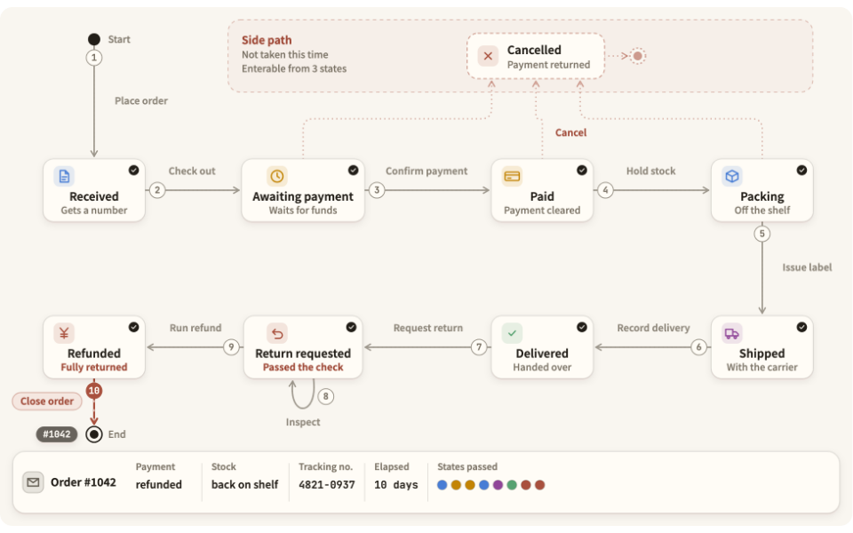</picture><br>State diagram</a></td>
</tr>
<tr>
<td align="center"><a href="packages/dragon/examples/quick-start.en.md#git-graph"><picture><source media="(prefers-color-scheme: dark)" srcset="docs/readme/kinds/git-dark.png">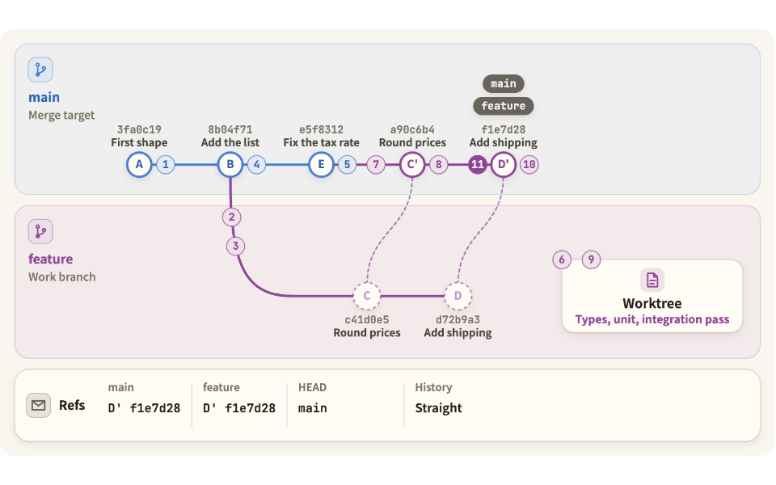</picture><br>Git graph</a></td>
<td align="center"><a href="packages/dragon/examples/quick-start.en.md#time-diagram"><picture><source media="(prefers-color-scheme: dark)" srcset="docs/readme/kinds/time-dark.png">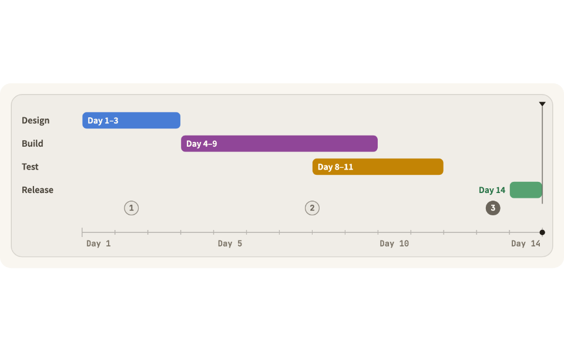</picture><br>Time diagram</a></td>
<td align="center"><a href="packages/dragon/examples/quick-start.en.md#tree-diagram"><picture><source media="(prefers-color-scheme: dark)" srcset="docs/readme/kinds/tree-dark.png">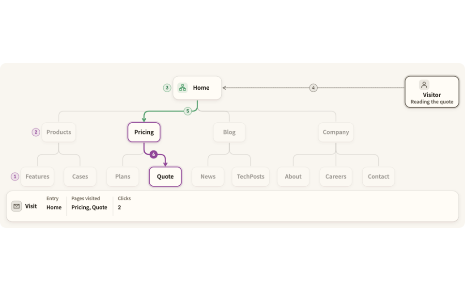</picture><br>Tree diagram</a></td>
</tr>
<tr>
<td align="center"><a href="packages/dragon/examples/quick-start.en.md#lineup-diagram"><picture><source media="(prefers-color-scheme: dark)" srcset="docs/readme/kinds/lineup-dark.png">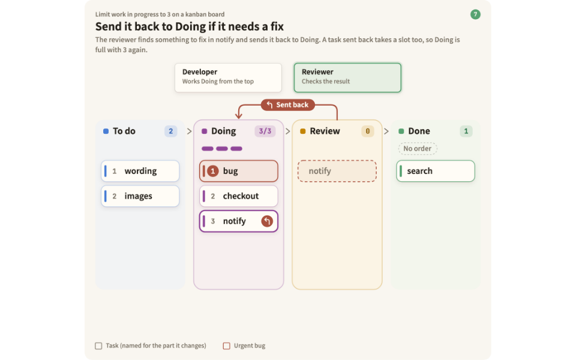</picture><br>Lineup diagram</a></td>
<td align="center"><a href="packages/dragon/examples/quick-start.en.md#try-diagram"><picture><source media="(prefers-color-scheme: dark)" srcset="docs/readme/kinds/try-dark.png">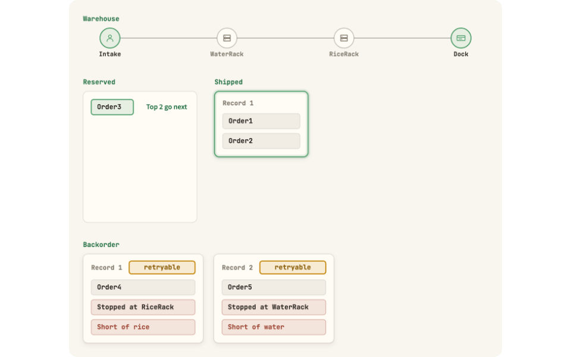</picture><br>Try diagram</a></td>
<td align="center"><a href="packages/dragon/examples/quick-start.en.md#pipe-diagram"><picture><source media="(prefers-color-scheme: dark)" srcset="docs/readme/kinds/pipe-dark.png">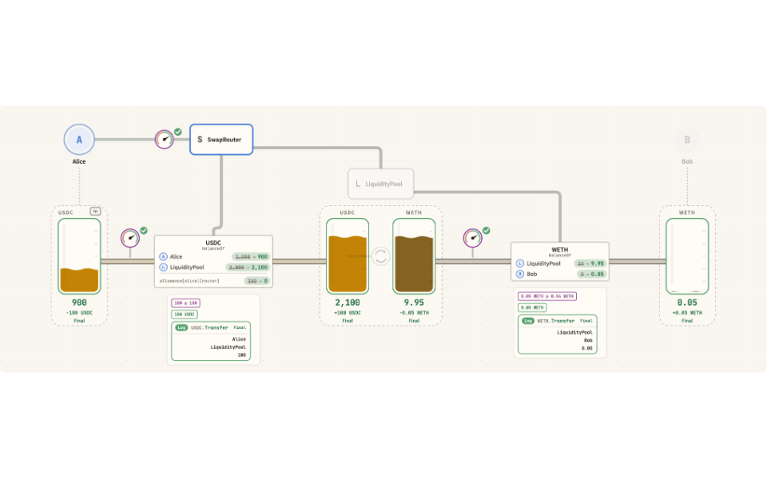</picture><br>Pipe diagram</a></td>
</tr>
<tr>
<td align="center"><a href="packages/dragon/examples/quick-start.en.md#chart"><picture><source media="(prefers-color-scheme: dark)" srcset="docs/readme/kinds/chart-dark.png">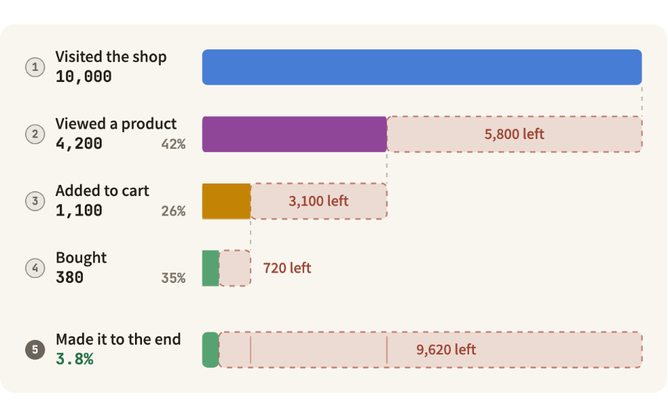</picture><br>Chart</a></td>
<td align="center"><a href="packages/dragon/examples/quick-start.en.md#flow-diagram"><picture><source media="(prefers-color-scheme: dark)" srcset="docs/readme/kinds/flow-dark.png">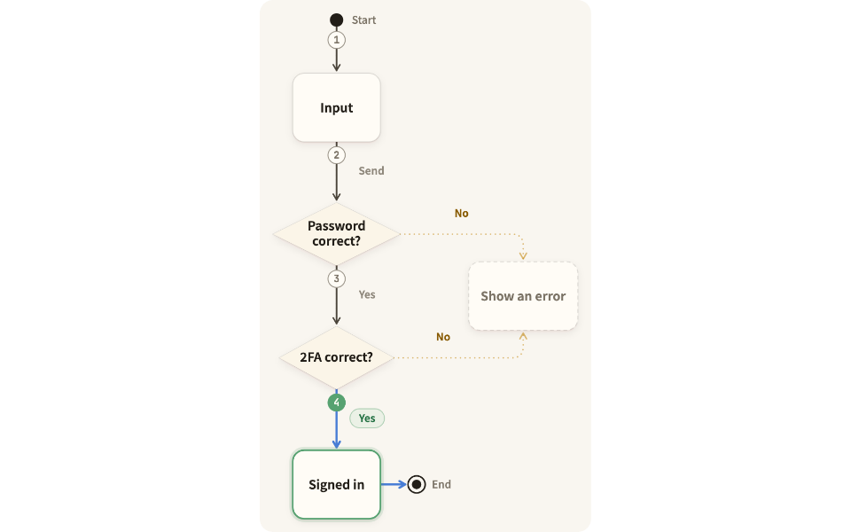</picture><br>Flow diagram</a></td>
<td align="center"><a href="packages/dragon/examples/quick-start.en.md#cycle-diagram"><picture><source media="(prefers-color-scheme: dark)" srcset="docs/readme/kinds/cycle-dark.png">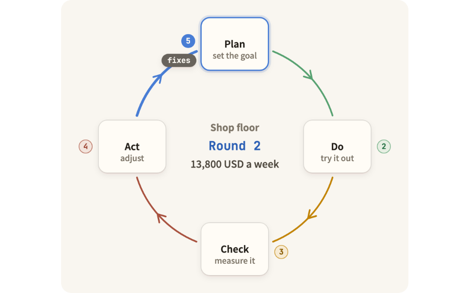</picture><br>Cycle diagram</a></td>
</tr>
<tr>
<td align="center"><a href="packages/dragon/examples/quick-start.en.md#mind-map"><picture><source media="(prefers-color-scheme: dark)" srcset="docs/readme/kinds/mind-dark.png">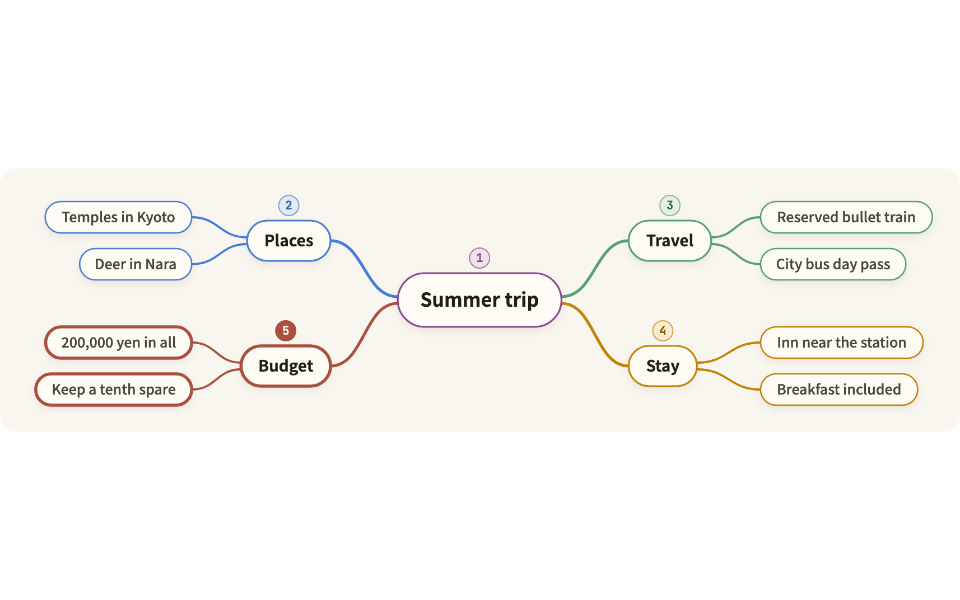</picture><br>Mind map</a></td>
<td align="center"><a href="packages/dragon/examples/quick-start.en.md#table-relation-diagram"><picture><source media="(prefers-color-scheme: dark)" srcset="docs/readme/kinds/er-dark.png">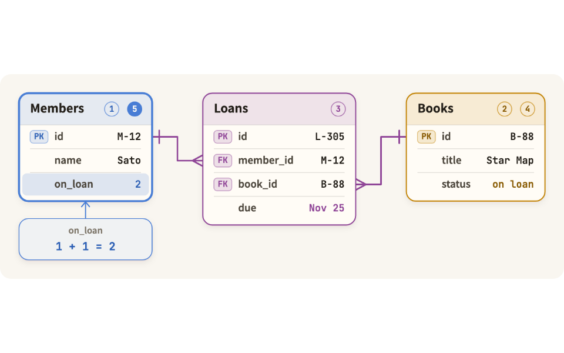</picture><br>Table relation diagram</a></td>
<td align="center"><a href="packages/dragon/examples/quick-start.en.md#two-axis-matrix"><picture><source media="(prefers-color-scheme: dark)" srcset="docs/readme/kinds/matrix-dark.png">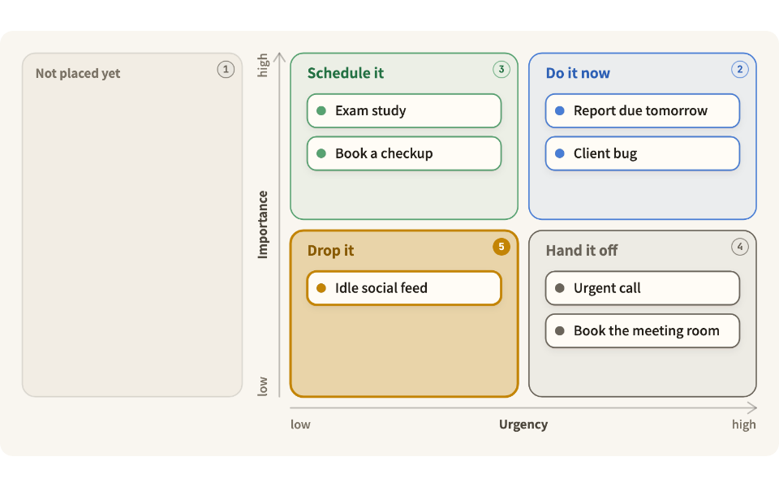</picture><br>Two-axis matrix</a></td>
</tr>
<tr>
<td align="center"><a href="packages/dragon/examples/quick-start.en.md#set-overlap-diagram"><picture><source media="(prefers-color-scheme: dark)" srcset="docs/readme/kinds/venn-dark.png">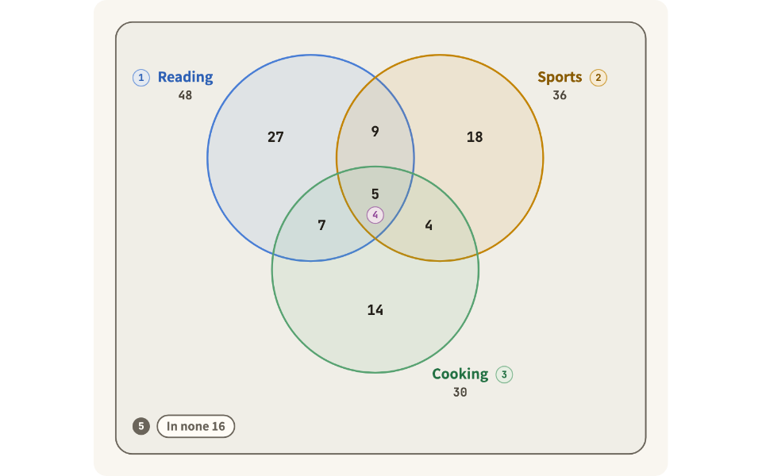</picture><br>Set overlap diagram</a></td>
<td align="center"><a href="packages/dragon/examples/quick-start.en.md#sankey-diagram"><picture><source media="(prefers-color-scheme: dark)" srcset="docs/readme/kinds/sankey-dark.png">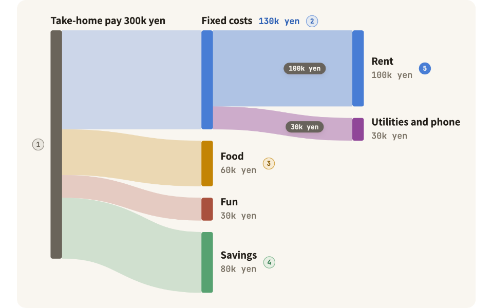</picture><br>Sankey diagram</a></td>
<td align="center"><a href="packages/dragon/examples/quick-start.en.md#owner-card-diagram"><picture><source media="(prefers-color-scheme: dark)" srcset="docs/readme/kinds/cards-dark.png">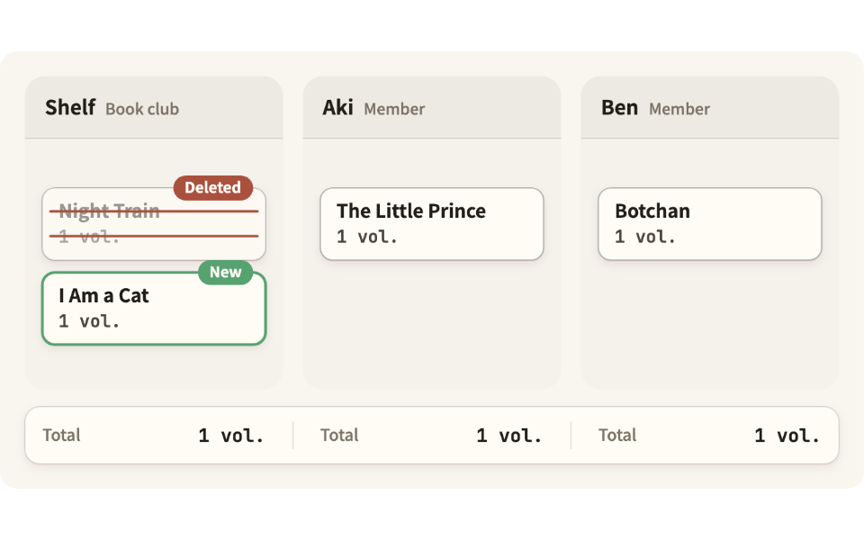</picture><br>Owner card diagram</a></td>
</tr>
<tr>
<td align="center"><a href="packages/dragon/examples/quick-start.en.md#checkout-diagram">Checkout diagram</a><br>A purchase model the reader can change</td>
</tr>
</table>

## What it does

| Part | What it is |
|---|---|
| Source | JSON with a skeleton of kind, title, and steps, and a field for each block name (`blocks`). It carries a format version, and older versions are converted when read |
| Notation | The dragon notation. The first English word of each line decides its kind. It converts to and from JSON, and names and text can be in any language |
| Renderer | Draws the source on a page and plays it one step at a time |
| Diagram kinds | Sequence diagram, architecture diagram, state diagram, git graph, time diagram, tree diagram, lineup diagram, try diagram, pipe diagram, chart, flow diagram, cycle diagram, mind map, table relation diagram, two-axis matrix, set overlap diagram, Sankey diagram, owner card diagram, checkout diagram |
| Export | The `dragon export` command writes MP4, GIF, HTML, and PNG from the same source |

## Notation

Every line follows these four rules.

1. The first English word of a line decides its kind. Only arrow lines start with a box id
2. A colon separates a key from its value, and attributes go inside `[ ]`, separated by `,`
3. Names and text with spaces go at the end of the line or before `[`. Wrap only values that contain `,` or `]` and names that contain `[` in `"`
4. The only nesting is `group … end` and the scene's `scene … end`. A step runs until the next `step`, and indentation is for reading. Only the lines that continue a `say` must be indented deeper than `say`

The [notation guide](packages/dragon/examples/quick-start.en.md) has every line form, and a section for each kind of diagram.
A full example of each kind is in [`packages/dragon/examples`](packages/dragon/examples).

## Documentation

| Read | For |
|---|---|
| [`packages/dragon/README.md`](packages/dragon/README.md) | Putting a diagram on a page, embedding it in other tools, loading diagram kinds on demand, adding your own blocks, and exporting |
| [Notation guide](packages/dragon/examples/quick-start.en.md) | Every line form, attribute, and diagram kind |
| [`CHANGELOG.md`](CHANGELOG.md) | What changed in each version, and how to rewrite diagrams written for older versions |

## Contributing

Issues and pull requests are welcome.
See [`CONTRIBUTING.md`](CONTRIBUTING.md) for how to build, test, and send a change.

## License

MIT
