# @cardenelabs/dragon

動く図を、人も AI も dragon記法で書くための package。

[English](README.md)

<p>
<a href="https://github.com/cardene777/dragon/blob/main/CHANGELOG.md"></a>
<a href="https://github.com/cardene777/dragon/blob/main/LICENSE"></a>
<a href="https://cardene777.github.io/dragon/"></a>
</p>

<picture>
<source media="(prefers-color-scheme: dark)" srcset="https://raw.githubusercontent.com/cardene777/dragon/main/docs/readme/ja/hero-dark.png">
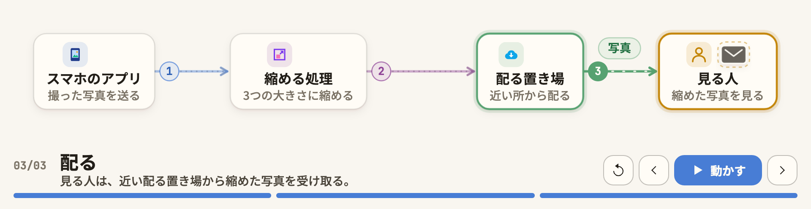
</picture>

dragon は、短い文の file から段ごとに動く図を描く。
見本帳 (全ての種類の図と、書くとその場で動く編集画面) は <https://cardene777.github.io/dragon/> にある。

## mermaidとの違い

| | mermaid | dragon |
|---|---|---|
| 出来上がる物 | 止まった1枚の絵 | 段ごとに動く図。線が光り、札が運ばれ、値が変わる |
| 見た目 | 図ごとに選ぶテーマ | 全ての種類が読む、色と字の大きさと余白の1つの表 |
| 書き出し | mermaid-cliでSVG、PNG、PDF | `dragon export`でMP4、GIF、HTML、PNG |
| AIで書く時 | 描く時に出る読めない所の誤り | `dragon check`が誤りの行と列を示し、skillがAIに記法を教える |
| GitHubでの見え方 | `mermaid`の塊をその場で描く | 書き出した絵で見せる。scriptの1行で、どの頁でも動かせる |

## 考え方

dragon は、ブロックを組み立てて図を作る道具である。
レゴのように、決まった形のブロックを組み合わせて、どの種類の図も同じ見た目で組み立てる。

| ブロック | 何か | 例 |
|---|---|---|
| コアブロック | 2 つ以上の種類の図で使い回すブロック | 箱 (`box`)、段 (`step`)、色、絵柄 |
| 個別ブロック | 1 つの種類の図だけで使うブロック | 時系列図の生存線、構成図の区画 (`group`) |
| 接続ブロック | 2 つのブロックを結ぶブロック | 線 (`->`)、枝分かれの図の merge |

図は、ブロックを組み立てたものである。
図の種類は、ブロックの並べ方と、受け付ける付け方だけを決める。
どの図でどのブロックを使えるかは、ブロックの付け方から決まる。
色と字の大きさと余白は 1 つの表が持ち、全てのブロックがそこから読むので、どの図も同じ見た目に揃う。

ブロックは、使う人が自分の手元でも足せる。
今の箱と線と印のどれかを元にして形と色の役を替えたブロックを、データだけの定義で書く ([ブロックを足す](https://github.com/cardene777/dragon/blob/main/packages/dragon/README.ja.md#ブロックを足す))。
図の種類と、元にできるブロックを増やす時は、この repo への pull request か fork で足す。

もう 1 つの軸は、mermaid と同じ手軽さで書けて、そのまま表示まで出ることである。

- 書く字が短い。図の種類の語と `A -> B: 名前` の 2 行で図になり、線に出た名前が箱になる
- script の 1 行で出る。頁に script の 1 行と記法の塊を置くだけで、動く図になる
- AI が速く書ける。AI も人と同じ記法で書き、読む処理の誤りの文が示す行と列を直す。JSON は原本として残り、記法と行き来できる
- 軽くて速い。頁は、書いた図が使うブロックだけを読む

記法は mermaid を手本にした独自の形で、mermaid とは互換にしない。
`-->|文|` のような読みにくい形を持たず、行の頭の英語の語だけで何の行かが分かる形を選んだ。

## 入れ方

```sh
npm install @cardenelabs/dragon
```

この package は次の 4 つを持つ。

| 持つ物 | 形 |
|---|---|
| 原本 | 図の種類と題と段の骨組みに、ブロックの名前ごとの欄 (`blocks`) を持つ JSON (下の節)。版を持ち、古い版は読む時に変換する |
| 記法 | 行の頭の英語の語で行の種類が決まる dragon記法 (下の節)。JSON と行き来でき、名前と文は日本語でも書ける ([書き方](https://github.com/cardene777/dragon/blob/main/packages/dragon/examples/quick-start.md)、[英語の書き方](https://github.com/cardene777/dragon/blob/main/packages/dragon/examples/quick-start.en.md)) |
| 描く部品 | 原本を頁に描き、段ごとに動かす部品。時系列図、構成図、状態遷移図、枝分かれの図、時間軸の図、木の図、列の図、試す図を描く |
| 書き出し | 同じ原本から mp4、GIF、HTML、PNG、SVG を書き出す命令 `dragon export` |

前の版から上げる時に書き直す所は [`CHANGELOG.ja.md`](https://github.com/cardene777/dragon/blob/main/CHANGELOG.ja.md) にある。

## AI に図を書かせる

dragon の skill は、AI に dragon記法で図を書かせ、`dragon check` で確かめて読めるまで直させる。
Claude Code では、GitHub の repo cardene777/dragon をプラグインの置き場に足してから、プラグインを入れる。

```text
/plugin marketplace add cardene777/dragon
/plugin install dragon@dragon
```

ほかの AI では、GitHub の repo cardene777/dragon の skill の dir (`plugins/dragon/skills/dragon`) を、その AI が skill を読む場所へ写す。
AI は `SKILL.md` から読み始め、描く図の種類の参照の file だけを読む。
プラグインの版は npm の `@cardenelabs/dragon` の版と同じで、skill は入れた版を `dragon --version` で確かめる。

## 最初の図

```dragon
sequence

ブラウザ -> アプリ: GET /login
アプリ -> ブラウザ: ログインの頁を返す
```

図の種類の語と、箱どうしを `->` で結ぶ行だけで図になる。
線に出た名前が箱になり、線 1 本が 1 段になって書いた順に光る。
箱に見せる名前や添え書きを付け、段に題と本文を付ける時は、`box` と `step` の行を書く。

```dragon
sequence ログインを頼む

box ブラウザ as 利用者のブラウザ [note: 利用者が操作する]
box アプリ [note: ログインを頼む側]

step ログインを押す
  say 利用者がアプリのログインを押す。
  ブラウザ -> アプリ: GET /login
```

見本帳の編集画面に貼るとその場で動き、次の節の書き方で自分の頁にも置ける。

## 描ける図

どの絵も、[`packages/dragon/examples`](https://github.com/cardene777/dragon/blob/main/packages/dragon/examples)の見本を最後の段で止めた物。
種類を押すと、その種類の書き方を読める。

<table>
<tr>
<td align="center" width="33%"><a href="https://github.com/cardene777/dragon/blob/main/packages/dragon/examples/quick-start.md#時系列図"><picture><source media="(prefers-color-scheme: dark)" srcset="https://raw.githubusercontent.com/cardene777/dragon/main/docs/readme/ja/kinds/sequence-dark.png">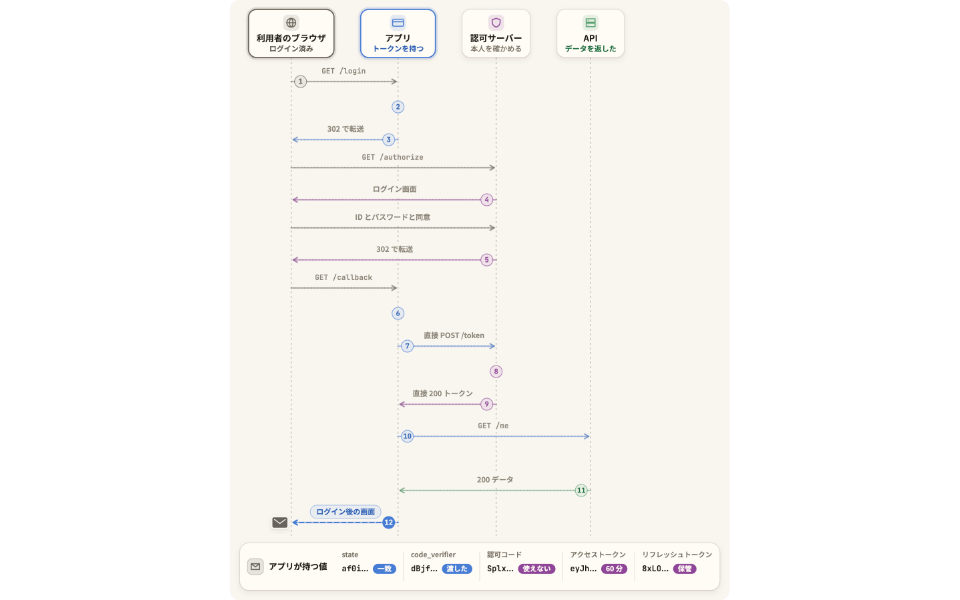</picture><br>時系列図</a></td>
<td align="center" width="33%"><a href="https://github.com/cardene777/dragon/blob/main/packages/dragon/examples/quick-start.md#構成図"><picture><source media="(prefers-color-scheme: dark)" srcset="https://raw.githubusercontent.com/cardene777/dragon/main/docs/readme/ja/kinds/architecture-dark.png">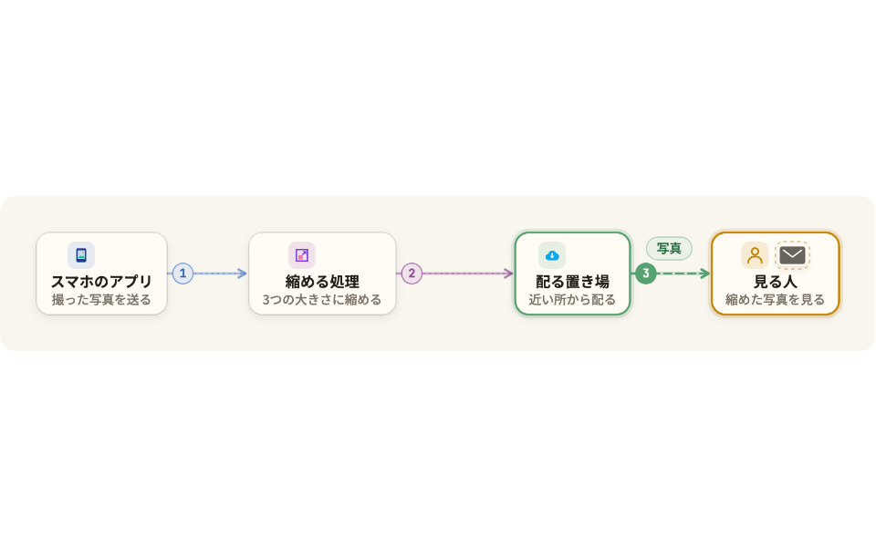</picture><br>構成図</a></td>
<td align="center" width="33%"><a href="https://github.com/cardene777/dragon/blob/main/packages/dragon/examples/quick-start.md#状態遷移図"><picture><source media="(prefers-color-scheme: dark)" srcset="https://raw.githubusercontent.com/cardene777/dragon/main/docs/readme/ja/kinds/state-dark.png">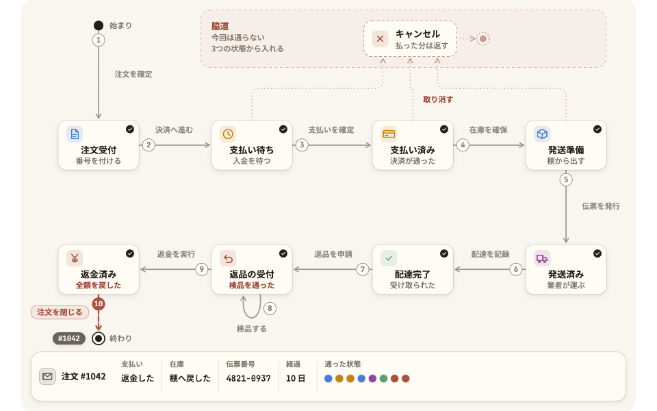</picture><br>状態遷移図</a></td>
</tr>
<tr>
<td align="center"><a href="https://github.com/cardene777/dragon/blob/main/packages/dragon/examples/quick-start.md#枝分かれの図"><picture><source media="(prefers-color-scheme: dark)" srcset="https://raw.githubusercontent.com/cardene777/dragon/main/docs/readme/ja/kinds/git-dark.png">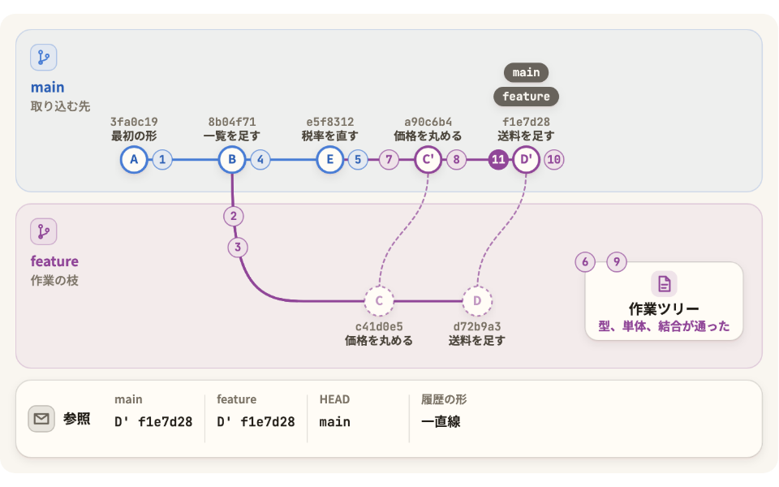</picture><br>枝分かれの図</a></td>
<td align="center"><a href="https://github.com/cardene777/dragon/blob/main/packages/dragon/examples/quick-start.md#時間軸の図"><picture><source media="(prefers-color-scheme: dark)" srcset="https://raw.githubusercontent.com/cardene777/dragon/main/docs/readme/ja/kinds/time-dark.png">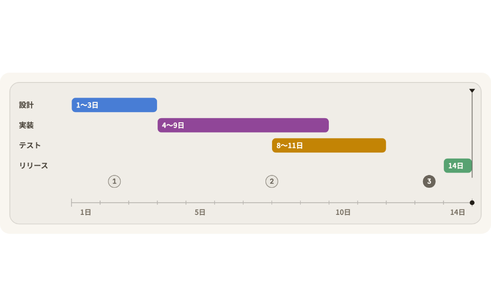</picture><br>時間軸の図</a></td>
<td align="center"><a href="https://github.com/cardene777/dragon/blob/main/packages/dragon/examples/quick-start.md#木の図"><picture><source media="(prefers-color-scheme: dark)" srcset="https://raw.githubusercontent.com/cardene777/dragon/main/docs/readme/ja/kinds/tree-dark.png">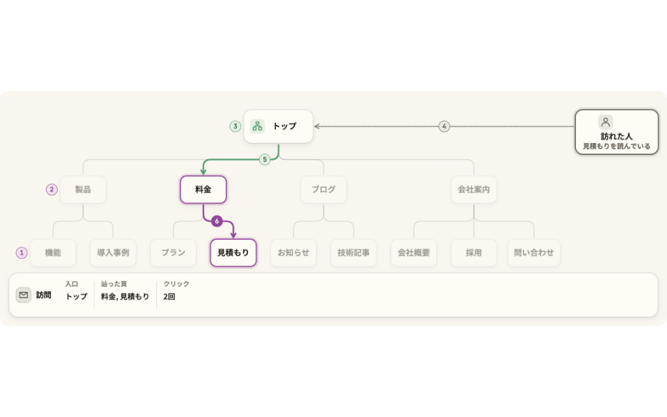</picture><br>木の図</a></td>
</tr>
<tr>
<td align="center"><a href="https://github.com/cardene777/dragon/blob/main/packages/dragon/examples/quick-start.md#列の図"><picture><source media="(prefers-color-scheme: dark)" srcset="https://raw.githubusercontent.com/cardene777/dragon/main/docs/readme/ja/kinds/lineup-dark.png">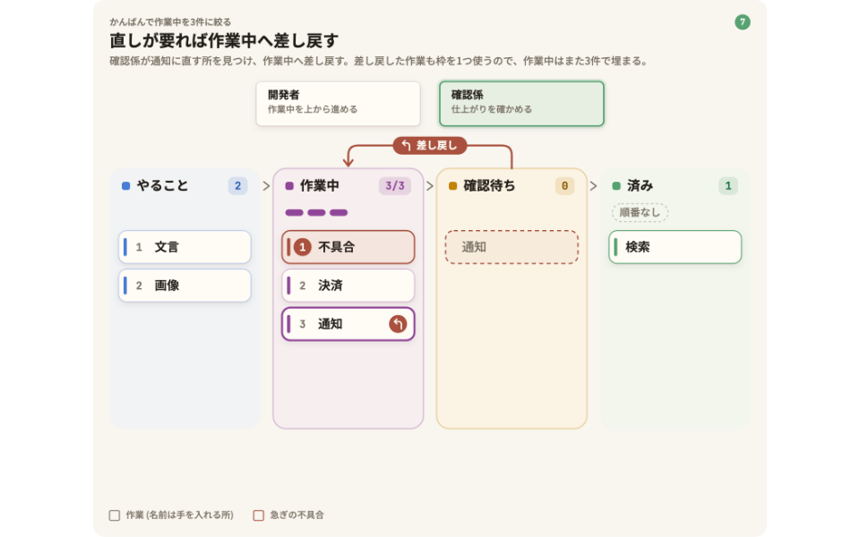</picture><br>列の図</a></td>
<td align="center"><a href="https://github.com/cardene777/dragon/blob/main/packages/dragon/examples/quick-start.md#試す図"><picture><source media="(prefers-color-scheme: dark)" srcset="https://raw.githubusercontent.com/cardene777/dragon/main/docs/readme/ja/kinds/try-dark.png">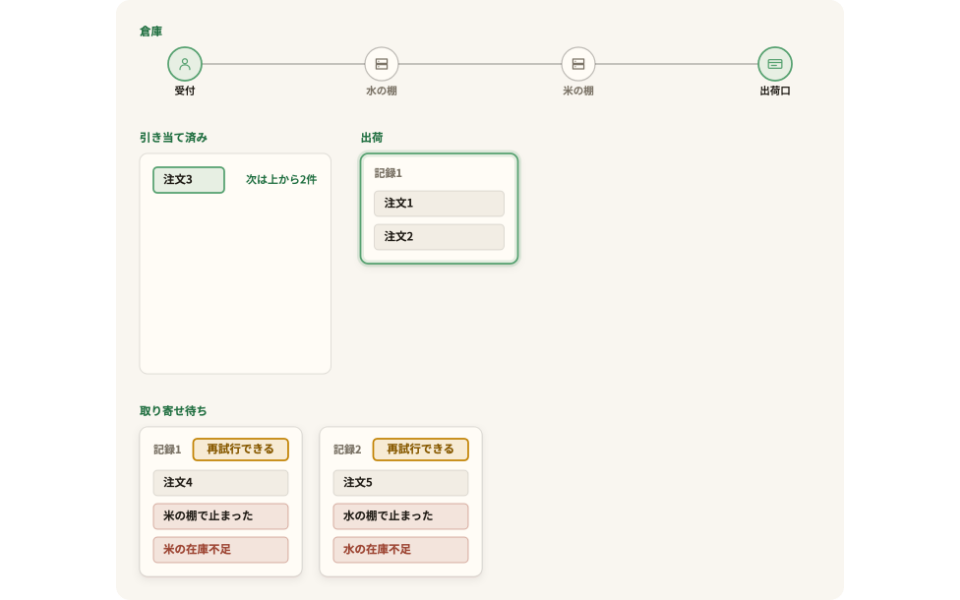</picture><br>試す図</a></td>
<td align="center"><a href="https://github.com/cardene777/dragon/blob/main/packages/dragon/examples/quick-start.md#配管の図"><picture><source media="(prefers-color-scheme: dark)" srcset="https://raw.githubusercontent.com/cardene777/dragon/main/docs/readme/ja/kinds/pipe-dark.png">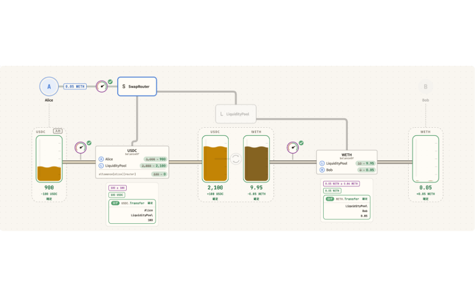</picture><br>配管の図</a></td>
</tr>
<tr>
<td align="center"><a href="https://github.com/cardene777/dragon/blob/main/packages/dragon/examples/quick-start.md#量の図"><picture><source media="(prefers-color-scheme: dark)" srcset="https://raw.githubusercontent.com/cardene777/dragon/main/docs/readme/ja/kinds/chart-dark.png">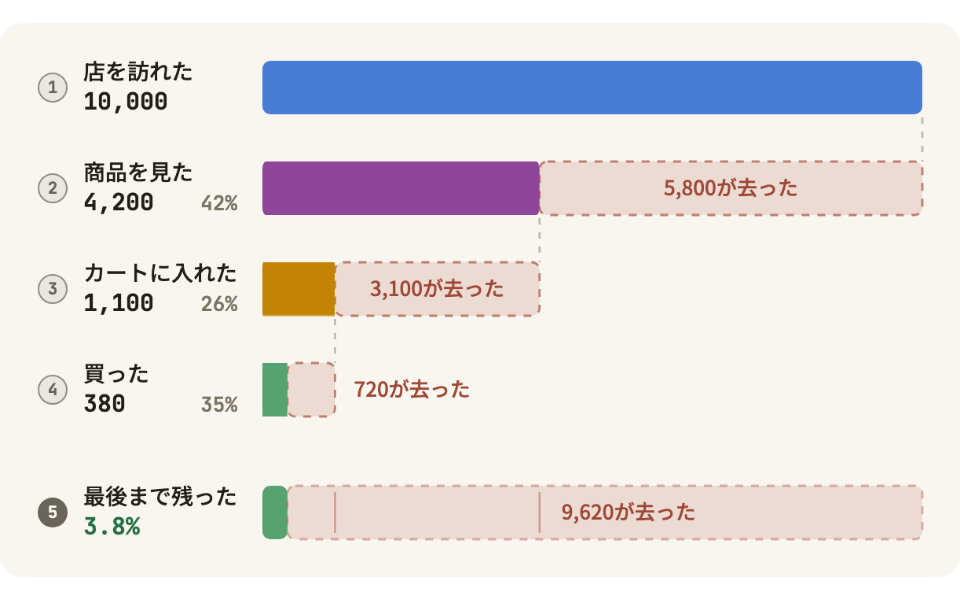</picture><br>量の図</a></td>
<td align="center"><a href="https://github.com/cardene777/dragon/blob/main/packages/dragon/examples/quick-start.md#手順の図"><picture><source media="(prefers-color-scheme: dark)" srcset="https://raw.githubusercontent.com/cardene777/dragon/main/docs/readme/ja/kinds/flow-dark.png">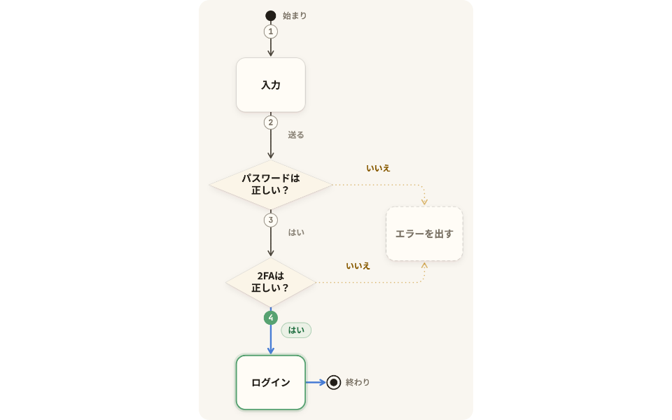</picture><br>手順の図</a></td>
<td align="center"><a href="https://github.com/cardene777/dragon/blob/main/packages/dragon/examples/quick-start.md#回り続ける図"><picture><source media="(prefers-color-scheme: dark)" srcset="https://raw.githubusercontent.com/cardene777/dragon/main/docs/readme/ja/kinds/cycle-dark.png">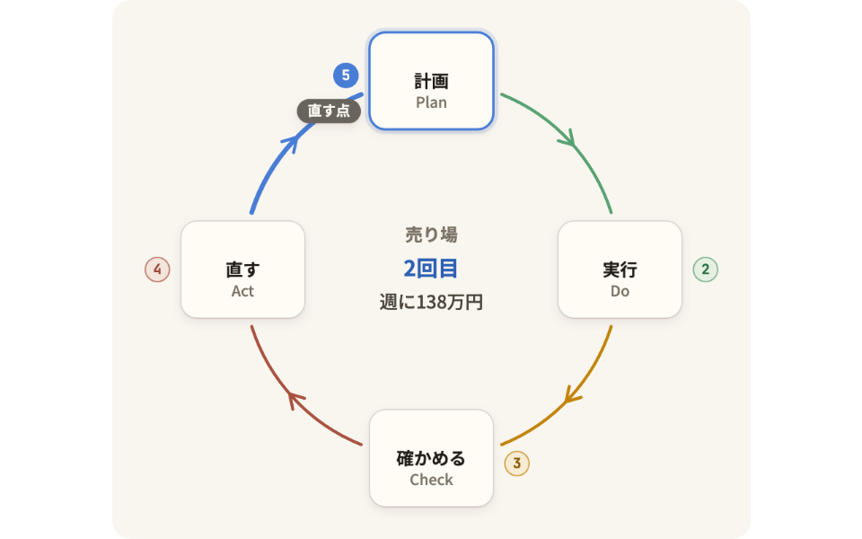</picture><br>回り続ける図</a></td>
</tr>
<tr>
<td align="center"><a href="https://github.com/cardene777/dragon/blob/main/packages/dragon/examples/quick-start.md#考えを広げる地図"><picture><source media="(prefers-color-scheme: dark)" srcset="https://raw.githubusercontent.com/cardene777/dragon/main/docs/readme/ja/kinds/mind-dark.png">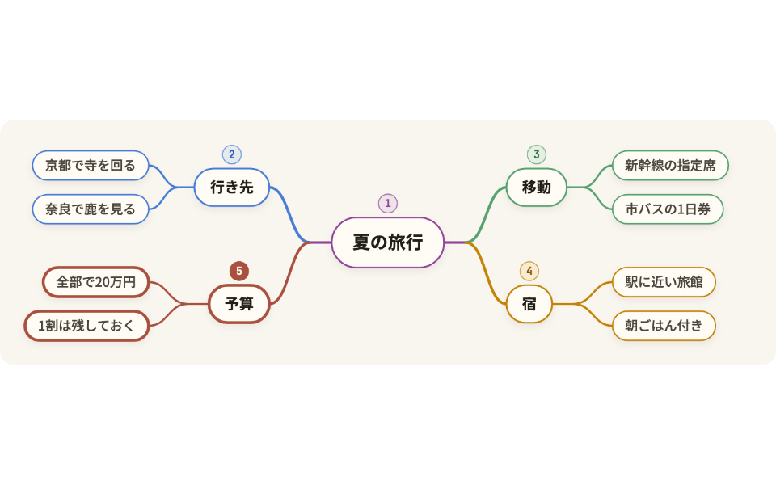</picture><br>考えを広げる地図</a></td>
<td align="center"><a href="https://github.com/cardene777/dragon/blob/main/packages/dragon/examples/quick-start.md#表どうしの関係の図"><picture><source media="(prefers-color-scheme: dark)" srcset="https://raw.githubusercontent.com/cardene777/dragon/main/docs/readme/ja/kinds/er-dark.png">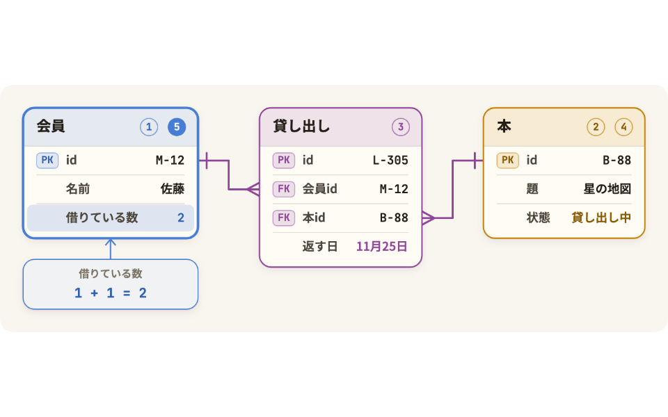</picture><br>表どうしの関係の図</a></td>
<td align="center"><a href="https://github.com/cardene777/dragon/blob/main/packages/dragon/examples/quick-start.md#2つの軸で置く図"><picture><source media="(prefers-color-scheme: dark)" srcset="https://raw.githubusercontent.com/cardene777/dragon/main/docs/readme/ja/kinds/matrix-dark.png">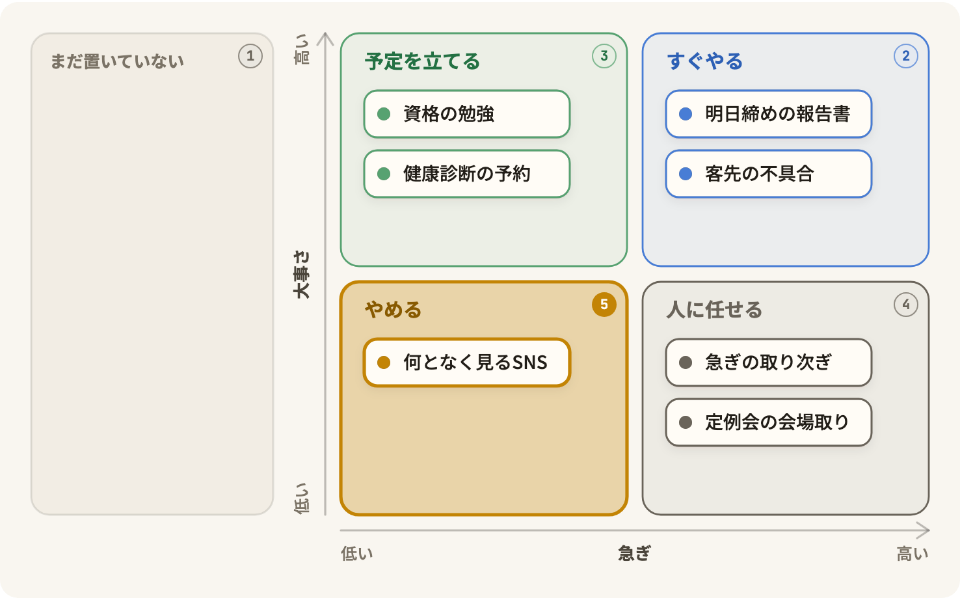</picture><br>2つの軸で置く図</a></td>
</tr>
<tr>
<td align="center"><a href="https://github.com/cardene777/dragon/blob/main/packages/dragon/examples/quick-start.md#集合の重なりの図"><picture><source media="(prefers-color-scheme: dark)" srcset="https://raw.githubusercontent.com/cardene777/dragon/main/docs/readme/ja/kinds/venn-dark.png">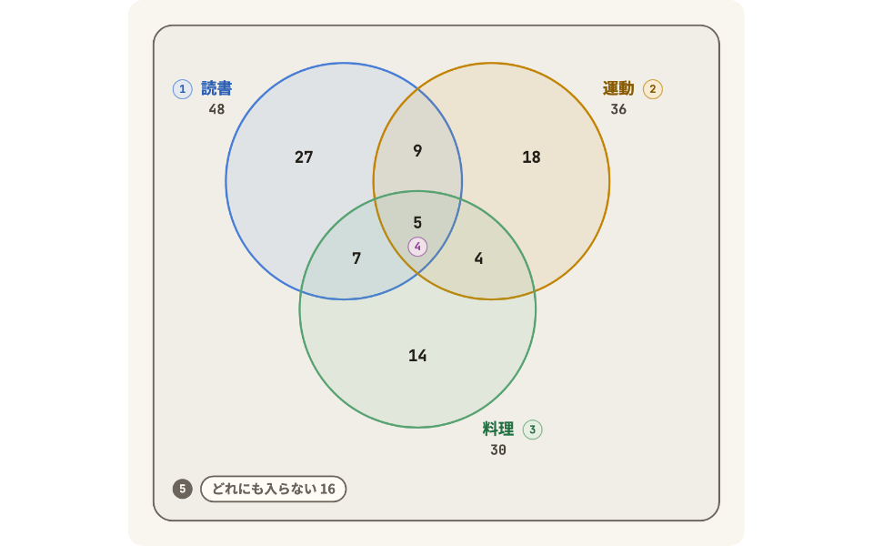</picture><br>集合の重なりの図</a></td>
<td align="center"><a href="https://github.com/cardene777/dragon/blob/main/packages/dragon/examples/quick-start.md#量の行き先の図"><picture><source media="(prefers-color-scheme: dark)" srcset="https://raw.githubusercontent.com/cardene777/dragon/main/docs/readme/ja/kinds/sankey-dark.png">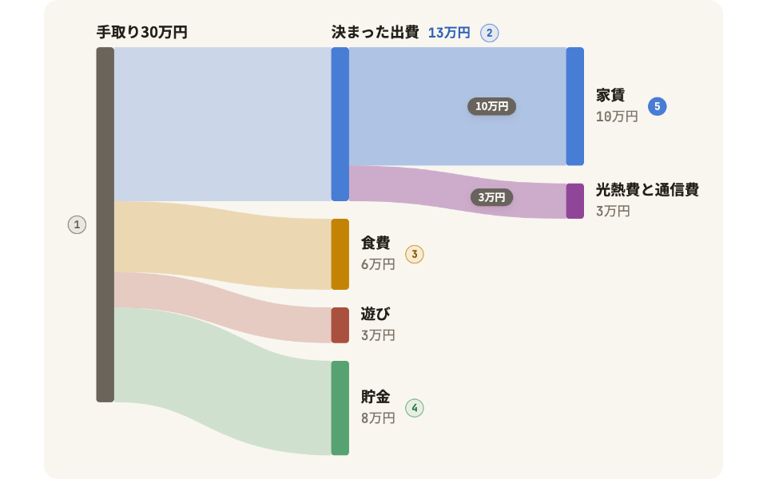</picture><br>量の行き先の図</a></td>
<td align="center"><a href="https://github.com/cardene777/dragon/blob/main/packages/dragon/examples/quick-start.md#持ち主ごとのカードの図"><picture><source media="(prefers-color-scheme: dark)" srcset="https://raw.githubusercontent.com/cardene777/dragon/main/docs/readme/ja/kinds/cards-dark.png">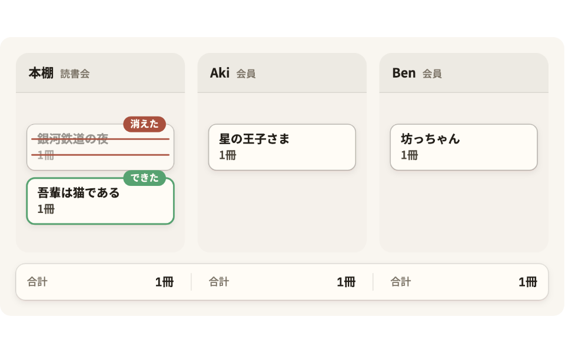</picture><br>持ち主ごとのカードの図</a></td>
</tr>
<tr>
<td align="center"><a href="https://github.com/cardene777/dragon/blob/main/packages/dragon/examples/quick-start.md#購入操作図">購入操作図</a><br>読む人が条件を変えられる購入の模型</td>
</tr>
<tr>
<td align="center"><a href="https://github.com/cardene777/dragon/blob/main/packages/dragon/examples/quick-start.md#判定の表">判定の表</a><br>例を規則と照らして通すか止めるかを出す表</td>
</tr>
</table>

## script の 1 行で頁に出す

HTML の頁に script の 1 行と、記法を書いた `<pre class="dragon">` の塊を置くと、塊が動く図に置き換わる。
入れる作業も束ねる作業も要らない。

```html
<script type="module" src="https://cdn.jsdelivr.net/npm/@cardenelabs/dragon@0.91/dist/cdn/dragon.js"></script>

<pre class="dragon">
sequence ログインを頼む

box ブラウザ as 利用者のブラウザ
box アプリ

step ログインを押す
  say 利用者がアプリのログインを押す。
  ブラウザ -> アプリ: GET /login
</pre>
```

script は jsDelivr から、版の真ん中の数まで固定した URL で読む。
後の直しの版は頁を直さずに届き、記法を変える版は届かない。
最初に読むのは `sequence` の描く部品で、`architecture` を含むほかの種類の部品は、頁の塊がその種類を使う時だけ読む。
同梱の 2 つの字の CSS を jsDelivr から読む `<link>` を、頁に 1 度だけ足す。
頁を読み終えた時に在る塊を全て描き、後から足した塊は描かない。
読み終えた時に幅を持たない塊 (`display: none` で隠したタブの中など) は、幅を持った時に描く。
印刷する時は、幅を持たない塊も印刷の前に描く。
塊の全ての行に共通の字下げは外して読む。
記法の中の `<` は `&lt;` と書く。
記法に誤りのある塊は図にせず、塊の場所に誤りの文を行ごとに出す (`<pre class="dragon-error">`)。
図の中の字と誤りの文は、頁の `lang` が `ja` で始まれば日本語、ほかは英語で出る。
頁を印刷すると、紙で押せない再生の帯と図の上の帯の釦を出さない。
段のある図は全ての段の止め絵を段の順に並べ、各絵の下に段の番号と題と`say`の文を置く。

通信の無い所で開ける 1 file にするには、頁を `dragon embed` に渡す。
script の 1 行を、全ての図の種類を持つ束ねた script に置き換え、頁の隣に `page.offline.html` を書く (`--out <file>` で書く file を選ぶ)。
この file は外から何も読まない。
同梱の字を埋めないので、同梱の字の後に並べた端末のsans-serifの字で描く。
`data-header`の塊の帯のエクスポートは、jsDelivrの頁と同じPNG、SVG、HTML、GIF、MP4、dragon記法、JSONの7つを外から読まずに保存する。
保存したHTMLも、埋めた頁と同じく端末のsans-serifの字で描く。

```sh
dragon embed page.html
```

### 止めて置く図

レポートや説明の頁のように、図を段で送らずに最後の段の形を 1 枚で見せたい時は、塊に属性 `data-still` を付ける。

```html
<pre class="dragon" data-still>
chart 商品ごとの売り上げ (千円) [shape: bar]

item croissant as クロワッサン
item melon as メロンパン

step 今週
  set croissant: 129
  set melon: 82
</pre>
```

`data-still` を持つ塊は、再生の部品 (釦、段の番号、段の題と本文、進みの帯) を置かず、最後の段の形を描いた SVG (`<div class="dragon-figure dragon-still">`) に置き換わる。
量の図は値まで描き、段の名前の所に図の題を出す。
手順の図は、段が通った線を全て実線で描く。
字は同梱の字の後に端末の sans-serif を持つので、同梱の字を読まない頁でも明朝に落ちない。
色味は既定で頁の白い地に馴染む `clear` を使う。
別の色味で描く時は、`<pre class="dragon" data-still data-palette="paper">` のように `data-palette` に色味の名前を書く。
色味に無い名前は書かない時と同じく `clear` で描き、説明の頁 (`layout: guide`) の話題の頭の地図は、頁の他の図と揃う `paper` を名指す。
止めて置く図は、頁の `<html>` が `data-theme="dark"` を持つ時と、`data-theme="light"` でない頁で端末が暗い表示の時に、暗い色に変わる。
図の地を頁の色に合わせる時は、図かその親に `--dragon-figure-background` を渡す (例 `.card { --dragon-figure-background: var(--surface); }`)。
図の地と、線の縁取りと札の地がその色になり、明るい頁でも暗い頁でも頁の枠と同じ色に見える。
ドーナツは輪の内側に 1 行で収まらない真ん中の名前を 2 行に折り、手順の帯 (`cycle` の `[shape: band]`) は手順の名前を山形の中に書く。
図は自分の幅より広く伸ばさず、枠が狭い時は縦横の比を保って縮める。

止めて置く塊だけの頁を `dragon embed` に渡すと、塊を SVG に描いて置き換え、束ねた script を入れない。
動く塊が混ざる頁では、止めて置く塊だけを SVG に描き、動く塊のために束ねた script を入れる。
package から描く時は、`renderDiagram` に `figure: true` を渡すと同じ SVG を返す。

### 決めた段で止めて置く

図を決めた段で止めて置く時は、塊に属性 `data-step` を付け、段の番号を帯の番号と同じく1から数えて書く。

```html
<pre class="dragon" data-step="2">
sequence 注文

box shop as 店
box bank as 銀行

step 頼む
  shop -> bank: 代金

step 払う
  bank -> shop: 払った

step 締める
  shop -> bank: 締め
</pre>
```

塊は置いた時に流さず、2段目の止め絵で止まる。
時系列図、構成図、状態遷移図、手順の図は前の段の線の名前を薄い灰で残すので、読み手はその段までの流れを1枚で読める。
止めた後も、読み手は帯で流したり段を送ったりできる。
段の数より大きい数は最後の段で止め、1以上の整数でない値は図を描かずに誤りの文にする。
`data-still` と `data-step` を一緒に持つ塊は `data-still` が効く。

## mdから頁を書き出す

`dragon export notes.md` は md の file を読み、HTML の頁 `notes.html` を 1 つ md の隣に書く (`--out <dir>` で書く先のフォルダを選ぶ)。
頁は file の文と表と `dragon` の囲みを載せ、見出しを頁とタブに分ける。
同じ処理は `@cardenelabs/dragon/node` の `exportPage(file, { outDir, lang })` でも呼べる。

| 見出し | なる物 |
|---|---|
| `#` | 頁の題 |
| 最初の `##` より前の文 | 入口。頁が最初に見せる所 |
| `##` | 項目をまとめる段 |
| `###` | 項目。項目ごとに頁を持つ |
| `####` | 入口と項目の頁の中のタブ |
| `#####` | タブの中のタブ |

既定の組み立ては、入口に `##` の段ごとの項目の札を並べ、札を押すと頁を読み直さずに項目の頁へ移る。
項目の頁からは入口と、前と次の項目へ戻れる。
ほかの組み立ては、頭の `---` の行の間の `layout` の行で選ぶ。
`layout: sidebar` は左に目次を置き、`layout: tabs` は上に段のタブを、その下に段の項目のタブを置く。
`layout: guide`は問いに答える説明の頁を作る ([説明の頁](#説明の頁))。
既定は `layout: entry` になる。

頭の行には、図の帯のボタンの並び`header-buttons`と帯の色`header-<色の欄>`も1行ずつ書ける。
`header-buttons`は、ボタンの名前 (`code`、`editor`、`copy`、`export`、`expand`) を書いた順に`,`で区切って並べ、書かなかったボタンを帯から外す。
色の欄は`surface`、`background`、`foreground`、`muted`、`border`、`accent`、`hover`の7つで、色の値の`#`は`"`で囲む。
書き出しはこれらの行を頁の帯の設定の塊 (`<script type="application/json" id="dragon-header">`、[scriptの1行で帯を付ける](#scriptの1行で帯を付ける)) にして頁に入れ、頁の全ての図の帯に効かせる。
知らないボタンの名前と、2度書いたボタンと、`;`か`<`を含む色の値と、知らない`header-`の行は、行を名指して書き出しを止める。

`note: pop`の行を書くと、頁の全ての図の箱の説明を押すと出る札で見せる ([押すと出る札](https://github.com/cardene777/dragon/blob/main/packages/dragon/examples/quick-start.md#押すと出る札))。
1行目に`[note: under]`を書いた図だけは名前の下の字で見せる。
この頁では、1行目に`note`を書かない図の箱にも`example`を書ける。
`note: under`は行を書かない頁と同じで、ほかの値は行を名指して書き出しを止める。

```md
---
layout: tabs
header-buttons: code, export
header-accent: "#c0392b"
note: pop
---
```

図の箱は、飛び先に項目の場所の名前を `[link: #<場所の名前>]` と書くと、押した時にその項目へ移る。
場所の名前は GitHub が見出しに付ける名前と同じ作り方で見出しの字から作り、英字を小文字にして約物を外し、空白を `-` にする。
`### 注文を受ける` の場所の名前は `#注文を受ける` になる。
`#<項目>/<タブ>` は項目のタブを開き、頁の URL は開いている項目とタブを残す。
頁に無い場所を指す飛び先は、書き出しを止める。

`` だけを書いた行は、その file を頁に載せる。
`.md` の file は md として、`.dragon` の file は図として、ほかの文字の file は `名前` を付けた code の囲みとして載る。
画像の file は画像のまま出る。
読むのは md の在るフォルダとその下の file だけで、外を指す行は書き出しを止める。

md に書いた HTML は字のまま出し、動かさない。
頁に足す字は、md の本文に仮名か漢字があれば日本語、無ければ英語になり、`--lang ja` か `--lang en` で選べる。
頁の図は jsDelivr の script の 1 行で描くので、通信の無い所で開ける file には、書き出した頁を `dragon embed` に渡す。
図の記法の誤りと、知らない `layout` と、最初の `##` より前の `###` は、file と行を名指して書き出しを止める。
受ける設定は `--out` と `--lang` だけで、`--fps` などの図の書き出しの設定は断る。

全ての決まりを使った見本は [`examples/page/`](https://github.com/cardene777/dragon/blob/main/packages/dragon/examples/page/page.md) にある。

````md
---
layout: entry
---

# 注文を届けるまで

店が注文を受けてから品物を届けるまでを見る。

#### 全体の図

```dragon
architecture 注文を届けるまで
box 画面 as 注文の画面 [link: #注文を受ける]
box 支払い as 支払いの仕組み [link: #代金を受け取る]
step 払う
  画面 -> 支払い: 注文
```

## 受付

### 注文を受ける

#### 結果

12件の注文を受けた。

#### 出力の全文


## 支払い

### 代金を受け取る

#### 仕組みの図


````

```sh
dragon export notes.md
dragon embed notes.html
```

### 説明の頁

`layout: guide`の頁は、`##`を話題にし、`###`を話題の中の問いの節にする。
節と目次の問いは番号を持たない。
話題が1つの頁は、全ての節を1つの頁に続けて積み、左の目次に話題とその問いを並べる。
目次は今読んでいる問いに印を付け、問いを押すとその節へ移る。
話題が2つ以上の頁は、全体像の頁と話題ごとの頁に分ける。
頁の上のヘッダーは、題と全体像と話題ごとのタブを並べ、頁を送っても画面に留まる。
開いている話題のタブは、太字と下線で示す。
タブが題の横に入らない時は、タブを題の下の段へ移す。
携帯の幅では、タブの段を横に送る。
ヘッダーの右の端には検索の欄を置く。
欄に語を打つと、題か目次の短い名前か1文の答えにその語を含む問いを話題ごとにまとめ、続けて名前か説明にその語を含む用語を並べた一覧が欄の下に出る。
大文字と小文字、全角と半角を区別せずに探し、打った語の全ての所に印を付ける。
問いを押すとその問いの頁を開き、用語を押すと用語の話題のその用語の札へ移って札の枠を青い線にする。
↓と↑で行を選び、Enterで選んだ行を開き、Escか欄の外を押すと一覧を閉じる。
当たる物が無い時は、無いことを一覧の所に出す。
携帯の幅では、題の右の虫眼鏡の釦を押すと題の下に欄が開く。
話題が1つで用語を持たない頁はヘッダーを持たないので、検索の欄を左の目次の頭に置く。
全体像の頁は、最初の`##`より前の文と全体像と話題の道筋を出す。
全体像の頁は、左の目次を出さずに本文を中央に置く。
話題の頁はまず、問いの短い名前と答えの1文を並べた一覧を出す。
話題の中は問いごとの頁に分け、一覧の行か目次の問いを押すと、その問いの節だけが出る。
全体像の図の箱に`link: #<話題の場所の名前>`を書くと、箱を押してその話題の頁へ移れ、その話題の頁の頭に、その箱だけに色を残した全体像の止め絵が出る。
頁は全体像、話題ごとの一覧とその話題の問いの順に並び、どの頁も終わりに前と次の頁へのlinkを持つ。
頁を切り替えてもfileを読み直さない。
左の目次は、開いている話題の問いだけを並べ、開いている頁の行の下にその頁の`####`の見出しを並べる。
`####`の見出しを持たない頁は、見出しの代わりにその頁の図の題を並べる。
見出しを押すとその見出しへ移り、目次は今読んでいる見出しに印を付ける。
目次は開いている頁を灰色の地と太字で示し、番号と並びを開け閉めする矢印を出さない。
幅860px以下では、左の目次を本文の上の目次の釦にまとめ、頁を選ぶと閉じる。
書き手は目次を書かない。
`###`の題の終わりに`[menu: 短い名前]`を書くと、目次にはその短い名前が出て、節の題は問いの全文のまま出る。
名前の無い`[menu: ]`は、行を名指して書き出しを止める。
最初の`##`より前に書いた```` ```dragon ````の図は、頁の頭の全体像になり、その下に話題が書いた順に並ぶ。
図の前に書いた文は図の上に残り、図の後に書いた文は全体像の中の図の下に出る。
節の題の直後の引用 (`>`) は、題の下の1文の答えとして出る。
題の直後でない引用は、今どおり引用のまま出る。
`<details>`と`<summary>`の行は確かめる問いになり、答えは釦を押すまで隠れ、もう一度押すと隠れる。
確かめる問いは左に丸を持ち、答えを開くと緑の丸に白いチェックが入り、答えを閉じても印は残る。
確かめる問いを持つ節は、話題の頭の問いの一覧の行と左の目次の行の右の端に同じ丸を持ち、節の全ての確かめる問いを開くとチェックが入る。
印はブラウザがその頁ごとに覚え、頁を開き直しても残る。
問いの一覧の下の`印を消す`の釦は全ての印を消し、印が在る間だけ出る。
印を覚えられないブラウザでも頁を閉じるまでは印が付き、印刷の形には印を出さない。
ほかのHTMLは、今どおり字のまま出る。

見出しは段ごとに形が違う。
頁の題 (`#`) は、暗い帯に明るい字で出る。
話題が2つ以上の頁はヘッダーが題を出すので、帯は印刷した紙にだけ出る。
話題の題 (`##`) は、字の色の下線を持つ。
問いの題 (`###`) は、左に話題の色の縦線を持つ。
`####`の見出しは淡い地の帯を持ち、`#####`の見出しは点線の下線を持つ。

用語の説明は、用語だけのmdのfile (`glossary.md`など) に書く。
`###`の見出しが用語、続く段落が説明、その後の引用が例になる。
最初の`##`より前に``の行を書くと、そのfileを読み込み、用語ごとに説明を並べた「用語」の話題を頁の終わりに足す。
本文に`[注文](glossary.md#注文)`のようにリンクを書くと、その語に下線が付く。
下線を押すと、すぐ下に用語の名前と説明と灰色の例の帯を持つ札が開く。
札は、札の外か閉じるのアイコンか同じ下線を押すと閉じる。
同じ用語を2度書いた用語のfileと、用語のfileに無い用語へのリンクは、fileと行を名指して書き出しを止める。
印刷の形では、ヘッダーと目次を出さずに全ての話題の節を書いた順に並べ、2つ目からの話題を新しい紙から始めて、紙の上に話題の名前を出す。
用語の札と確かめる問いの答えを全て開き、図の箱の札は図に重ねず図の下に箱の名前と並べる。

`dragon export guide.md guide.en.md`のように日本語と英語の説明の頁のmdを1組で渡すと、2つの言葉で読める頁を1つ書く。
頁の名前は先に渡したfileから付ける。
探す欄の右の地球の印の釦は今の言葉を示し、押すと`日本語`と`English`の一覧が開く。
言葉を選ぶと、開いていた話題、問い、`####`の見出し、図、用語の札のまま言葉が替わり、頁を読み直さない。
頁を開くと、linkが指す節の言葉、前に選んだ言葉、ブラウザの言葉の順に言葉を決める。
片方の言葉で開いた確かめる問いには、もう一方の言葉でも印が付き、`印を消す`は両方の印を消す。
携帯の幅では釦が地球の印だけになり、ヘッダーの無い頁は目次の探す欄の右に釦を置く。
2つのfileは、話題、問いの節、節ごとの`####`の見出しと確かめる問い、用語の数を揃えて書く。
数が違うと、違う所ごとにfileと行を名指して書き出しを止める。
探す欄と印刷の形は、今の言葉だけを出す。
見本は [`examples/guide/`](https://github.com/cardene777/dragon/blob/main/packages/dragon/examples/guide/guide.md) にある。

````md
---
layout: guide
note: pop
---

# 注文を届けるまでの手引き


## 注文を受ける

### 店はどの注文を受けるのか

> 在庫の在る品物だけの[注文](glossary.md#注文)を受ける。

<details>
<summary>在庫の無い品物を1つ含む注文はどうなるか</summary>

断られる。

</details>
````

```md
### 注文

利用者が選んだ品物と届け先の組。

> りんごを3つ、東京の家へ
```

## HTMLで書く

1枚のHTMLで書く資料では、図もHTMLで書ける。
記法の1行が1つの要素になり、`<pre class="dragon">`の塊と同じscriptの1行が、置いた所に同じ帯と段の図を描く。

| 記法の行 | HTMLの要素 |
|---|---|
| 1行目 (`sequence 注文を受ける`) | `<dg-`と図の種類の名前の要素。`<dg-sequence title="注文を受ける">`が図の全体を包む |
| 宣言の行 (`box shop as 店`) | ブロックの名前の要素。`<dg-box id="shop">店</dg-box>` |
| `step 注文を出す` | `<dg-step title="注文を出す">`。段の行を中に持つ |
| `say` | `<dg-body>` |
| 段の中の行 (`shop -> api: 注文を送る`) | `<dg-edge from="shop" to="api">注文を送る</dg-edge>` |

要素と属性の名前は、原本のJSONの欄の名前から作る。
語と数は属性に、箱の名前と線の名札は要素の字に書く。
小さな組を1つ持つ欄は`-`でつないだ属性 (`carry-kind="coin"`) にし、大文字を含む欄の名前は`-`でつないだ小文字の属性 (`labelSide`は`label-side`) にする。
記法に語が増えると次の版で要素も増えるので、どの図のHTMLの形も`dragon convert diagram.dragon`で出せる。
HTMLは`<dg-box/>`を閉じないので、全ての要素を終わりのタグで閉じる。

```html
<script type="module" src="https://cdn.jsdelivr.net/npm/@cardenelabs/dragon@0.91/dist/cdn/dragon.js"></script>

<dg-sequence title="注文を受ける">
  <dg-box id="shop">店</dg-box>
  <dg-box id="api">注文のAPI</dg-box>

  <dg-step title="注文を出す">
    <dg-body>店が注文をAPIへ送る。</dg-body>
    <dg-edge from="shop" to="api">注文を送る</dg-edge>
  </dg-step>
</dg-sequence>
```

同じ頁の`<pre class="dragon">`の塊も、今までどおり描ける。
図の要素の`class`と`style`と`data-`で始まる属性は頁が使う物として、原本に読まない。

`dragon export`で書き出すmdの頁は、`<dragon-page>`で包む1枚のHTMLの頁に変えられる。
頭の行は属性に、`##`と`###`は見出しを持つ`<section>`に、引用は`<blockquote>`に、`<details>`は`<details>`のまま、用語のリンクは`<a>`に、`dragon`の囲みは図のHTMLの形になる。
説明の頁 (`layout: guide`) も変えられる。
問いを1つ持つ説明の頁は、次の形になる。

```html
<dragon-page layout="guide">
  <h1>注文を届けるまでの手引き</h1>
  <section>
    <h2>注文を受ける</h2>
    <section>
      <h3>店はどの注文を受けるのか</h3>
      <blockquote>
        <p>店は、品物が全て在庫に在る時だけ<a href="glossary.md#注文">注文</a>を受ける。</p>
      </blockquote>
      <details>
        <summary>品物が1つ在庫に無い注文はどうなるか</summary>
        <p>店は断る。</p>
      </details>
    </section>
  </section>
</dragon-page>
```

| 命令 | すること |
|---|---|
| `dragon convert diagram.dragon` | 図のHTMLの形を出す |
| `dragon convert page.md` | `<dragon-page>`のHTMLの頁を出す |
| `dragon convert page.html` | 最初の`<dg-...>`の図の記法か、`<dragon-page>`のmdの頁を出す |
| `dragon check page.html` | 全ての`<dg-...>`の図と`<pre class="dragon">`の塊を確かめ、誤りをHTMLの行と要素の名前で出す。`--layout`も使える |

`--out <file>`を付けると、出す物をfileに書く。
記法へ書き戻すと原本のJSONが同じになる整えた記法になり、空行と字下げは残らない。
codeからは、`@cardenelabs/dragon`の`notationToHtml`、`htmlToNotation`、`htmlToDiagram`、`diagramToHtml`、`markdownToHtml`、`htmlToMarkdown`が同じことをする。

## 頁に置く

頁で 1 度だけ字の入口 `@cardenelabs/dragon/fonts` を import し、記法を読んだ原本を `mountDiagram` に渡す。

```ts
import "@cardenelabs/dragon/fonts";
import { mountDiagram, parseNotation } from "@cardenelabs/dragon";

const source = await (await fetch("login.dragon")).text();
const parsed = parseNotation(source);
if (!parsed.ok) throw new Error(parsed.errors.map((e) => `${e.line}: ${e.message}`).join("\n"));

const host = document.getElementById("figure");
if (host === null) throw new Error("#figure not found");
const player = mountDiagram(host, parsed.diagram);
```

字の入口は、同梱の 2 つの字 (Noto Sans JP と JetBrains Mono) の CSS を読み込むだけで、何も出さない。
図は同梱の字で測った字の幅で組む。
読み込まないと同梱の字の後に並べた端末のsans-serifの字で描かれ、字の幅が測った幅より数px広くなることがある。
CSS と字の file は、束ねる道具 (Vite など) が頁へ運ぶ。
この入口は Node の組み込みの module を読まないため、Next.js の Turbopack のように頁を束ねる道具でもそのまま読める。
再生の部品が出す字 (釦の読み上げの名前、全体図の札) は英語で出る。
日本語で出すには、`mountDiagram` の 3 つ目の引数に `{ lang: "ja" }` を渡し、誤りの文を日本語にするには `parseNotation` にも渡す。
原本の file を今の版へ移す `migrateFile` は、Node でだけ動く入口 `@cardenelabs/dragon/node` から引く。

`mountDiagram` が返す `player` で段を動かす (`next`、`prev`、`play`、`pause`、`destroy`)。
3 つめの引数には色味や段が替わった時に呼ぶ関数などの設定 (`PlayerOptions`) を渡す。
置いた時に流さず決めた段の止め絵で止めて置くには `pausedAt` に段の番号 (0 から) を、1 度だけ流して最後の段で止めるには `playOnce: true` を渡す。
`still: true` を渡すと、最後の段の止め絵に全ての段の線の名前と箱の中の処理を最後の段と同じ濃さで出し、動かさない読者にも流れ全体を 1 枚で見せる。
`still` は `renderDiagram` にも渡せる。
どれも渡さなければ、置いた時から全ての段を繰り返し流す。

流す速さを変えるには、`speed` に倍率を渡すか (`speed: 2` なら半分の秒で段が進む)、置いた後に `player` の `setSpeed` を呼ぶ。
図の動きと段の札と `onStep` は同じ速さで進み、流している途中で変えても今の位置から続く。
`speed` と `setSpeed` は 0 より大きい有限の数を受け、それ以外は `RangeError` を投げる。

600px より狭い枠に置いた配管の図は、全体を枠の幅に収めて始めるので、箱の名前の字が小さくなる。
`zoom: "readable"` を渡すと、箱の名前が読める大きさ (画面で 10.5px 以上) に寄せて始め、枠を寄せた図の高さまで伸ばして横に送る。
段を進めると、図はその段に関わる関係者の所へ送られ、縮小の釦を押すと全体を収める形に戻る。
この設定は 600px より狭い枠の配管の図にだけ効き、600px 以上の枠と配管の図でない図では今どおりに描く。

色味は名前 (`palette`) で選び、`colors` に色の変数の名前と値を渡すと、渡した色だけを描く明暗 (`theme`) の色として上書きする。
鍵は色味が持つ名前 (`bg`、`surf`、`ink`、`line`、`c-green`、`t-green` など。型は `ColorName`) で、渡さない色は名前で選んだ色味の値のまま残る。
置いた図、寄って追う時の全体図、釦と段の帯のどれも同じ色で塗る。`renderDiagram` も同じ `colors` を受ける。

```ts
mountDiagram(host, parsed.diagram, {
  palette: "night",
  colors: { bg: "#0a0f0a", surf: "#101810", ink: "#39ff14", line: "#1f9a0b", "c-green": "#39ff14" },
});
```

色味に無い名前と、`;`、`"`、`<` などを含む色として読めない値を渡すと、その名前を挙げて描かずに断る。

`line: "pen"` を渡すと、箱の縁と線と矢印と輪をゆるく揺れる手描きのペンの線で描く。
絵柄と字と図の地の枠はそのまま描き、線の端と折れ目と尖った角は元の位置に残す。
同じ図は何度描いても同じ形に揺れる。
既定の `line: "ruler"` はまっすぐな定規の線で描き、`renderDiagram` と `captureHtml` も同じ `line` を受ける。

配管の図を頁の側の語で描くには、`words.pipe` を渡す。
`tags` は槽の下の数に添える語 (`provisional` が暫定、`final` が確定、`rolled` が取り消し)、`io` は始めた人と受け取った人の槽の札 (`in` と `out`)、`fold` と `open` と `foldTitle` は内側の段をまとめた枠の文と押すと開くの語とまとめた段の題を替える。
`fold` の `{steps}` と `{parties}` には内側の段と関係者の数が、`foldTitle` の `{name}` には呼ばれた関係者の名前が入る。
一部の語だけを渡せ、渡さない語は `lang` の語で描く。`renderDiagram` も同じ `words` を受ける。

```ts
mountDiagram(host, parsed.diagram, {
  words: { pipe: { tags: { final: "成功", rolled: "リバート" }, fold: "内側の{steps}ステップ" } },
});
```

## 他のツールに組み込む

外のツールやサービスは、帯 (コード、エディタ、コピー、エクスポート、拡大) を持つ図を4つの置き方で頁に置ける。
4つとも同じ記法から同じ図を描き、図の再生と前後の操作は図の下に残る。
見本帳の組み込みの見本の頁は、4つの置き方で同じ図を並べて見せる。

### scriptの1行で帯を付ける

`<pre class="dragon">` の塊に属性 `data-header` を付けると、scriptの1行の入口はその塊に帯を付ける。
属性を持たない塊は帯の無い図のまま。
入口は`data-header`の塊が在る頁でだけ、記法が使う部品と同時に帯の部品を読み、帯の内側に図を1度だけ描く。
帯の部品が届くまで塊は記法のまま残り、帯の無い図を描いてから描き直すことはしない。
`data-header`の無い頁は帯の部品を読まないので、最初に読む量は増えない。

帯のボタンの並びと見た目は、頁に置く帯の設定の塊`<script type="application/json" id="dragon-header">`に書く。
鍵はSDKの`mountDragon`と同じ`buttons`と`look`で、頁の全ての`data-header`の塊の帯に効く。
例えば塊の中身を`{ "buttons": ["code", "export"], "look": { "colors": { "accent": "#c0392b" } } }`にすると、帯はコードとエクスポートの2つのボタンを並べ、差し色を赤にする。
`buttons`に書けるのは初めから在る5つのボタンの名前だけで、押した時の関数が要る置く側のボタンは書けない。
JSONとして読めない塊と、知らないボタンの名前を書いた塊は、`data-header`の塊をその誤りの文に置き換える。

```html
<script type="module" src="https://cdn.jsdelivr.net/npm/@cardenelabs/dragon@0.91/dist/cdn/dragon.js"></script>

<pre class="dragon" data-header>
sequence Take an order
box shop as Shop
box api as Order API
step Place the order
  shop -> api: Send the order
</pre>
```

### 押した箱を見分ける

描いた箱と囲みは、記法のidを`data-node`に持つ。
例えば`box api as API server`は`data-node="api"`を持つ要素になる。
箱を押した時に何かを出すには、押された要素から`closest('[data-node]')`でidを読む。
囲みの中の箱を押すと囲みでなく箱が返り、線と札はidを持たない。

```html
<script>
document.addEventListener("click", (event) => {
  const node = event.target.closest('[data-node]');
  if (node) showNote(node.getAttribute("data-node"));
});
</script>
```

### SDKの関数

`@cardenelabs/dragon/embed` の `mountDragon(host, source, options)` は、要素に帯つきの図を置き、置いた図を返す。

```ts
import { mountDragon } from "@cardenelabs/dragon/embed";

const source = await (await fetch("order.dragon")).text();
const host = document.getElementById("figure");
if (host === null) throw new Error("#figure not found");
const embed = mountDragon(host, source, {
  lang: "en",
  look: { colors: { accent: "#2563eb" }, radius: "6px", frame: { border: "1px solid #e5e7eb" } },
  buttons: ["code", "copy", "export", { id: "log", label: "Log", onClick: (placed) => console.log(placed.source) }],
});
host.addEventListener("dragon-export", (event) => console.log(event.detail.format));
```

`look` は、帯の色 (`colors`)、帯の書体 (`font`)、字の大きさ (`fontSize`)、ボタンの角 (`radius`)、高さ (`height`) と、図を囲む枠の線と地 (`frame`) を頁に合わせる。
`buttons` は帯のボタンを並べる順に書き、書かなかった初めからのボタンは外れ、物を書くと置く側のボタンを足す。足したボタンの `onClick` は置いた図を受け取る。
`header`を`false`にすると帯を出さずに図だけを置き、返した物でエクスポート (`export`)、エディタで開く (`openEditor`)、コピー (`copy`) を呼べる。
`lang` は帯の言葉 (`ja` か `en`) を決め、書かない時は要素から上で最も近い `lang` 属性に従い、それも無い時は英語にする。
記法の誤りの文も帯と同じ言葉で出し、`<html lang="ja">`の頁では日本語になる。
`nonce` は、`adoptedStyleSheets` を持たないブラウザで作る style要素に付ける。
置いた要素は、描けた・描けなかった (`dragon-render`)、段が変わった (`dragon-step`)、エクスポートした (`dragon-export`)、エディタで開いた・コピーした (`dragon-share`) の4つを `bubbles` と `composed` で知らせる。

### Web Component

`defineDragonElement()` は要素 `<dragon-diagram>` を登録する。
要素は中の字を記法として読み、影の根に帯つきの図を置く。
属性 `header="false"` で帯を外し、属性 `nonce` は同じ名前の設定として渡し、帯の言葉は要素から上で最も近い `lang` 属性に従う。
属性と中の字が変わると置き直し、頁から外されると図を取り除き、4つの知らせは要素の外の頁で受けられる。
Reactなどの部品からも、要素をそのまま使える。

```html
<script type="module">
  import { defineDragonElement } from "@cardenelabs/dragon/embed";
  defineDragonElement();
</script>

<dragon-diagram>
  sequence Take an order
  box shop as Shop
  box api as Order API
  step Place the order
    shop -> api: Send the order
</dragon-diagram>
```

### iframe

頁で packageを動かせない置き先では、見本帳の埋め込みの頁を iframeで開く。
`embedUrl(source, { lang })` は、ブラウザがサーバーへ送らない `#` の後ろに記法を詰めた埋め込みの頁の URLを返す。
埋め込みの頁は同じ4つの知らせを、`{ source: "dragon", type, detail }` の形で置いた頁へ `postMessage` で送る。
iframeの中でコピーのボタンを使えるよう、`clipboard-write` を許す。

```html
<iframe id="figure" title="Take an order" allow="clipboard-write" style="width: 100%; height: 560px; border: 0"></iframe>

<script type="module">
  import { embedUrl } from "@cardenelabs/dragon";

  const source = await (await fetch("order.dragon")).text();
  const frame = document.getElementById("figure");
  frame.src = await embedUrl(source, { lang: "en" });
  addEventListener("message", (event) => {
    if (event.source !== frame.contentWindow || event.data?.source !== "dragon") return;
    console.log(event.data.type, event.data.detail);
  });
</script>
```

## 図の種類の部品を後から読む

頁が最初に読む量を抑えたい時は、`@cardenelabs/dragon/light` から読む。
既定の入口と同じ部品を出すが、`chart`、`cycle`、`er`、`flow`、`git`、`lineup`、`matrix`、`mind`、`pipe`、`state`、`time`、`tree`、`try`、`venn`、`sankey`、`cards` の描く部品と、その種類だけが使うブロックの読み方を持たない。
これから読む記法か JSON を渡して `loadFor` を待つと、その図の種類の描く部品と、その図が使うブロックの読み方だけを読む。
`parseNotation` で記法から読んだ図は描く時に原本の形の検査を省くので、記法の図を描く頁は検査を読まない。JSON を渡した時は `loadFor` が原本の形の検査も読み、読む前に JSON を読むか描くと `loadFor` を待つよう示す誤りで止まる。
読んだ後は既定の入口と同じ関数で、待たずに同じ図を読み、描き、書き戻す。

```ts
import { loadFor, mountDiagram, parseNotation } from "@cardenelabs/dragon/light";

await loadFor(text);
const parsed = parseNotation(text);
if (parsed.ok) mountDiagram(host, parsed.diagram);
```

種類を先に読んでおく時は、種類の名前を渡して `loadKind` を待つ。
その種類の描く部品と、その種類の全てのブロックの読み方と、原本の形の検査を読む。
描かずに図の題と種類だけを引く時は `loadReadings` を待つ。ブロックの読み方だけを読み、描く部品は読まない。
`diagramKind` は、読む前の記法か JSON の図の種類を返す。`definesBlocks` は記法が足すブロックの定義を持つかを返し、持つ記法は `loadReadings` か `loadFor` を待ってから読む。
読んでいない種類を描くと種類の名前を含む誤りで、読んでいないブロックの行を読むとブロックの名前を含む誤りで止まる。
読み込みが落ちると `loadFor` と `loadKind` が拒否され、次に呼ぶと読み直す。
`sequence` と `architecture` は描く部品とブロックの読み方を初めから持つので、記法の図は何も待たずに読んで描ける。
ただし時系列図の配管の見た目 (`[shape: pipe]`) は `loadFor` が読む。先に読む時は `loadLook("pipe")` を待つ。読む前に描くと、`loadLook` を待つよう告げる誤りで止まる。
1 つの頁で既定の入口と混ぜると、全ての種類の部品が頁に入る。

軽い入口の頁で帯つきの図を置く時は、`@cardenelabs/dragon/frame`の代わりに`@cardenelabs/dragon/light/frame`から読む。
`@cardenelabs/dragon/frame`と同じ名前 (`mountFramedDiagram`、`createDragonFrame`、`createFigureHeader`、`diagramEditorUrl`) を出し、記法を読む処理と図の再生の部品は軽い入口から読むので、既定の入口を頁に入れない。
`loadFor`を待った後に、待たずに帯つきの図を置く。
読んでいない種類の記法を置くと、種類の名前を挙げて`loadFor`を待つよう告げる誤りで止まり、置き先に帯を残さない。

```ts
import { loadFor } from "@cardenelabs/dragon/light";
import { mountFramedDiagram } from "@cardenelabs/dragon/light/frame";

await loadFor(text);
mountFramedDiagram(host, text);
```

## ブロックを足す

今の箱と線と印のどれかを元にして、形と色の役を替えたブロックを、自分の手元で足せる。
置き場所と動きと置ける図の種類は元のブロックのままで、色は色味の表から読むので、足したブロックも他のブロックと同じ見た目に揃う。

定義は `blocks 1` の行の後に、`block +<名前>` から `end` までで書く。
名前は `+` で始める。
後で dragon が同じ名前のブロックを足しても、書いた図の意味は変わらない。

```text
architecture ブリッジを渡る

blocks 1
block +bridge
  base box
  shape path "M 0 70 Q 50 0 100 70 Z"
  color violet
end
block +wire
  base edge
  shape dashed
  color amber
end

box eth as Ethereum
+bridge cc as CCIP
box base as Base

step 送る
  say トークンをブリッジへ送る。
  eth -> cc: 送る

step 渡す
  say ブリッジがトークンを渡す。
  cc +wire base: 渡す
```

| 元 (`base`) | 記法の書き方 | 形 (`shape`) | 色 (`color`) |
|---|---|---|---|
| `box` | 箱の行の `box` の代わりに `+<名前>` を書く | `round` / `circle` / `cylinder` / `diamond` / `hexagon` か、形を囲む四角を箱の枠いっぱいに伸ばす `path "…"` | 色の役 |
| `edge` | 線の行の `->` の代わりに `+<名前>` を書く | `solid` / `dashed` / `dotted` | 色の役 |
| `icon` | 箱の行に `[icon: +<名前>]` を書く | 中心を (0, 0) に置いて 20 四方に描く `path "…"` | 載せた箱の色 |

`box` を元にした定義は、`icon key` や `icon tabler:building-bridge-2` の行で箱の絵柄も持てる。
書ける名前は箱の行の `icon:` と同じで、箱の行に書いた絵柄が定義の絵柄に勝つ。

`icon` を元にした定義は、1 色の `path` の代わりに、元の色を持つ形を `paint <色> "<path>"` の行で何本も書ける。
元の SVG の表示の枠 (`viewBox`) を `view <x> <y> <幅> <高さ>` の行で書くと、描く時に絵柄の 20 四方へ縮め、形ごとに書いた色で塗る。
色は `#` と 16 進の 3 桁か 6 桁で書き、偶奇の決まりで塗る形は色の後に `evenodd` を書く。
色付きの絵柄は、絵柄を置けるどの図の箱にも置ける。

```text
blocks 1
block +phone
  base icon
  view 0 0 24 24
  paint #1E3A8A "M7 2h10a2 2 0 0 1 2 2v16a2 2 0 0 1 -2 2h-10a2 2 0 0 1 -2 -2v-16a2 2 0 0 1 2 -2z"
  paint #BFDBFE "M7 5h10v12h-10z"
end
```

手元の色付きの SVG は、`dragon icon <file.svg>` でこの形の定義の行に変えられる。
`--name +<名前>` で定義の名前を決め、渡さない時は file の名前から付ける。
1 色で塗っていない形 (グラデーション、模様、埋め込んだ画像、字) と、変形 (`transform`) と線 (`stroke`) を持つ要素は、要素の名前を挙げて断る。
クラウドの事業者のアイコンを使う時は、配る元の最新の物を変えて使う。

定義はデータだけで、path に書けるのは path の文法の字 (命令の字と数と区切り) だけである。
URL と code と SVG の要素は書けないので、他の人が書いた定義を読んでも何も実行されない。
版の行 (`blocks 1`) を書かない定義と、知らない版の定義は断る。

定義は 3 つの入口で読む。

- 図の頭に書くと、その図だけで使える
- 定義を 1 つの file に置き、頁の `<link rel="dragon-blocks" href="bridge.dragon">` で読むと、頁の全ての記法の塊で使える
- code では `readBlocks` で読み、`parseNotation` と `renderDiagram` の引数 `blocks` に渡す

```ts
import { parseNotation, readBlocks, renderDiagram } from "@cardenelabs/dragon";

// 記法の字か、{ "format": 1, "blocks": [...] } の JSON を渡す
const read = readBlocks(definition);
if (read.ok) {
  const parsed = parseNotation(notation, { blocks: read.blocks });
  if (parsed.ok) renderDiagram(parsed.diagram, { blocks: read.blocks });
}
```

図の種類と、元にできるブロックを増やす時は、この repo への pull request か fork で足す。

## dragon記法

どの行も次の決まり 4 つに従う。

1. 行の種類は行の頭の英語の語で決まる。矢印の行だけは箱の名札から始まる
2. 鍵と値はコロンで区切り、属性は `[ ]` の中に `,` で並べる
3. 空白を含む名前と文は、行末か `[` の前に置く。`,` か `]` を含む値と、`[` を含む名前だけを `"` で囲む
4. 入れ子は `group … end` と場面の `scene … end` だけ。段は次の `step` までで、字下げは読みやすさのために付ける。`say` の続きの行だけは `say` より深く字下げする

行の頭の語は `sequence` `architecture` `state` `git` `time` `tree` `flow` `cycle` `mind` `er` `matrix` `venn` `sankey` `cards` `group` `end` `box` `choice` `branch` `scale` `period` `row` `task` `point` `zoom` `strip` `step` `say` `code` `source` `commit` `delete` `mark` `span` `leaf` `node` `idea` `table` `field` `axis` `pick` `act` `note` `set` `refuse` `scene` `stop` で、線の行は `名札 -> 名札` と書く。
時系列図と構成図と状態遷移図は、1 行目の題と、箱の宣言と、段と、段の本文を省ける。
`box` の行を書かない図は線に出た名前を出た順に箱にし、1 字だけ違う名前の箱を、図を描いたまま知らせる。
`step` の行を書かない図は線 1 本を 1 段にし、`say` を書かない段は線の名前を本文にする。
線の名前の札は、語を並べた地の文なら本文の字で描き、コードの印 (`()`、`_`、`/`、`0x`、語の中の大文字) を持つ札と数で始まる札は等幅の字で描く。印の無いコマンドを等幅で描く時は、札全体をbacktickで囲む (`` `git rebase main` ``)。囲みのbacktickは描かない。
図の下の値の欄 (`strip`) に`set`で書く値も同じ決まりで字を選ぶ。英字と数字が混ざる語 (hashの`8b04f71`)、`…`で途中を切った値、`v`で始まる版 (`v2.4.0`)、`m/44'/60'`のような道も等幅で描き、枝の名前のような印の無い値は、値全体をbacktickで囲む (`` set HEAD: `main` ``)。
箱の行の属性 `link` に飛び先を書くと、描いた図でその箱が飛び先への link になる。
段の中の `source <名前> [url: <URL>]` の行は段の出典になり、1 つの段に何行でも書け、読み上げの段の一覧に名前の link で出る。
飛び先と出典の URL には、`/` で始まる path か、`http://` か `https://` で始まる URL か、`#` で始まる頁の中の場所だけを書ける。

```dragon
architecture 注文を倉庫へ回す

group 店側 as 店 [note: 注文を受ける側, color: blue, icon: cart]
  box 受付 [note: 注文を受ける, icon: app]
end

group 倉庫側 as 倉庫 [note: 品物を送る側, color: green, icon: box]
  box 出荷 [note: 品物を送る, icon: truck]
end

step 出荷に回す
  say
    受付が注文の番号を 2 つまとめて出荷に回す。
    出荷は届いた番号の順に品物を送る。
  受付 -> 出荷: 送ってよい [tag: "#42, #43"]
```

`parseNotation` は記法を原本の JSON に、`printNotation` は原本の JSON を記法に直す。
`printNotation` は宣言と段を省ける図を省いて書き、`{ short: false }` を渡すと省かずに書く。
誤りの文の言葉は `parseNotation(text, { lang: "ja" })` のように渡した言葉で決まり、渡さなければ英語になる。
前の形の記法 (`時系列図` か `構成図` で始まる形) は読まず、その行の新しい形を示す誤りで止まる。
前の形と新しい形の対応表は [`CHANGELOG.ja.md`](https://github.com/cardene777/dragon/blob/main/CHANGELOG.ja.md) にある。

## 原本の JSON

原本の JSON は、版 (`version`)、図の種類 (`kind`)、題 (`title`)、段 (`steps`) の骨組みを持ち、図に置くブロックをブロックの名前ごとの欄 (`blocks`) に並べる。
箱は `blocks.box`、区画は `blocks.group`、中身の帯は `blocks.strip` に書く。
枝分かれの図の枝は `blocks.branch`、状態遷移図の通らない道は `blocks.path`、列の図のチップは `blocks.item`、役は `blocks.role` に書く。
時間軸の図の目盛りと区切りと印の列と作業と節目と拡大の範囲は、`blocks.scale`、`blocks.period`、`blocks.row`、`blocks.task`、`blocks.point`、`blocks.zoom` に書く。
手順の図の判断は `blocks.choice`、通らない道は `blocks.path` に書く。
表どうしの関係の図の表と項目は `blocks.table` に書く。
集合の重なりの図の集まりは `blocks.circle` に書く。
量の行き先の図の出どころと行き先は `blocks.box` に書き、帯は段の `events` の線で、量を線の名前に書く。段ごとの帯の見た目は根の `sankey` の欄に `{ "shape": "rows" }` を書く。
持ち主ごとのカードの図の持ち主の列は`blocks.box`に、初めから在るカードは`blocks.card`に書く。
段の中で起きること (線や箱の中の処理) は、段ごとの `events` に書く。

```json
{
  "version": 2,
  "kind": "sequence",
  "title": "送って受ける",
  "blocks": {
    "box": [
      { "id": "a", "name": "送る側" },
      { "id": "b", "name": "受ける側" }
    ]
  },
  "steps": [
    {
      "title": "送る",
      "body": "送る側が受ける側へ送る。",
      "events": [{ "type": "edge", "from": "a", "to": "b", "carry": { "kind": "envelope" } }]
    }
  ]
}
```

版1の原本 (`boxes` や `regions` を根に持つ形) も読める。
`readDiagram` は版1の原本を版2の形に移して返し、移したことを `warnings` に書く。
原本の file そのものを書き換えるには、`@cardenelabs/dragon/node` の `migrateFile` を使う。
版1と版2の欄の対応は [`CHANGELOG.ja.md`](https://github.com/cardene777/dragon/blob/main/CHANGELOG.ja.md) にある。

## 書き出し

書き出しは画面なしの Chromium で、頁と同じ描画を時刻を止めて 1 コマずつ撮る。
撮ったコマは同じ Chromium の中で mp4 と GIF に詰めるので、ffmpeg は要らない。
Chromium を動かす `playwright-core` は、書き出しを使う時だけ入れる。

```sh
pnpm add -D playwright-core
pnpm exec playwright-core install chromium
```

原本の JSON (`.json`) か記法 (`.dragon`) を渡すと、同じ名前の 4 つの file を書き出す。

```sh
dragon export ccip.json --out out
```

| 設定 | 意味 |
|---|---|
| `--out <dir>` | 書き出す先。無ければ作る (既定は今の dir) |
| `--width <px>` | 枠の幅。見せ方 (全体を止める / 寄って追う) を選び、寄って追う窓の幅になる。配管の図は幅に依らず全体を止める |
| `--palette <名前>` | 色味 (`clear` / `paper` / `night` / `arcade` / `sea`、既定は `paper` で、配管の図は `sea`)。`arcade` は図の箱の右上と左下を落として描く |
| `--line <名前>` | 線の描き方 (`ruler` / `pen`、既定は `ruler`)。`pen` は箱の縁と線と矢印と輪をゆるく揺れる手描きのペンの線で描き、絵柄と字と図の地の枠はそのまま描く |
| `--theme <明暗>` | `light` か `dark` |
| `--lang <言葉>` | 図の中の字 (dragonが図に足す字、全体図の札、HTML の読み上げの名前) と、命令が出す文 (使い方の文、誤りの文、描けない時の断りの文) の言葉 (`ja` か `en`)。無ければ、図の中の字は図の題か `say` に仮名か漢字があれば `ja`、無ければ `en` で、命令が出す文は `en`。記法の file でも JSON の原本でも同じ |
| `--fps <数>` | mp4 の 1 秒のコマの数 (既定 30) |
| `--gif-fps <数>` | GIF の 1 秒のコマの数 (既定 10) |
| `--format <形>` | 書き出す形 (`mp4`、`gif`、`html`、`png`、`svg`) を `,` で区切る (既定 `mp4,gif,html,png`)。`svg` は最後の段の止め絵を、字の書体を埋めて書く |
| `--blocks <file>` | 足したブロックの定義の file。その定義で図を描き、HTML にも定義を入れる。頭に定義を書かずに足したブロックを使う図も書き出せる |

PNG は最後の段の止め絵を、全体を止めた見せ方で撮る。
図の中で字が重なる段がある時は、書き出したうえで重なりを段と文で 1 件 1 行ずつ標準エラーに出す (例 `段 5: 段の番号 1 と段の番号 5 が重なる`)。終わり方は 0 のまま変えない。
HTML は図で描く字だけに削った字の file を埋めた 1 file で、外へ何も取りに行かない。
node から呼ぶ時は `@cardenelabs/dragon/export` の `exportDiagram` を使う。

### ブラウザで書き出す

頁に描いた図は、読み手のブラウザの中で GIF と mp4 と PNG と SVG にできる。
入口 `@cardenelabs/dragon/capture` は書き出す釦を押した時に読み、描くだけの頁には載せない。
頁に描いた SVG の要素を渡すと、`captureGif` と `captureMp4` と `capturePng` は Blob を、`captureSvg` は文字列を返す。
GIF と mp4 は図の動きを 1 周撮り、コマの数と縦横は同じ図を `dragon export` で書き出した物と同じになる。
PNG は今の時刻の止め絵で、縦横は SVG の 2 倍になる。
PNG と SVG は dragon の図でない SVG も受ける。
字は頁が読み込んだ `@font-face` から、描いた字の範囲に当たる字の file だけを丸ごと埋める。
字の file を読めない時は、読めない字の名前と範囲を名指して断る。
mp4 は WebCodecs の H.264 で作るので、作れないブラウザでは `canCaptureMp4` が `false` を返す。

```ts
import { canCaptureMp4, captureGif, captureMp4, capturePng, captureSvg } from "@cardenelabs/dragon/capture";

const svg = document.querySelector('svg[data-dragon="figure"]') as SVGSVGElement;
const png = await capturePng(svg);
const svgText = await captureSvg(svg);
const gif = await captureGif(svg);
const mp4 = (await canCaptureMp4()) ? await captureMp4(svg) : undefined;
```

GIF と mp4 に `renderDiagram` が返す `timeline` を渡すと (`captureGif(svg, { timeline })`)、GIF の色の表を `dragon export` と同じ絵から作る。

`captureHtml` は SVG の代わりに記法を受け、`dragon export --format html` と同じく外を読まずに開ける 1 file の HTML を返す。
頁は `dragon export` と同じ処理で組むので、字の `@font-face` のほかは同じ文字列になる。
字は頁が読み込んだ `@font-face` から、頁と再生の帯で描かれうる字の範囲に当たる字の file を丸ごと埋め、字の file を読めない時は読めない字の名前と範囲を名指して断る。
再生の script (`player.global.js`、1MB を超える) は入口の隣に置き、初めて呼んだ時にだけ読む。
`palette` と `theme` で色を選び、`line` で線の描き方を選び、`lang` で図の中の字と断りの文の言葉を選ぶ。

```ts
import { captureHtml } from "@cardenelabs/dragon/capture";

const html = await captureHtml(source, { lang: "ja", palette: "paper", theme: "light" });
const file = new Blob([html], { type: "text/html" });
```

記法をエディタで開く URL は、描く入口の `editorUrl` が作る。
記法を URL の `#n=` の後ろに詰めるので、記法は頁を配るサーバーに送られない。

```ts
import { editorUrl } from "@cardenelabs/dragon";

const url = editorUrl(source); // https://cardene777.github.io/dragon/editor#n=...
const local = editorUrl(source, { base: "http://localhost:5173/" });
```

## license

MIT

## 読者が条件を変える購入図

`checkout`は本体の図種です。主体、注文フロー、商品、配送、予算、承認、支払い、注文とケースを記法のブロックに分けます。標準の解析・記法出力・描画・配置の入口で扱います。記事のコード表示と操作欄を含む書き出しには、`@cardenelabs/dragon/frame`の`mountFramedDiagram`を使います。`src/frame/README.md`と`examples/checkout/acp-purchase.dragon`に使い方があります。
