# @cardenelabs/dragon

Animated diagrams that people and AI write in a plain notation.

[日本語](https://github.com/cardene777/dragon/blob/main/packages/dragon/README.ja.md)

<p>
<a href="https://github.com/cardene777/dragon/blob/main/CHANGELOG.md">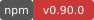</a>
<a href="https://github.com/cardene777/dragon/blob/main/LICENSE"></a>
<a href="https://cardene777.github.io/dragon/">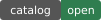</a>
</p>

<picture>
<source media="(prefers-color-scheme: dark)" srcset="https://raw.githubusercontent.com/cardene777/dragon/main/docs/readme/hero-dark.png">
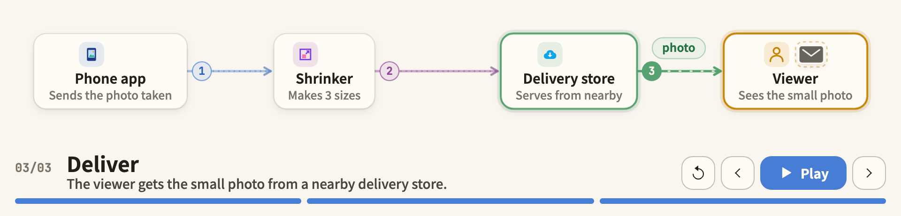
</picture>

dragon turns a short text file into a diagram that plays one step at a time.
The catalog at <https://cardene777.github.io/dragon/> shows every kind of diagram, with an editor that plays what you type.

## Why dragon

| | mermaid | dragon |
|---|---|---|
| What you get | A still picture | A diagram that plays step by step. Lines light up, chips travel, and values change |
| Look | A theme picked per diagram | One table of colors, sizes, and spacing that every kind reads |
| Export | SVG, PNG, and PDF through mermaid-cli | MP4, GIF, HTML, and PNG through `dragon export` |
| Writing with AI | Parse errors when the diagram renders | `dragon check` points to the line and column, and a skill teaches the notation to AI agents |
| On GitHub | Drawn from a `mermaid` code block | Shown as an exported picture, and plays on any page with one script line |

## The idea

dragon builds diagrams out of blocks, the way Lego builds models out of bricks.
Every kind of diagram is assembled from blocks of fixed shapes, so all of them share one look.

| Block | What it is | Examples |
|---|---|---|
| Core blocks | Blocks that two or more diagram kinds share | box (`box`), step (`step`), color, icon |
| Kind blocks | Blocks that only one diagram kind uses | the lifeline of a sequence diagram, the group of an architecture diagram (`group`) |
| Connector blocks | Blocks that join two blocks | the edge (`->`), the merge of a git graph |

A diagram is blocks put together.
A diagram kind only decides how its blocks are laid out and which connections it accepts.
Colors, text sizes, and spacing live in one table that every block reads, so every diagram looks consistent.

You can also add your own blocks in your own project.
Start from a box, a line, or an icon, change its shape and color role, and write it as plain data ([Add your own blocks](https://github.com/cardene777/dragon/blob/main/packages/dragon/README.md#add-your-own-blocks)).
To add a diagram kind or a new base block, open a pull request to this repository or work in a fork.

dragon also aims to be as easy as mermaid to write, and to show the diagram right away.

- Short to write. The diagram kind and one `A -> B: name` line make a diagram, and the names on the lines become boxes.
- One script line. Add one script line and the notation to a page, and the notation becomes a diagram that plays.
- Fast for AI to write. AI writes the same notation as people and fixes the line and column that the parser's error messages point to. JSON stays as the source and converts to and from the notation.
- Light and fast. A page loads only the blocks its diagrams use.

The notation is modeled on mermaid, but it is not compatible with mermaid.
It drops hard-to-read forms such as `-->|text|`, and the first English word of each line says what the line is.

## Install

```sh
npm install @cardenelabs/dragon
```

The package has four parts.

| Part | What it is |
|---|---|
| Source | JSON that holds the kind, title, and steps, plus a field for each block name (`blocks`) (see below). It records a format version, and older versions are converted when read |
| Notation | The dragon notation, where the first English word of each line sets the line's kind (see below). It converts to and from JSON, and names and text can be in any language ([notation guide](https://github.com/cardene777/dragon/blob/main/packages/dragon/examples/quick-start.en.md)) |
| Renderer | Draws the source on a page and plays it one step at a time. It draws sequence, architecture, state, git, time, tree, lineup, and try diagrams |
| Export | The `dragon export` command writes MP4, GIF, HTML, PNG, and SVG from the same source |

## Write diagrams with AI

The dragon skill teaches an AI agent to write diagrams in the dragon notation, check them with `dragon check`, and fix them until the check passes.
In Claude Code, add the GitHub repository cardene777/dragon as a plugin marketplace and install the plugin.

```text
/plugin marketplace add cardene777/dragon
/plugin install dragon@dragon
```

For other AI agents, copy the `plugins/dragon/skills/dragon` directory from the cardene777/dragon repository on GitHub into the folder where the agent loads its skills.
The agent starts from `SKILL.md` and reads only the reference file for the kind of diagram it draws.
The plugin version matches the npm version of `@cardenelabs/dragon`, and the skill checks the installed version with `dragon --version`.

## A first diagram

```dragon
sequence

browser -> app: GET /login
app -> browser: Return the sign-in page
```

A diagram kind plus lines that join boxes with `->` is all a diagram needs.
Each name on a line becomes a box, and each line becomes a step that lights up in the order you wrote it.
Add `box` and `step` lines when a box needs a display name or a caption, or when a step needs a title and a body.

```dragon
sequence Ask to sign in

box browser as User's browser [note: operated by the user, color: slate]
box app as App [note: asks for sign-in, color: blue]

step Press sign in
  say The user presses the app's sign-in button.
  browser -> app: GET /login
```

Paste it into the editor on the catalog to watch it play, or put it on your own page as shown below.

## Diagram kinds

Each picture is the last step of an example in [`packages/dragon/examples`](https://github.com/cardene777/dragon/blob/main/packages/dragon/examples).
Select a kind to read how to write it.

<table>
<tr>
<td align="center" width="33%"><a href="https://github.com/cardene777/dragon/blob/main/packages/dragon/examples/quick-start.en.md#sequence-diagram"><picture><source media="(prefers-color-scheme: dark)" srcset="https://raw.githubusercontent.com/cardene777/dragon/main/docs/readme/kinds/sequence-dark.png">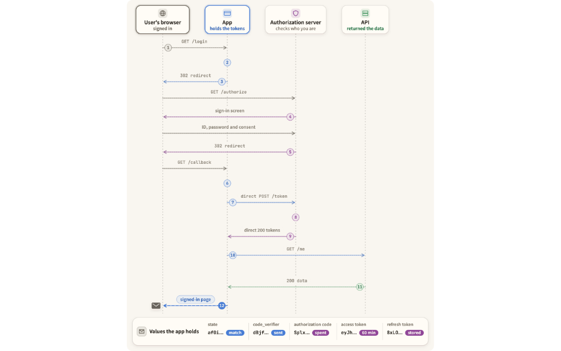</picture><br>Sequence diagram</a></td>
<td align="center" width="33%"><a href="https://github.com/cardene777/dragon/blob/main/packages/dragon/examples/quick-start.en.md#architecture-diagram"><picture><source media="(prefers-color-scheme: dark)" srcset="https://raw.githubusercontent.com/cardene777/dragon/main/docs/readme/kinds/architecture-dark.png">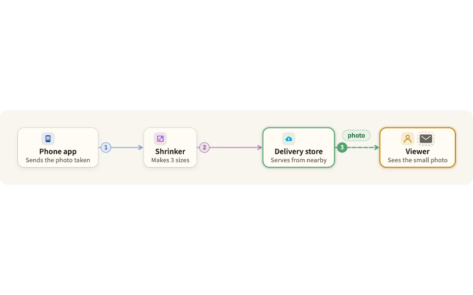</picture><br>Architecture diagram</a></td>
<td align="center" width="33%"><a href="https://github.com/cardene777/dragon/blob/main/packages/dragon/examples/quick-start.en.md#state-diagram"><picture><source media="(prefers-color-scheme: dark)" srcset="https://raw.githubusercontent.com/cardene777/dragon/main/docs/readme/kinds/state-dark.png">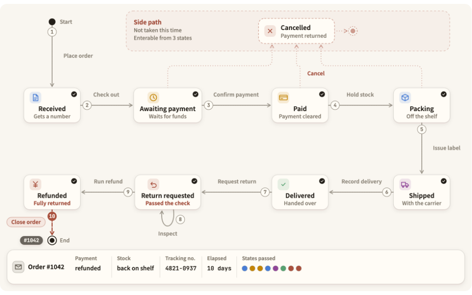</picture><br>State diagram</a></td>
</tr>
<tr>
<td align="center"><a href="https://github.com/cardene777/dragon/blob/main/packages/dragon/examples/quick-start.en.md#git-graph"><picture><source media="(prefers-color-scheme: dark)" srcset="https://raw.githubusercontent.com/cardene777/dragon/main/docs/readme/kinds/git-dark.png">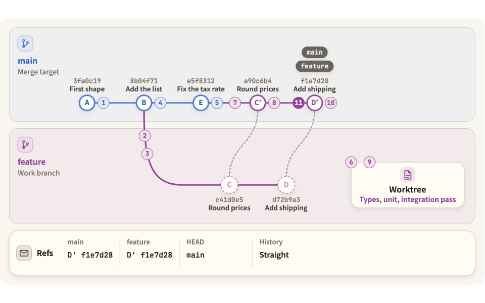</picture><br>Git graph</a></td>
<td align="center"><a href="https://github.com/cardene777/dragon/blob/main/packages/dragon/examples/quick-start.en.md#time-diagram"><picture><source media="(prefers-color-scheme: dark)" srcset="https://raw.githubusercontent.com/cardene777/dragon/main/docs/readme/kinds/time-dark.png">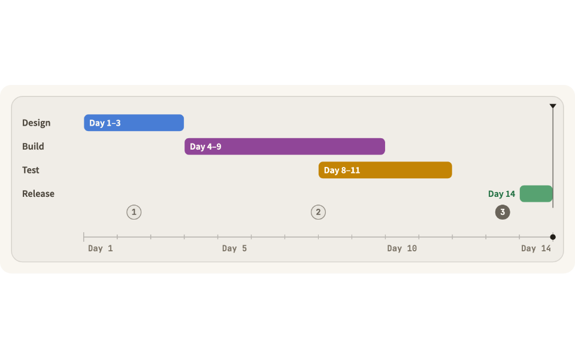</picture><br>Time diagram</a></td>
<td align="center"><a href="https://github.com/cardene777/dragon/blob/main/packages/dragon/examples/quick-start.en.md#tree-diagram"><picture><source media="(prefers-color-scheme: dark)" srcset="https://raw.githubusercontent.com/cardene777/dragon/main/docs/readme/kinds/tree-dark.png">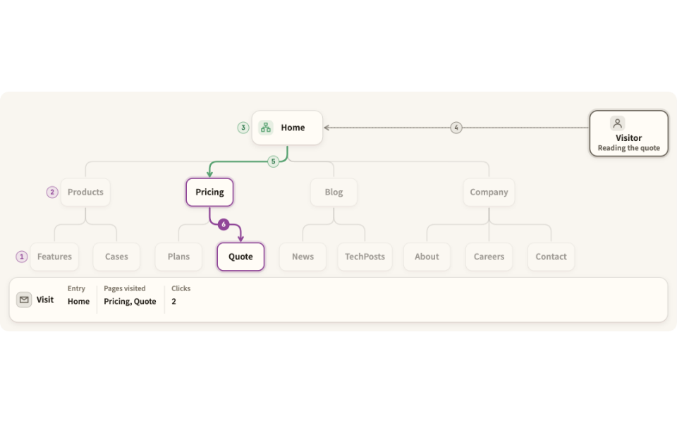</picture><br>Tree diagram</a></td>
</tr>
<tr>
<td align="center"><a href="https://github.com/cardene777/dragon/blob/main/packages/dragon/examples/quick-start.en.md#lineup-diagram"><picture><source media="(prefers-color-scheme: dark)" srcset="https://raw.githubusercontent.com/cardene777/dragon/main/docs/readme/kinds/lineup-dark.png">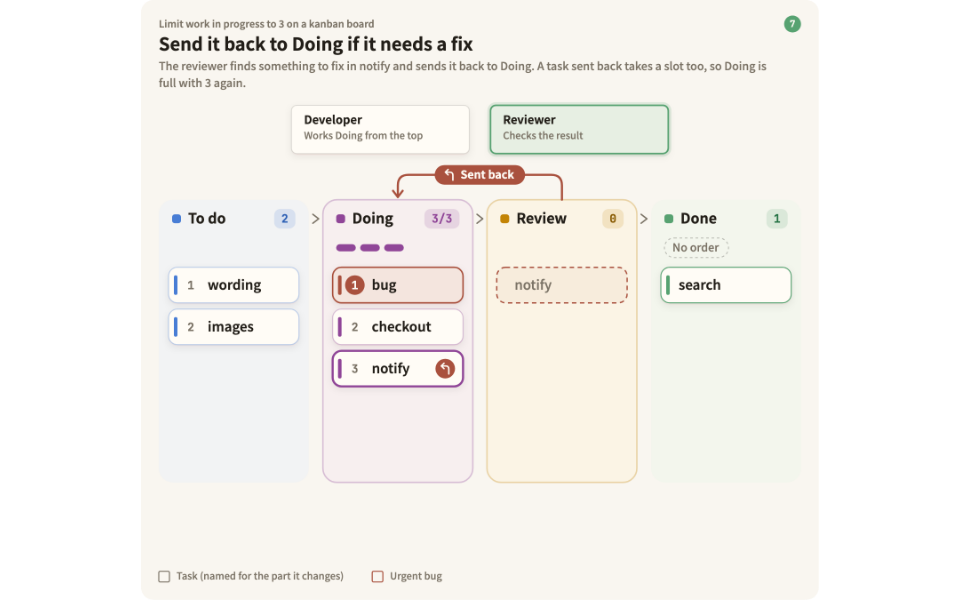</picture><br>Lineup diagram</a></td>
<td align="center"><a href="https://github.com/cardene777/dragon/blob/main/packages/dragon/examples/quick-start.en.md#try-diagram"><picture><source media="(prefers-color-scheme: dark)" srcset="https://raw.githubusercontent.com/cardene777/dragon/main/docs/readme/kinds/try-dark.png">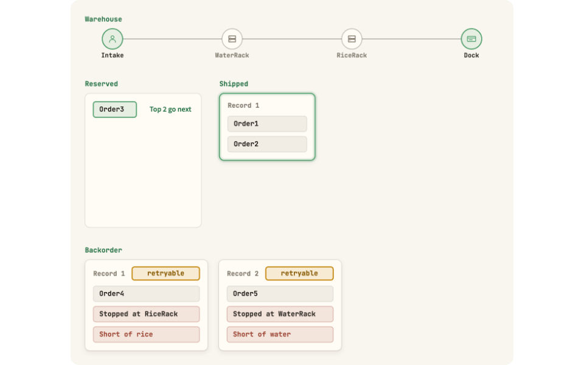</picture><br>Try diagram</a></td>
<td align="center"><a href="https://github.com/cardene777/dragon/blob/main/packages/dragon/examples/quick-start.en.md#pipe-diagram"><picture><source media="(prefers-color-scheme: dark)" srcset="https://raw.githubusercontent.com/cardene777/dragon/main/docs/readme/kinds/pipe-dark.png">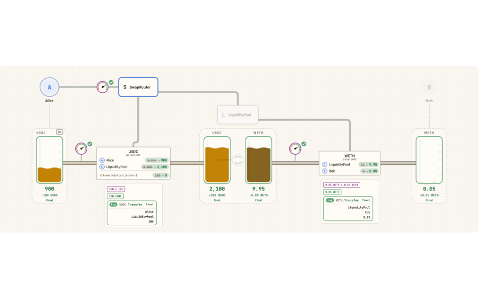</picture><br>Pipe diagram</a></td>
</tr>
<tr>
<td align="center"><a href="https://github.com/cardene777/dragon/blob/main/packages/dragon/examples/quick-start.en.md#chart"><picture><source media="(prefers-color-scheme: dark)" srcset="https://raw.githubusercontent.com/cardene777/dragon/main/docs/readme/kinds/chart-dark.png">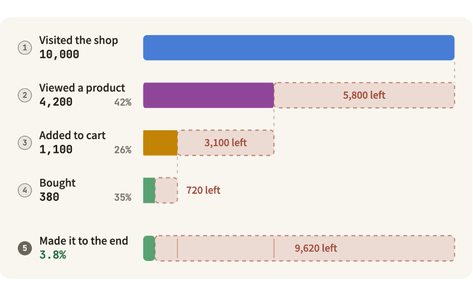</picture><br>Chart</a></td>
<td align="center"><a href="https://github.com/cardene777/dragon/blob/main/packages/dragon/examples/quick-start.en.md#flow-diagram"><picture><source media="(prefers-color-scheme: dark)" srcset="https://raw.githubusercontent.com/cardene777/dragon/main/docs/readme/kinds/flow-dark.png">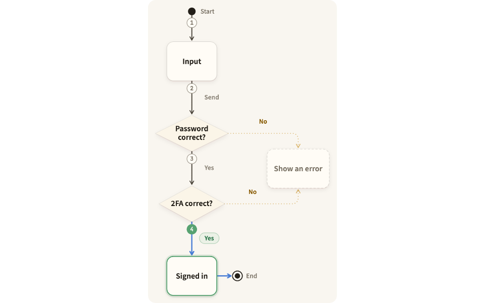</picture><br>Flow diagram</a></td>
<td align="center"><a href="https://github.com/cardene777/dragon/blob/main/packages/dragon/examples/quick-start.en.md#cycle-diagram"><picture><source media="(prefers-color-scheme: dark)" srcset="https://raw.githubusercontent.com/cardene777/dragon/main/docs/readme/kinds/cycle-dark.png">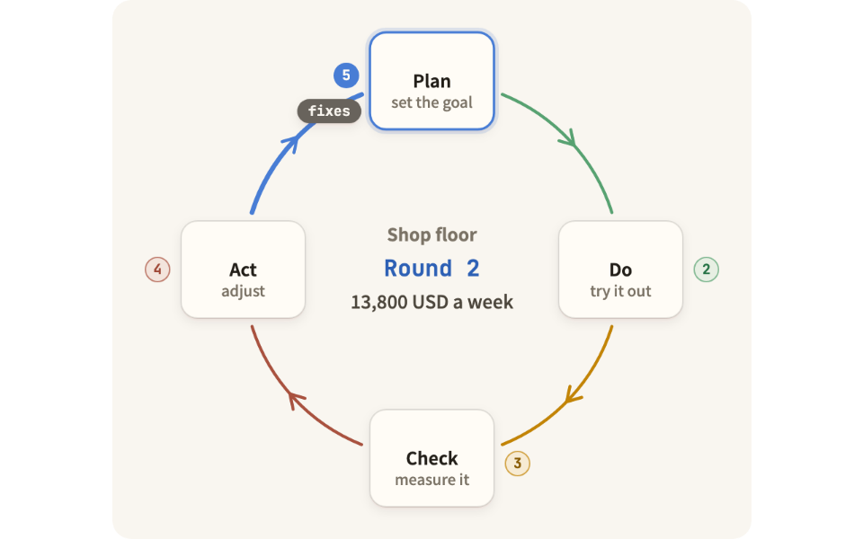</picture><br>Cycle diagram</a></td>
</tr>
<tr>
<td align="center"><a href="https://github.com/cardene777/dragon/blob/main/packages/dragon/examples/quick-start.en.md#mind-map"><picture><source media="(prefers-color-scheme: dark)" srcset="https://raw.githubusercontent.com/cardene777/dragon/main/docs/readme/kinds/mind-dark.png">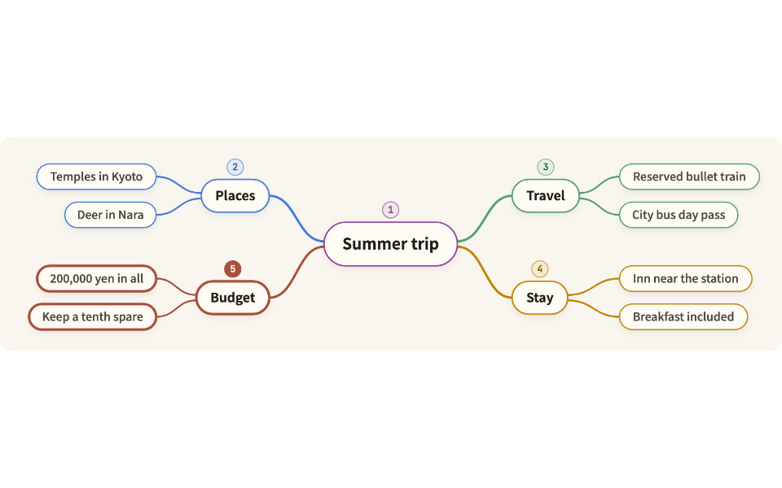</picture><br>Mind map</a></td>
<td align="center"><a href="https://github.com/cardene777/dragon/blob/main/packages/dragon/examples/quick-start.en.md#table-relation-diagram"><picture><source media="(prefers-color-scheme: dark)" srcset="https://raw.githubusercontent.com/cardene777/dragon/main/docs/readme/kinds/er-dark.png">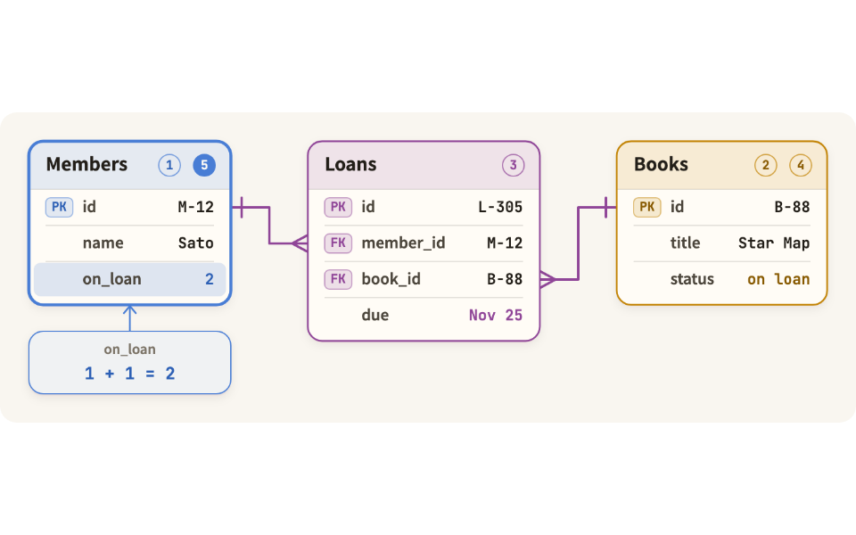</picture><br>Table relation diagram</a></td>
<td align="center"><a href="https://github.com/cardene777/dragon/blob/main/packages/dragon/examples/quick-start.en.md#two-axis-matrix"><picture><source media="(prefers-color-scheme: dark)" srcset="https://raw.githubusercontent.com/cardene777/dragon/main/docs/readme/kinds/matrix-dark.png">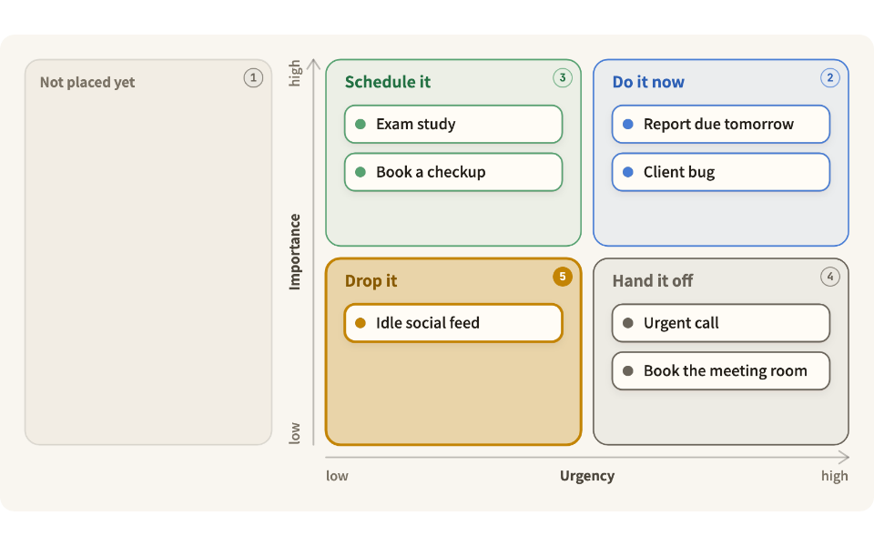</picture><br>Two-axis matrix</a></td>
</tr>
<tr>
<td align="center"><a href="https://github.com/cardene777/dragon/blob/main/packages/dragon/examples/quick-start.en.md#set-overlap-diagram"><picture><source media="(prefers-color-scheme: dark)" srcset="https://raw.githubusercontent.com/cardene777/dragon/main/docs/readme/kinds/venn-dark.png">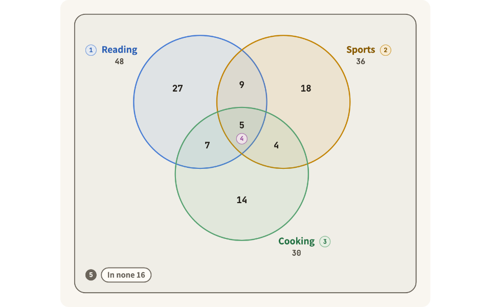</picture><br>Set overlap diagram</a></td>
<td align="center"><a href="https://github.com/cardene777/dragon/blob/main/packages/dragon/examples/quick-start.en.md#sankey-diagram"><picture><source media="(prefers-color-scheme: dark)" srcset="https://raw.githubusercontent.com/cardene777/dragon/main/docs/readme/kinds/sankey-dark.png">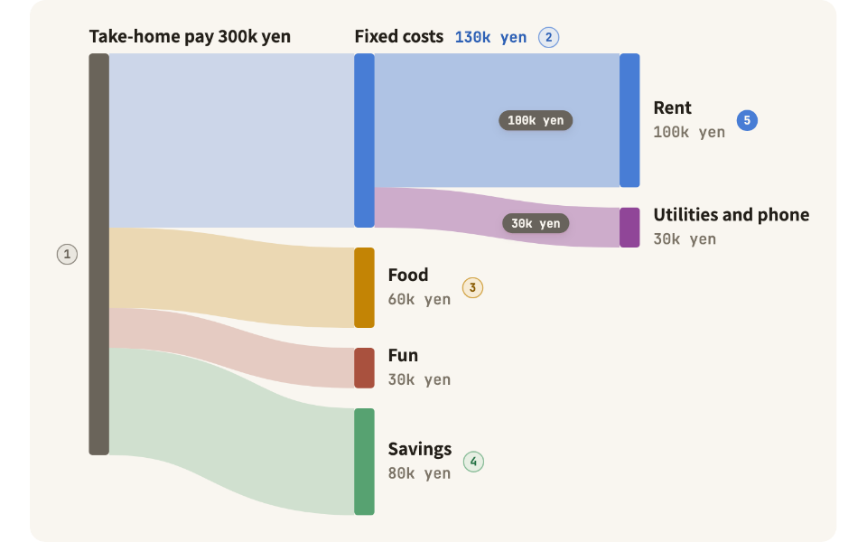</picture><br>Sankey diagram</a></td>
<td align="center"><a href="https://github.com/cardene777/dragon/blob/main/packages/dragon/examples/quick-start.en.md#owner-card-diagram"><picture><source media="(prefers-color-scheme: dark)" srcset="https://raw.githubusercontent.com/cardene777/dragon/main/docs/readme/kinds/cards-dark.png">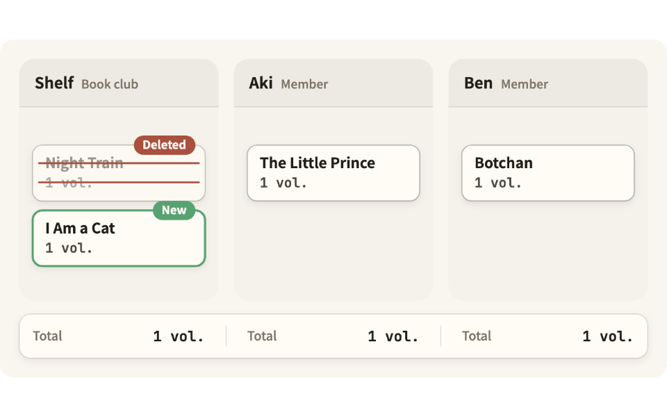</picture><br>Owner card diagram</a></td>
</tr>
<tr>
<td align="center"><a href="https://github.com/cardene777/dragon/blob/main/packages/dragon/examples/quick-start.en.md#checkout-diagram">Checkout diagram</a><br>A purchase model the reader can change</td>
</tr>
<tr>
<td align="center"><a href="https://github.com/cardene777/dragon/blob/main/packages/dragon/examples/quick-start.en.md#judge-table">Judge table</a><br>A table that checks each case against the rules</td>
</tr>
</table>

## Show it with one script line

Add one script line to any HTML page and write the notation in a `<pre class="dragon">` block.
The block turns into a diagram that plays.
There is nothing to install or build.

```html
<script type="module" src="https://cdn.jsdelivr.net/npm/@cardenelabs/dragon@0.83/dist/cdn/dragon.js"></script>

<pre class="dragon">
sequence Ask to sign in

box browser as User's browser
box app as App

step Press sign in
  say The user presses the app's sign-in button.
  browser -> app: GET /login
</pre>
```

The script loads from jsDelivr, with the URL pinned to the minor version.
Later patch releases with fixes reach the page, but a release that changes the notation does not.
It loads the `sequence` renderer up front.
It loads the renderer for any other kind, `architecture` included, only when a block on the page uses that kind.
It adds one `<link>` to the page that loads the CSS for the two bundled fonts from jsDelivr.
It draws every block on the page once the page has loaded.
It does not watch for blocks added later.
A block that has no width at that point, such as one in a tab hidden with `display: none`, is drawn when it first gets a width.
When the page is printed, such a block is drawn before printing.
Indentation shared by every line of a block is removed before parsing.
Write `<` in the notation as `&lt;`.
A block whose notation has an error is not drawn, and its error messages appear in its place (`<pre class="dragon-error">`).
Diagram text and error messages are in Japanese when the page's `lang` starts with `ja`, and in English otherwise.
When the page is printed, the player bar and the buttons of the bar above a diagram, which cannot be pressed on paper, are left out.
A diagram with steps prints the still of every step in order, each with its step number, title, and `say` text below it.

To make a file that works offline, run `dragon embed` on the page.
It replaces the script line with the bundled script, which contains every diagram kind, and writes `page.offline.html` next to the page (`--out <file>` sets the file).
The file fetches nothing from the network.
It does not embed the bundled fonts, so it uses the device's sans-serif fonts, which come after the bundled fonts in the font list.
The Export menu on a `data-header` block's bar saves the same seven formats as the jsDelivr page (PNG, SVG, HTML, GIF, MP4, notation, and JSON) without fetching anything.
The HTML it saves also uses the device's sans-serif fonts, like the embedded page.

```sh
dragon embed page.html
```

### A still figure

To show only the last step as a single picture, for example in a report or an explainer, add `data-still` to the block.

```html
<pre class="dragon" data-still>
chart Sales by product in thousands of yen [shape: bar]

item croissant as Croissant
item melon as Melon bun

step This week
  set croissant: 129
  set melon: 82
</pre>
```

A `data-still` block gets no player: no buttons, step number, step title and text, or progress bar.
It is replaced by an SVG of the last step (`<div class="dragon-figure dragon-still">`).
A chart draws its values and shows the diagram title where the step title would be.
A flow diagram draws every line its steps passed through as a solid line.
Its font list puts the device's sans-serif fonts after the bundled fonts, so a page that does not load the bundled fonts never shows a serif font.
It uses the `clear` palette by default, which suits a white page.
It turns dark when the page's `<html>` has `data-theme="dark"`.
It also turns dark when the device prefers a dark color scheme and the page does not set `data-theme="light"`.
To give the figure your page's own color, set `--dragon-figure-background` on the figure or an ancestor, for example `.card { --dragon-figure-background: var(--surface); }`.
The background, the outlines around lines, and the plates behind labels then use that color on both light and dark pages.
A donut chart wraps a center label onto two lines when it does not fit inside the ring.
A step band (`cycle` with `[shape: band]`) writes each step name inside its chevron.
The figure never grows past its own width, and it shrinks to fit a narrower frame while keeping its aspect ratio.

If every block on a page is still, `dragon embed` draws them as SVGs in place and adds no bundled script.
If the page also has moving blocks, it draws only the still blocks as SVGs and adds the bundled script for the rest.
From the package, pass `figure: true` to `renderDiagram` to get the same SVG.

### A diagram paused on one step

To place a diagram paused on one step, add `data-step` with the step number, counting from 1 as the step bar does.

```html
<pre class="dragon" data-step="2">
sequence Order

box shop as Shop
box bank as Bank

step Ask
  shop -> bank: payment

step Pay
  bank -> shop: paid

step Close
  shop -> bank: closed
</pre>
```

The block does not play when it is placed and waits on the still of step 2.
In sequence, architecture, state, and flow diagrams, lines of earlier steps keep their labels in faint gray.
The reader sees the flow up to that step in one picture.
The reader can still play the diagram or move between steps with the bar.
A number larger than the step count pauses on the last step.
A value that is not a whole number from 1 turns the block into an error message.
A block with both `data-still` and `data-step` uses `data-still`.

## Write a page from Markdown

`dragon export notes.md` reads a Markdown file and writes one HTML page, `notes.html`, next to it (`--out <dir>` sets the folder).
The page contains the file's prose, tables, and `dragon` code blocks, and it turns the headings into pages and tabs.
To do the same from code, call `exportPage(file, { outDir, lang })` from `@cardenelabs/dragon/node`.

| Heading | Becomes |
|---|---|
| `#` | The page title |
| Text before the first `##` | The entry, the first thing the page shows |
| `##` | A group of items |
| `###` | An item, which has its own page |
| `####` | A tab, in the entry and in an item page |
| `#####` | A tab inside a tab |

The default layout shows the entry with one card per item, grouped by `##`.
Clicking a card opens the item's page without a reload.
An item page links back to the entry and to the previous and next items.
To choose another layout, add a `layout` line between `---` lines at the top of the file.
`layout: sidebar` keeps a table of contents on the left.
`layout: tabs` puts the groups in tabs along the top, with each group's items in tabs below them.
`layout: guide` makes a guide page that answers questions, as [Guide page](#guide-page) shows.
`layout: entry` is the default.

The lines between `---` can also set the bar's button order with `header-buttons` and its colors with `header-<color field>`, one line per setting.
`header-buttons` lists button names (`code`, `editor`, `copy`, `export`, `expand`) separated by `,`, in the order to show them.
Buttons you leave out are dropped.
The color fields are `surface`, `background`, `foreground`, `muted`, `border`, `accent`, and `hover`.
Put a color value that starts with `#` in quotes (`"`).
The export writes these lines into the page's bar settings block (`<script type="application/json" id="dragon-header">`; see [One script line with the bar](#one-script-line-with-the-bar)).
That block applies to the bar of every diagram on the page.
An unknown button name, a duplicate button, a color value with `;` or `<`, or an unknown `header-` line stops the export, and the error names the line.

A `note: pop` line shows the box notes of every diagram on the page on cards that open on a click ([Note cards](https://github.com/cardene777/dragon/blob/main/packages/dragon/examples/quick-start.en.md#note-cards)).
A diagram with `[note: under]` on its first line keeps its notes under the names.
On such a page, a box of a diagram with nothing about `note` on its first line can also take `example`.
`note: under` is the same as leaving the line out, and another value stops the export with the line named.

```md
---
layout: tabs
header-buttons: code, export
header-accent: "#c0392b"
note: pop
---
```

A box in a diagram opens an item when its link points to that item's place, written `[link: #<place>]`.
A place comes from the heading text, the same way GitHub makes heading anchors.
Letters become lowercase, punctuation is dropped, and spaces become `-`, so `### Take the order` becomes `#take-the-order`.
`#<item>/<tab>` opens a tab inside an item, and the page URL keeps track of the open item and tab.
A link to a place that does not exist on the page stops the export.

A line that contains only `` inserts that file into the page.
A `.md` file goes in as Markdown, a `.dragon` file as a diagram, and any other text file as a code block named `name`.
An image file is shown as an image.
Only files in the Markdown file's folder or its subfolders are read.
A line that points outside that folder stops the export.

Raw HTML in the Markdown is shown as text and never runs.
The words the page adds itself are in Japanese when the text has kana or kanji, and in English otherwise.
Use `--lang ja` or `--lang en` to choose.
The page draws its diagrams with the jsDelivr script line, so run `dragon embed` on it to get a file that works offline.
A notation error in a diagram, an unknown `layout`, or a `###` before the first `##` stops the export, and the error names the file and line.
Page export accepts only `--out` and `--lang`, and rejects diagram options such as `--fps`.

The worked example in [`examples/page/`](https://github.com/cardene777/dragon/blob/main/packages/dragon/examples/page/page.en.md) uses every rule above.

````md
---
layout: entry
---

# From order to delivery

How a shop takes an order and delivers the goods.

#### Overview diagram

```dragon
architecture From order to delivery
box web as Order screen [link: #take-the-order]
box pay as Payment system [link: #take-the-payment]
step Pay
  web -> pay: Order
```

## Intake

### Take the order

#### Result

Took 12 orders.

#### Full output


## Payment

### Take the payment

#### How it works


````

```sh
dragon export notes.md
dragon embed notes.html
```

### Guide page

`layout: guide` turns each `##` into a topic and each `###` into a numbered question section, and stacks every topic on one page.
Each section is numbered `<topic>-<question>`, such as `2-1` for the first question of the second topic.
A menu on the left lists every topic and its questions, made from the `##` and `###` titles, and stays on screen while the page scrolls.
The menu marks the question being read, and clicking a question scrolls to its section.
On a phone, the menu folds above the text behind a button.
A `###` title can end with `[menu: <short name>]`.
The menu then shows the short name, and the section keeps the whole question as its title.
`[menu: ]` with no name stops the export with the line named.
A ```` ```dragon ```` figure before the first `##` becomes the overview at the top of the page.
Text written before the figure stays above it, and text written after the figure is shown under it inside the overview.
The topics follow it in the order they are written.
A quote (`>`) right after a `###` title is shown under the title as the one-sentence answer.
Other quotes stay quotes.
A `<details>` block with a `<summary>` line becomes a check question.
Its answer stays hidden until the button is clicked, and a second click hides it again.
Other raw HTML is still shown as text.

Write the terms in a Markdown file of their own, such as `glossary.md`.
Each `###` heading is a term, the paragraph after it is the meaning, and a quote after that is an example.
A `` line before the first `##` loads the file and adds a topic named `Terms` at the end of the page, with one card per term.
In the text, a link such as `[order](glossary.md#order)` is underlined.
Clicking it opens a card just below it with the term, its meaning, and a gray example band.
The card closes on a click outside it, on its close icon, or on the term again.
A term written twice, or a link to a term the file does not have, stops the export with the file and line named.
When the page is printed, the menu is left out and the sections of every topic follow in written order.
Each topic after the first starts on a new sheet, with its name at the top.
Every term card and check answer is drawn open, and box cards are listed below their diagram with their box names instead of over it.
The worked example is in [`examples/guide/`](https://github.com/cardene777/dragon/blob/main/packages/dragon/examples/guide/guide.en.md).

````md
---
layout: guide
note: pop
---

# From order to delivery


## Take the order

### Which orders does the shop take?

> The shop takes an [order](glossary.md#order) only when every item is in stock.

<details>
<summary>What happens to an order with one item out of stock?</summary>

The shop turns it down.

</details>
````

```md
### Order

The items a user picks and the address to send them to.

> Three apples to a house in Tokyo
```

## Write the diagram in HTML

When a report is one HTML file, its diagrams can be written in HTML too.
Each notation line becomes one element, and the same script line as a `<pre class="dragon">` block draws it where it stands, with the same bar and steps.

| Notation line | HTML element |
|---|---|
| The first line (`sequence Take an order`) | `<dg-` and the diagram kind. `<dg-sequence title="Take an order">` wraps the whole diagram |
| A declaration line (`box shop as Shop`) | The element named after its block, `<dg-box id="shop">Shop</dg-box>` |
| `step Place the order` | `<dg-step title="Place the order">`, which holds the lines of the step |
| `say` | `<dg-body>` |
| A line inside a step (`shop -> api: Send the order`) | `<dg-edge from="shop" to="api">Send the order</dg-edge>` |

The element and attribute names come from the field names of the source JSON.
Words and numbers are attributes, and a box name or a line label is the element text.
A field that holds one small object is a hyphenated attribute (`carry-kind="coin"`), and a field name with capitals becomes a lowercase attribute joined by `-` (`labelSide` is `label-side`).
A new notation word gets its element with the next release, so `dragon convert diagram.dragon` shows the HTML form of any diagram.
HTML does not close `<dg-box/>`, so close every element with its end tag.

```html
<script type="module" src="https://cdn.jsdelivr.net/npm/@cardenelabs/dragon@0.83/dist/cdn/dragon.js"></script>

<dg-sequence title="Take an order">
  <dg-box id="shop">Shop</dg-box>
  <dg-box id="api">Order API</dg-box>

  <dg-step title="Place the order">
    <dg-body>The shop sends the order to the API.</dg-body>
    <dg-edge from="shop" to="api">Send the order</dg-edge>
  </dg-step>
</dg-sequence>
```

`<pre class="dragon">` blocks on the same page still work.
`class`, `style`, and attributes starting with `data-` on a diagram element are left to the page and are not read into the diagram.

A Markdown page for `dragon export` converts to one HTML page in `<dragon-page>`.
The front matter becomes its attributes, and `##` and `###` become `<section>` with the heading.
A quote becomes `<blockquote>`, `<details>` stays `<details>`, and a glossary link becomes `<a>`.
A `dragon` code block becomes the HTML form of the diagram.
Guide pages (`layout: guide`) convert too.
A guide page with one question converts to this.

```html
<dragon-page layout="guide">
  <h1>From order to delivery</h1>
  <section>
    <h2>Take the order</h2>
    <section>
      <h3>Which orders does the shop take?</h3>
      <blockquote>
        <p>The shop takes an <a href="glossary.md#order">order</a> only when every item is in stock.</p>
      </blockquote>
      <details>
        <summary>What happens to an order with one item out of stock?</summary>
        <p>The shop turns it down.</p>
      </details>
    </section>
  </section>
</dragon-page>
```

| Command | What it does |
|---|---|
| `dragon convert diagram.dragon` | Prints the HTML form of the diagram |
| `dragon convert page.md` | Prints the `<dragon-page>` HTML page |
| `dragon convert page.html` | Prints the notation of the first `<dg-...>` diagram, or the Markdown page of a `<dragon-page>` |
| `dragon check page.html` | Checks every `<dg-...>` diagram and `<pre class="dragon">` block, and names the HTML line and element of each error. `--layout` works too |

Add `--out <file>` to write a file instead.
Converting back gives tidied notation with the same source JSON, so blank lines and indentation are not kept.
From code, `notationToHtml`, `htmlToNotation`, `htmlToDiagram`, `diagramToHtml`, `markdownToHtml`, and `htmlToMarkdown` from `@cardenelabs/dragon` do the same.

## Put it on a page

Import the font entry `@cardenelabs/dragon/fonts` once on the page, then parse the notation and pass the result to `mountDiagram`.

```ts
import "@cardenelabs/dragon/fonts";
import { mountDiagram, parseNotation } from "@cardenelabs/dragon";

const source = await (await fetch("login.dragon")).text();
const parsed = parseNotation(source);
if (!parsed.ok) throw new Error(parsed.errors.map((e) => `${e.line}: ${e.message}`).join("\n"));

const host = document.getElementById("figure");
if (host === null) throw new Error("#figure not found");
const player = mountDiagram(host, parsed.diagram);
```

The font entry only loads the CSS for the two bundled fonts (Noto Sans JP and JetBrains Mono) and exports nothing.
dragon lays out diagrams using character widths measured from the bundled fonts.
Without the font entry, diagrams use the device's sans-serif fonts listed after the bundled fonts, and text can be a few pixels wider than measured.
Your bundler (Vite, for example) ships the CSS and font files with the page.
The entry does not import any Node built-in modules, so it also works with bundlers such as Next.js Turbopack.
The player's own text, such as the screen reader names of its buttons and the overview label, is in English.
For Japanese, pass `{ lang: "ja" }` to `mountDiagram` as the third argument, and to `parseNotation` for its error messages.
`migrateFile` upgrades a source file to the current format version.
It comes from the Node-only entry `@cardenelabs/dragon/node`.

Use the `player` that `mountDiagram` returns to control the diagram (`next`, `prev`, `play`, `pause`, `destroy`).
The third argument takes settings (`PlayerOptions`), such as the palette and a callback for step changes.
To show a diagram paused on one step, pass that step's number (counting from 0) as `pausedAt`.
To play it once and stop on the last step, pass `playOnce: true`.
`still: true` stops on the last step and does not move.
It shows every step's line labels and box actions as strongly as the last step's.
Readers who never play the diagram still see the whole flow in one picture.
`renderDiagram` also takes `still`.
Without any of these, the diagram starts playing as soon as it is placed and loops through every step.

To change the playback speed, pass a multiplier as `speed`, or call `setSpeed` on the `player` later.
For example, `speed: 2` plays the steps in half the time.
The motion, the step label, and `onStep` all follow this speed.
Changing it during playback continues from the current point.
`speed` and `setSpeed` take a finite number greater than 0 and throw a `RangeError` for anything else.

In a frame narrower than 600px, a pipe diagram starts scaled to fit the frame width, so its box names look small.
Pass `zoom: "readable"` to start zoomed in, so box names are readable (10.5px or larger on screen).
The frame grows to the zoomed diagram's height, and the diagram pans sideways.
As the steps advance, the view pans to the parties in each step.
The zoom-out button returns to the fitted view.
The setting affects only pipe diagrams in frames narrower than 600px.
Wider frames and other kinds draw as usual.

Pick a color set by name with `palette`.
To override single colors for the current `theme`, pass color variable names and values in `colors`.
The keys are the palette's color names (`bg`, `surf`, `ink`, `line`, `c-green`, `t-green`, and so on; the type is `ColorName`).
Colors you leave out keep the palette's values.
The diagram, the overview shown while following, and the buttons and step bar all use these colors.
`renderDiagram` takes the same `colors`.

```ts
mountDiagram(host, parsed.diagram, {
  palette: "night",
  colors: { bg: "#0a0f0a", surf: "#101810", ink: "#39ff14", line: "#1f9a0b", "c-green": "#39ff14" },
});
```

A name the palette does not have is rejected, and so is a value that is not a valid color (one containing `;`, `"`, `<`, and so on).
The error names it, and nothing is drawn.

Pass `line: "pen"` to draw box edges, lines, arrows, and rings as gently wobbling, hand-drawn pen lines.
Icons, text, and the diagram frame do not change.
Line ends, bends, and sharp corners stay in place, and a given diagram wobbles the same way every time it is drawn.
The default `line: "ruler"` draws straight lines, and `renderDiagram` and `captureHtml` take the same `line`.

To use your own wording in a pipe diagram, pass `words.pipe`.
`tags` replaces the words under the tank amounts (`provisional`, `final`, `rolled`).
`io` replaces the labels on the sender's and receiver's tanks (`in`, `out`).
`fold`, `open`, and `foldTitle` replace the text of a folded box, its "click to open" line, and the title of the folded step.
In `fold`, `{steps}` and `{parties}` become the number of inner steps and parties.
In `foldTitle`, `{name}` becomes the name of the called party.
You can pass just some of the words; the rest keep the defaults for `lang`.
`renderDiagram` takes the same `words`.

```ts
mountDiagram(host, parsed.diagram, {
  words: { pipe: { tags: { final: "Success", rolled: "Reverted" }, fold: "{steps} inner steps" } },
});
```

## Embed it in other tools

Tools and services can embed a diagram with its bar (Code, Editor, Copy, Export, and expand) in their pages in four ways.
All four draw the same diagram from the same notation, and the player's step controls stay under the diagram.
The embedding page in the gallery shows all four side by side, using the same diagram.

### One script line with the bar

Add `data-header` to a `<pre class="dragon">` block, and the one-line script adds the bar to that block.
Blocks without the attribute stay plain diagrams.
The script loads the bar only on pages that have `data-header` blocks.
It loads the bar together with the parts the notation uses, and draws the diagram once, inside the bar.
A block stays as notation until the bar arrives, and the script never draws a plain diagram first and then redraws it.
Pages without `data-header` never load the bar, so they load nothing extra.

To set the bar's button order and look, add a bar settings block to the page: `<script type="application/json" id="dragon-header">`.
Its keys are `buttons` and `look`, as in the SDK's `mountDragon`.
It applies to the bar of every `data-header` block on the page.
For example, `{ "buttons": ["code", "export"], "look": { "colors": { "accent": "#c0392b" } } }` shows only the code and export buttons and uses red as the accent.
`buttons` accepts only the names of the five built-in buttons.
Custom buttons need a click handler, so they cannot go here.
If the settings block is not valid JSON or names an unknown button, every `data-header` block shows that error instead.

```html
<script type="module" src="https://cdn.jsdelivr.net/npm/@cardenelabs/dragon@0.83/dist/cdn/dragon.js"></script>

<pre class="dragon" data-header>
sequence Take an order
box shop as Shop
box api as Order API
step Place the order
  shop -> api: Send the order
</pre>
```

### Find the box that was pressed

Every drawn box and group carries its notation id in `data-node`.
For example, `box api as API server` draws an element with `data-node="api"`.
To react when someone presses a box, read the id from the pressed element with `closest('[data-node]')`.
Pressing a box inside a group returns the box, not the group.
Lines and labels carry no id.

```html
<script>
document.addEventListener("click", (event) => {
  const node = event.target.closest('[data-node]');
  if (node) showNote(node.getAttribute("data-node"));
});
</script>
```

### The SDK function

`mountDragon(host, source, options)` from `@cardenelabs/dragon/embed` places a diagram with its bar in an element and returns the placed diagram.

```ts
import { mountDragon } from "@cardenelabs/dragon/embed";

const source = await (await fetch("order.dragon")).text();
const host = document.getElementById("figure");
if (host === null) throw new Error("#figure not found");
const embed = mountDragon(host, source, {
  lang: "en",
  look: { colors: { accent: "#2563eb" }, radius: "6px", frame: { border: "1px solid #e5e7eb" } },
  buttons: ["code", "copy", "export", { id: "log", label: "Log", onClick: (placed) => console.log(placed.source) }],
});
host.addEventListener("dragon-export", (event) => console.log(event.detail.format));
```

`look` matches the bar to your page.
It sets the bar colors (`colors`), font (`font`), font size (`fontSize`), button corners (`radius`) and height (`height`), and the border and background of the frame around the diagram (`frame`).
`buttons` lists the bar buttons in order, and built-in buttons you leave out are dropped.
An object in the list adds a custom button, and its `onClick` receives the placed diagram.
Set `header` to `false` to place the diagram without the bar.
The returned object can still export (`export`), open the editor (`openEditor`), and copy (`copy`).
`lang` sets the bar language (`ja` or `en`).
Without it, the bar follows the nearest `lang` attribute above the element, or falls back to English.
Notation errors use the same language as the bar, so they are in Japanese on a `<html lang="ja">` page.
`nonce` is set on the style element that dragon creates for browsers without `adoptedStyleSheets`.
The element fires four events with `bubbles` and `composed`: `dragon-render` (drawn or not), `dragon-step` (the step changed), `dragon-export` (exported), and `dragon-share` (opened the editor or copied).

### The Web Component

`defineDragonElement()` registers `<dragon-diagram>`.
The element reads the notation from its text and renders a diagram with the bar in its shadow root.
`header="false"` removes the bar, and `nonce` passes on the setting of the same name.
The element follows the nearest `lang` attribute above it.
It redraws when its attributes or text change, and removes the diagram when it is taken off the page.
The four events reach the page outside the element.
React and other frameworks can use the element as is.

```html
<script type="module">
  import { defineDragonElement } from "@cardenelabs/dragon/embed";
  defineDragonElement();
</script>

<dragon-diagram>
  sequence Take an order
  box shop as Shop
  box api as Order API
  step Place the order
    shop -> api: Send the order
</dragon-diagram>
```

### An iframe

If your page cannot run the package, load the gallery's embed page in an iframe.
`embedUrl(source, { lang })` returns the embed page URL with the notation packed after the `#`.
Browsers do not send that part of the URL to the server.
The embed page sends the same four events to your page with `postMessage` as `{ source: "dragon", type, detail }`.
Allow `clipboard-write` so the Copy button works inside the iframe.

```html
<iframe id="figure" title="Take an order" allow="clipboard-write" style="width: 100%; height: 560px; border: 0"></iframe>

<script type="module">
  import { embedUrl } from "@cardenelabs/dragon";

  const source = await (await fetch("order.dragon")).text();
  const frame = document.getElementById("figure");
  frame.src = await embedUrl(source, { lang: "en" });
  addEventListener("message", (event) => {
    if (event.source !== frame.contentWindow || event.data?.source !== "dragon") return;
    console.log(event.data.type, event.data.detail);
  });
</script>
```

## Load diagram kinds on demand

To keep a page's initial load small, import from `@cardenelabs/dragon/light`.
It exports the same functions as the default entry.
It leaves out the renderers for `chart`, `cycle`, `er`, `flow`, `git`, `lineup`, `matrix`, `mind`, `pipe`, `state`, `time`, `tree`, `try`, `venn`, `sankey`, and `cards`.
It also leaves out the blocks that only those kinds use.
Before reading a diagram, await `loadFor` with its notation or JSON.
It loads only that kind's renderer and the blocks the diagram uses.
A diagram parsed from notation with `parseNotation` skips the schema check when drawn, so a page that draws notation never loads the check.
When you pass JSON, `loadFor` also loads the schema check.
Reading or drawing JSON before that fails with an error that tells you to await `loadFor`.
After that, the same functions as in the default entry read, draw, and print the diagram without waiting.

```ts
import { loadFor, mountDiagram, parseNotation } from "@cardenelabs/dragon/light";

await loadFor(text);
const parsed = parseNotation(text);
if (parsed.ok) mountDiagram(host, parsed.diagram);
```

To load a kind ahead of time, await `loadKind` with the kind's name.
It loads the kind's renderer, every block of that kind, and the schema check.
To read a diagram's title and kind without drawing it, await `loadReadings`.
It loads only the blocks, not the renderer.
`diagramKind` returns the kind of a notation or JSON before you read it.
`definesBlocks` tells whether a notation has block definitions, which need `loadReadings` or `loadFor` before you read it.
Drawing a kind that is not loaded fails with an error that names the kind.
Reading a line of a block that is not loaded fails with an error that names the block.
If loading fails, `loadFor` and `loadKind` reject, and the next call tries again.
`sequence`, `architecture`, and their blocks are included from the start, so their notation reads and draws without loading anything.
The one exception is the pipe look of a sequence diagram (`[shape: pipe]`).
`loadFor` loads it, or you can await `loadLook("pipe")` to load it ahead of time.
Drawing it before then fails with an error that tells you to await `loadLook`.
Using the light entry and the default entry on the same page loads every kind's renderer.

To put a diagram with the bar on a page that uses the light entry, import from `@cardenelabs/dragon/light/frame` instead of `@cardenelabs/dragon/frame`.
It exports the same names as `@cardenelabs/dragon/frame` (`mountFramedDiagram`, `createDragonFrame`, `createFigureHeader`, `diagramEditorUrl`).
It reads the notation and draws the diagram with the light entry, so the default entry stays off the page.
After `loadFor`, it places the diagram with its bar without waiting.
Notation of a kind that is not loaded fails with an error that names the kind and tells you to await `loadFor`.
In that case, the element gets no bar.

```ts
import { loadFor } from "@cardenelabs/dragon/light";
import { mountFramedDiagram } from "@cardenelabs/dragon/light/frame";

await loadFor(text);
mountFramedDiagram(host, text);
```

## Add your own blocks

You can add your own blocks to your project.
Base each one on a box, a line, or an icon, and change its shape and color role.
A new block keeps the placement, motion, and diagram kinds of the block it is based on.
It reads its colors from the palette table, so it looks like every other block.

Write definitions after a `blocks 1` line, each one running from `block +<name>` to `end`.
Start the name with `+`.
That way, if dragon later adds a block with the same name, your diagrams keep their meaning.

```text
architecture Across the bridge

blocks 1
block +bridge
  base box
  shape path "M 0 70 Q 50 0 100 70 Z"
  color violet
end
block +wire
  base edge
  shape dashed
  color amber
end

box eth as Ethereum
+bridge cc as CCIP
box base as Base

step Send
  say The token goes to the bridge.
  eth -> cc: send

step Hand over
  say The bridge hands the token over.
  cc +wire base: hand over
```

| Base (`base`) | How to write it | Shape (`shape`) | Color (`color`) |
|---|---|---|---|
| `box` | Write `+<name>` in place of `box` on a box line | `round` / `circle` / `cylinder` / `diamond` / `hexagon`, or `path "…"`, whose outline is stretched to fill the box | A color role |
| `edge` | Write `+<name>` in place of `->` on a line | `solid` / `dashed` / `dotted` | A color role |
| `icon` | Write `[icon: +<name>]` on a box line | `path "…"` drawn in a 20 by 20 square centered on (0, 0) | The color of its box |

A definition based on `box` can also give its boxes an icon with a line such as `icon key` or `icon tabler:building-bridge-2`.
It accepts the same names as `icon:` on a box line.
An icon written on the box line overrides the definition's icon.

A definition based on `icon` can use colored shapes, written as `paint <color> "<path>"` lines, instead of a one-color `path`.
Write the original SVG's view box as `view <x> <y> <width> <height>`.
dragon scales the icon to fit the 20 by 20 icon square and fills each shape with the color written for it.
Write a color as `#` followed by 3 or 6 hex digits.
Put `evenodd` after the color to fill a shape with the even-odd rule.
A colored icon works on boxes in every diagram kind that supports icons.

```text
blocks 1
block +phone
  base icon
  view 0 0 24 24
  paint #1E3A8A "M7 2h10a2 2 0 0 1 2 2v16a2 2 0 0 1 -2 2h-10a2 2 0 0 1 -2 -2v-16a2 2 0 0 1 2 -2z"
  paint #BFDBFE "M7 5h10v12h-10z"
end
```

`dragon icon <file.svg>` converts a colored SVG into definition lines in this form.
`--name +<name>` sets the definition's name; without it, the name comes from the file name.
The command rejects shapes not filled with a single color (gradients, patterns, embedded images, text) and elements with a transform or a stroke.
The error names the element.
When you use a cloud provider's icons, convert the latest versions from the provider.

A definition is data only.
A path accepts only path syntax (commands, numbers, and separators).
It cannot contain URLs, code, or SVG elements, so reading a definition someone else wrote never runs anything.
dragon rejects a definition that lacks the version line (`blocks 1`) or has an unknown version.

dragon reads definitions from three places.

- At the top of a diagram, for that diagram only
- In a file the page loads with `<link rel="dragon-blocks" href="bridge.dragon">`, for every notation block on the page
- In code, by reading them with `readBlocks` and passing them as the `blocks` option of `parseNotation` and `renderDiagram`

```ts
import { parseNotation, readBlocks, renderDiagram } from "@cardenelabs/dragon";

// Pass notation text, or JSON shaped as { "format": 1, "blocks": [...] }
const read = readBlocks(definition);
if (read.ok) {
  const parsed = parseNotation(notation, { blocks: read.blocks });
  if (parsed.ok) renderDiagram(parsed.diagram, { blocks: read.blocks });
}
```

To add diagram kinds or new base blocks, send a pull request to this repository or work in a fork.

## Notation

Every line follows these four rules.

1. The first English word of a line decides its kind. Only arrow lines start with a box id
2. A colon separates a key from its value, and attributes go inside `[ ]`, separated by `,`
3. Names and text with spaces go at the end of the line or before `[`. Wrap only values that contain `,` or `]` and names that contain `[` in `"`
4. The only nesting is `group … end` and the scene's `scene … end`. A step runs until the next `step`, and indentation is for reading. Only the lines that continue a `say` must be indented deeper than `say`

The words that start a line are `sequence` `architecture` `state` `git` `time` `tree` `flow` `cycle` `mind` `er` `matrix` `venn` `sankey` `cards`. They also include `group` `end` `box` `choice` `branch` `scale` `period` `row` `task` `point` `zoom` `strip` `step` `say` `code`. The rest are `source` `commit` `delete` `mark` `span` `leaf` `node` `idea` `table` `field` `axis` `pick` `act` `note` `set` `refuse` `scene` `stop`, and a line is written as `id -> id`.
Sequence, architecture, and state diagrams can omit the title on the first line, the box declarations, the steps, and the step bodies.
A diagram with no `box` lines makes a box for each name on its lines, in the order the names appear.
It still draws the diagram, but it points out box names that differ by one character.
A diagram with no `step` lines makes each line a step, and a step without `say` uses the line label as its body.
A line label made of plain words is drawn in the text font.
A label with a code sign (`()`, `_`, `/`, `0x`, or a capital inside a word), or one that starts with a digit, is drawn in the monospace font.
To draw a command with no code sign in the monospace font, wrap the whole label in backticks (`` `git rebase main` ``); the backticks are not drawn.
A value written with `set` in the strip under the diagram follows the same rule.
Hashes and other words that mix lowercase letters and digits (`8b04f71`) also stay monospace, as do values cut short with `…`.
So do versions starting with `v` (`v2.4.0`) and paths such as `m/44'/60'`.
To show a name with no code sign in monospace, such as a branch name in the strip, wrap it in backticks (`` set HEAD: `main` ``).
A `link` attribute on a box line makes that box a link in the drawn diagram.
A `source <name> [url: <URL>]` line inside a step cites a source for that step, and a step can have any number of them.
They appear as links in the step list that screen readers read.
A link or source URL can be a path starting with `/`, a URL starting with `http://` or `https://`, or a place on the page starting with `#`.

```dragon
architecture Send orders to the warehouse

group shop as Shop [note: takes orders, color: blue, icon: cart]
  box intake as Intake [note: takes the order, icon: app]
end

group warehouse as Warehouse [note: ships the goods, color: green, icon: box]
  box shipping as Shipping [note: ships the goods, icon: truck]
end

step Pass to shipping
  say
    Intake bundles two order numbers and passes them to shipping.
    Shipping sends the goods in the order the numbers arrive.
  intake -> shipping: OK to ship [tag: "#42, #43"]
```

`parseNotation` turns the notation into the source JSON, and `printNotation` turns the source JSON back into the notation.
`printNotation` omits declarations and steps when the diagram allows it, and writes everything when you pass `{ short: false }`.
Error messages use the language you pass, as in `parseNotation(text, { lang: "ja" })`, and default to English.
The old form of the notation (starting with `時系列図` or `構成図`) is no longer read.
It fails with an error that shows the new form of that line.
[`CHANGELOG.md`](https://github.com/cardene777/dragon/blob/main/CHANGELOG.md) has a table that maps the old form to the new one.

## Source JSON

The source JSON is built around the format version (`version`), the diagram kind (`kind`), the title (`title`), and the steps (`steps`).
It lists the blocks placed on the diagram under one field per block name (`blocks`).
Boxes go in `blocks.box`, groups in `blocks.group`, and the strip in `blocks.strip`.
Git graph branches go in `blocks.branch`, the paths a state diagram does not take in `blocks.path`, lineup chips in `blocks.item`, and lineup roles in `blocks.role`.
A time diagram's scale, period, rows, tasks, points and zoom range go in `blocks.scale`, `blocks.period`, `blocks.row`, `blocks.task`, `blocks.point` and `blocks.zoom`.
A flow diagram's choices go in `blocks.choice`, and the paths it does not take in `blocks.path`.
A table relation diagram's tables and their fields go in `blocks.table`.
A set overlap diagram's sets go in `blocks.circle`.
A Sankey diagram keeps its sources and targets in `blocks.box`, and each band is a line in a step's `events` with the amount as its label.
An owner card diagram keeps its owner columns in `blocks.box` and the cards there from the start in `blocks.card`.
What happens in a step (lines and actions inside a box) goes in each step's `events`.

```json
{
  "version": 2,
  "kind": "sequence",
  "title": "Send and receive",
  "blocks": {
    "box": [
      { "id": "a", "name": "Sender" },
      { "id": "b", "name": "Receiver" }
    ]
  },
  "steps": [
    {
      "title": "Send",
      "body": "The sender sends to the receiver.",
      "events": [{ "type": "edge", "from": "a", "to": "b", "carry": { "kind": "envelope" } }]
    }
  ]
}
```

Version 1 sources (with `boxes` or `regions` at the top) can still be read.
`readDiagram` converts a version 1 source to the version 2 shape, returns it, and records the conversion in `warnings`.
To rewrite the source file itself, use `migrateFile` from `@cardenelabs/dragon/node`.
The mapping between version 1 and version 2 fields is in [`CHANGELOG.md`](https://github.com/cardene777/dragon/blob/main/CHANGELOG.md).

## Export

Export runs a headless Chromium and captures the same drawing as the page, one frame at a time, with the clock stopped.
It encodes the frames into MP4 and GIF inside the same Chromium, so you do not need ffmpeg.
You only need `playwright-core`, which runs Chromium, if you use export.

```sh
pnpm add -D playwright-core
pnpm exec playwright-core install chromium
```

Pass the source JSON (`.json`) or the notation (`.dragon`), and it writes four files with the same base name.

```sh
dragon export ccip.json --out out
```

| Option | Meaning |
|---|---|
| `--out <dir>` | Where to write. Created if missing (default: the current dir) |
| `--width <px>` | Frame width. Picks the view (`fixed` / `follow`) and sets the window width for `follow`. A pipe diagram is always `fixed` |
| `--palette <name>` | Colors (`clear` / `paper` / `night` / `arcade` / `sea`, default `paper`, and `sea` for the pipe diagram). `arcade` also cuts the top-right and bottom-left corners of boxes |
| `--line <name>` | How lines are drawn (`ruler` / `pen`, default `ruler`). `pen` draws box edges, lines, arrows and rings as gently wobbling hand-drawn pen lines and keeps icons, text and the diagram frame as they are |
| `--theme <mode>` | `light` or `dark` |
| `--lang <lang>` | Language of the text in the diagram (the text dragon adds, overview labels, and the names read in HTML) and of the command's messages (usage, errors, and the message when it cannot draw) (`ja` or `en`). Without it, the text in the diagram is `ja` when the title or a `say` line has kana or kanji and `en` otherwise, and the messages are `en`. The same goes for notation files and source JSON |
| `--fps <n>` | Frames per second of the MP4 (default 30) |
| `--gif-fps <n>` | Frames per second of the GIF (default 10) |
| `--format <formats>` | The formats to write (`mp4`, `gif`, `html`, `png`, `svg`), separated by `,` (default `mp4,gif,html,png`). `svg` writes the still of the last step with its fonts embedded |
| `--blocks <file>` | A file of block definitions. The diagram is drawn with them, and the HTML carries them, so a diagram that uses added blocks without defining them at its head can be exported |

The PNG is a still of the last step in the `fixed` view.
If text overlaps in any step, the export still finishes.
It prints each overlap to standard error on its own line, naming the step and the text.
With `--lang en`, a line looks like `Step 5: Step number 1 and step number 5 overlap`.
The exit code stays 0.
The HTML is a single file with fonts cut down to the characters the diagram draws, and it fetches nothing from the network.
To call it from Node, use `exportDiagram` from `@cardenelabs/dragon/export`.

### Export in the browser

You can turn a diagram drawn on a page into GIF, MP4, PNG, or SVG in the reader's browser.
Load the `@cardenelabs/dragon/capture` entry only when the export button is pressed, so pages that only draw diagrams do not carry it.
Pass in the SVG element drawn on the page.
`captureGif`, `captureMp4`, and `capturePng` return a Blob, and `captureSvg` returns a string.
GIF and MP4 capture one cycle of the diagram's motion, with the same frame count and size that `dragon export` writes for that diagram.
The PNG is a still of the current moment, at twice the size of the SVG.
PNG and SVG capture also accept SVGs that are not dragon diagrams.
Fonts are embedded whole.
From the page's `@font-face` rules, only the font files whose range covers the drawn characters are included.
If a font file cannot be read, the call fails and names the font and its range.
MP4 uses H.264 through WebCodecs, so `canCaptureMp4` returns `false` in browsers that cannot encode it.

```ts
import { canCaptureMp4, captureGif, captureMp4, capturePng, captureSvg } from "@cardenelabs/dragon/capture";

const svg = document.querySelector('svg[data-dragon="figure"]') as SVGSVGElement;
const png = await capturePng(svg);
const svgText = await captureSvg(svg);
const gif = await captureGif(svg);
const mp4 = (await canCaptureMp4()) ? await captureMp4(svg) : undefined;
```

For GIF and MP4, pass the `timeline` that `renderDiagram` returns (`captureGif(svg, { timeline })`).
The GIF colors are then built from the same pictures as `dragon export`.

`captureHtml` takes the notation instead of an SVG and returns a single HTML file that opens without fetching anything, like `dragon export --format html`.
The same code as `dragon export` builds the page, so the text is identical except for the `@font-face` rules.
Fonts are embedded whole from the page's `@font-face` rules, covering the characters the page and the player bar can draw.
If a font file cannot be read, the call fails and names its family and range.
The player script (`player.global.js`, over 1 MB) sits next to the entry and is fetched only on the first call.
`palette` and `theme` set the colors, and `line` sets how lines are drawn.
`lang` sets the language of the diagram text and of the error messages.

```ts
import { captureHtml } from "@cardenelabs/dragon/capture";

const html = await captureHtml(source, { lang: "en", palette: "paper", theme: "light" });
const file = new Blob([html], { type: "text/html" });
```

`editorUrl` from the drawing entry builds a URL that opens the notation in the editor.
The notation goes after `#n=` in the URL, so it never reaches the server that hosts the page.

```ts
import { editorUrl } from "@cardenelabs/dragon";

const url = editorUrl(source); // https://cardene777.github.io/dragon/editor#n=...
const local = editorUrl(source, { base: "http://localhost:5173/" });
```

## License

MIT

## Reader-controlled purchase diagrams

`checkout` is a native diagram kind. It separates parties, order flow, product, delivery, budget, approval, payment, order and scenarios into notation blocks. Use the standard parsing, printing and mounting APIs. For article source tabs and full-view exports, import `mountFramedDiagram` from `@cardenelabs/dragon/frame`. See `src/frame/README.md` and `examples/checkout/acp-purchase.dragon`.
